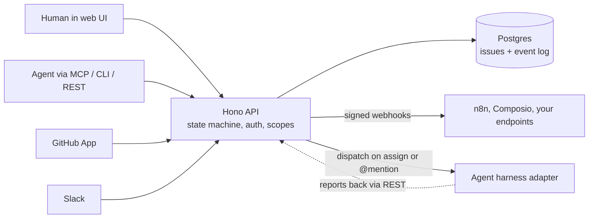

<p align="center">
  <picture>
    <source media="(prefers-color-scheme: dark)" srcset="assets/brand/lockup-dark.svg">
    
  </picture>
</p>

# Tallyline

<p align="center"><strong>A self-hostable, open-source (AGPL-3.0) issue tracker where humans and AI agents work the same board.</strong></p>

<p align="center">
  <a href="./LICENSING.md">AGPL-3.0</a> ·
  <a href="./docs/deploy.md">Self-host</a> ·
  <a href="./docs/agents.md">Agents</a> ·
  <a href="./ROADMAP.md">Roadmap</a> ·
  <a href="./CHANGELOG.md">Changelog</a>
</p>


<sub>Real capture of the running app with demo data (`apps/web`, dark theme). The blue star marks issues assigned to an agent.</sub>

## Stack

- **Monorepo:** pnpm workspaces + Turborepo, all TypeScript (strict)
- **Web:** Next.js App Router + Tailwind CSS + shadcn/ui + cmdk (`apps/web`)
- **API:** Node + Hono + Postgres via Drizzle (`apps/api`)
- **MCP server:** Model Context Protocol server for AI agents (`apps/mcp-server`)
- **Dispatch:** agent routing inside the API (`apps/api/src/services/dispatch.ts`)
- **CLI:** `tallyline` command-line tool (`tools/cli`)
- **iOS app (in development):** native SwiftUI client in `apps/ios` (see [Recent changes](#recent-changes))
- **Shared packages:** `packages/types`, `packages/silver-lining`
- **Infra:** Docker Compose (Postgres only) for dev and self-host

## What it is

Tallyline is a Linear-style tracker you run yourself. Issues move through one state machine
(`triage`, `backlog`, `todo`, `in_progress`, `in_review`, `done`, plus `canceled` and `duplicate`)
whether a person or an agent moves them, and every change is written to an append-only event log with
the actor's identity.

- **Keyboard-first web app.** Issue list, kanban board, triage inbox, review queue, cycles, insights,
  and a roadmap timeline. `Cmd+K` palette, `j`/`k` movement, `g` plus a letter to jump, `?` for the keymap.
- **Agents as actors.** Register an agent, give it a scoped `tly_agt_*` key, assign it issues, and its
  actions are attributed to it by name.
- **Three ways in for agents.** An [MCP server](./docs/mcp.md) (stdio and Streamable HTTP), the
  [`tallyline` CLI](./docs/agents.md) with `--json` output and stable exit codes, and the REST API with
  an OpenAPI document at `GET /openapi.json`.
- **Dispatch.** Assigning an issue to an agent or `@mention`ing it creates a dispatch and calls that
  agent's harness adapter (local harnesses, or a signed webhook). See [docs/adapters.md](./docs/adapters.md).
- **Signed webhooks out.** HMAC-SHA256 deliveries with retries and a delivery log
  ([docs/webhooks.md](./docs/webhooks.md)).
- **Bring your own AI provider.** An admin connects OpenRouter or any OpenAI-compatible endpoint for a
  workspace. The key is sealed at rest and never shown again, and a monthly spend limit stops calls before
  they happen ([docs/llm-assist.md](./docs/llm-assist.md)).
- **Integrations.** GitHub App sync, Slack intake and thread mirroring, an n8n node, a Composio
  toolkit, and importers for GitHub issues and Linear CSV.

<p align="center">
  
</p>

## Quick start (development)

Requires Node.js, pnpm 10 and Docker.

```bash
git clone https://github.com/duketopceo/tallyline
cd tallyline
pnpm install
cp .env.example .env
docker compose up -d   # Postgres on :5432
pnpm dev               # web on :3100, API on :4000
```

Open `http://localhost:3100`, bootstrap the first workspace, and you have a board.

Running tests? Do not point them at this dev stack — see [CONTRIBUTING.md](./CONTRIBUTING.md#testing-against-real-postgres); the test harnesses refuse to start against it.

## Recent changes

Merged since the README was last updated (PRs #158 to #193, full list in the [CHANGELOG](./CHANGELOG.md)):

- **v2.0.0** is released: agent protocol, automated intake, plan import, project health and status updates,
  workspace search, issue relations and installable web app, plus the move to AGPL-3.0 and a Postgres-only stack.
- **Bring your own AI provider** ([#187](https://github.com/duketopceo/tallyline/pull/187)): per-workspace
  OpenRouter or OpenAI-compatible provider with sealed keys and a monthly spend limit.
- **Deploy lock** ([#188](https://github.com/duketopceo/tallyline/pull/188)): `ops/deploy.sh` is the one
  sanctioned way to update a production host. It takes a lock, refuses a dirty tree or an older commit, runs a
  backup first, and health-checks every service. See [Deploying a production host](./docs/deploy.md#deploying-a-production-host-opsdeploysh).
- **Browser sign-in for the CLI** ([#189](https://github.com/duketopceo/tallyline/pull/189)): `tallyline
  connect` opens a page where an admin approves the code the terminal shows, so no pasted token is needed. It
  also works over SSH with `--browser`.
- **System status and a first-run checklist** ([#190](https://github.com/duketopceo/tallyline/pull/190)): admins
  get `GET /v1/workspaces/{ws}/system/status` and a `/welcome` page that checks the database, backups, sign-in
  methods, AI provider and email, and tells you the next step for each.
- **Mobile groundwork** (#182, #184, #186): QR pairing and a device registry, `updatedSince` delta reads, and
  `Idempotency-Key` on writes, for offline-capable clients ([docs/offline-sync.md](./docs/offline-sync.md)).
- **iOS app, early** ([#191](https://github.com/duketopceo/tallyline/pull/191),
  [#192](https://github.com/duketopceo/tallyline/pull/192), [#193](https://github.com/duketopceo/tallyline/pull/193)):
  `apps/ios` has pairing sign-in, a typed API client, an issue list and detail view, a review queue, and board
  tabs. It has not been tested on a device or released to TestFlight yet. See [apps/ios/README.md](./apps/ios/README.md).

What is planned next (more of the CLI and setup work, push notifications, a fuller iOS app) is in
[ROADMAP.md](./ROADMAP.md).

## Self-host

From clone to a working board in under 10 minutes:

```bash
git clone https://github.com/duketopceo/tallyline && cd tallyline
cat > .env <<EOF2
POSTGRES_PASSWORD=$(openssl rand -hex 16)
JWT_SECRET=$(openssl rand -hex 32)
EOF2
docker compose -f docker-compose.selfhost.yml up -d
# http://localhost:3100 -> /bootstrap -> board
```

After sign-in, open **Settings, Setup** (`/welcome`) for a checklist of what is still worth setting up (backups, email, AI provider).

Env reference, Cloudflare Tunnel, Railway, upgrades and backups: [docs/deploy.md](./docs/deploy.md).

## Connect an agent

```bash
# 0. on your computer: `tallyline connect` signs in through your browser (or paste a token)
# 1. a signed-in human registers an agent and mints a key (shown once)
#    POST /v1/workspaces/:ws/agents          then   POST /v1/workspaces/:ws/agents/:id/keys
# 2. the agent works the board
export TALLYLINE_API_URL=http://localhost:4000 TALLYLINE_TOKEN=tly_agt_... TALLYLINE_WORKSPACE=acme
tallyline ready --json      # what can I claim?
tallyline claim ENG-42      # assign to me, move to in_progress
tallyline comment ENG-42 "reproduced; fix in progress"
tallyline done ENG-42       # in_review, then done
```

(`DOCKETRY_*`/`dok_*`/`x-docketry-*` names were retired in the rename — old values are ignored.)

MCP clients use the same key. Config for Claude Code, Cursor, Codex and opencode is in
[docs/agents.md](./docs/agents.md). Board rules for agents are in [SKILL.md](./SKILL.md).

## How it works



Everything goes through the API, so the same auth, scope and state-machine rules apply to every
client. Details of the repository layout are in [AGENTS.md](./AGENTS.md).

## Status

v2.0.0 is the latest release (v1.0.0 shipped 2026-10-10; see the [CHANGELOG](./CHANGELOG.md)). The stack is
Postgres-only; agent key revoke/rotate and GitHub Actions CI are live, and later work is listed under
[Recent changes](#recent-changes) and in the CHANGELOG's Unreleased section. Upcoming work is sequenced in
[ROADMAP.md](./ROADMAP.md) (full ledger:
[docs/plans/2026-10-17-0000-feat-tallyline-full-roadmap-plan.md](./docs/plans/2026-10-17-0000-feat-tallyline-full-roadmap-plan.md)).
Research on competing tools:
[docs/research/2026-10-10-landscape.md](./docs/research/2026-10-10-landscape.md).

## Docs

- [AGENTS.md](./AGENTS.md) — agent entry point and repo conventions
- [DESIGN.md](./DESIGN.md) — design contract
- [docs/agents.md](./docs/agents.md) — onboard an AI agent (keys, MCP, CLI)
- [docs/mcp.md](./docs/mcp.md) — MCP server reference
- [docs/deploy.md](./docs/deploy.md) — self-host guide
- [docs/llm-assist.md](./docs/llm-assist.md) — connect your own AI provider
- [docs/offline-sync.md](./docs/offline-sync.md) — delta reads and idempotent writes for mobile clients
- [apps/ios/README.md](./apps/ios/README.md) — the iOS app (in development)
- [docs/auth.md](./docs/auth.md) — sign-in & SSO: GitHub/Google/OIDC setup, invites, linking, env flags
- [docs/adapters.md](./docs/adapters.md) — agent harness adapters
- [docs/webhooks.md](./docs/webhooks.md) — signed outbound webhooks
- [docs/glitchtip.md](./docs/glitchtip.md) — GlitchTip alerts into triage, per-project team routing
- [docs/security-review.md](./docs/security-review.md) — security model + audit
- [SKILL.md](./SKILL.md) — board rules for agents working the tracker
- [plans/](./plans/) — implementation plans

## Contributing

See [CONTRIBUTING.md](./CONTRIBUTING.md) for setup, the local `pnpm check` gate and conventions.
Security reports: [SECURITY.md](./SECURITY.md).

## License

AGPL-3.0. Free to use and modify, including privately. If you host or distribute a modified version, you must publish your source under the same license. See [`LICENSE`](./LICENSE).

The client and integration packages stay under the MIT License so you can embed them anywhere: `apps/mcp-server` (`@tallyline/mcp-server`), `tools/cli` (`@tallyline/cli`), `integrations/n8n` (`n8n-nodes-tallyline`), `integrations/composio` (`@tallyline/composio`) and the Claude Code plugin in `plugins/tallyline`. Each has its own `LICENSE` file. [`LICENSING.md`](./LICENSING.md) maps every path to its license.

Release v1.0.0 and everything before this change were published under the MIT License and remain available under MIT. Plane, Huly and Tegon are not copied from.
