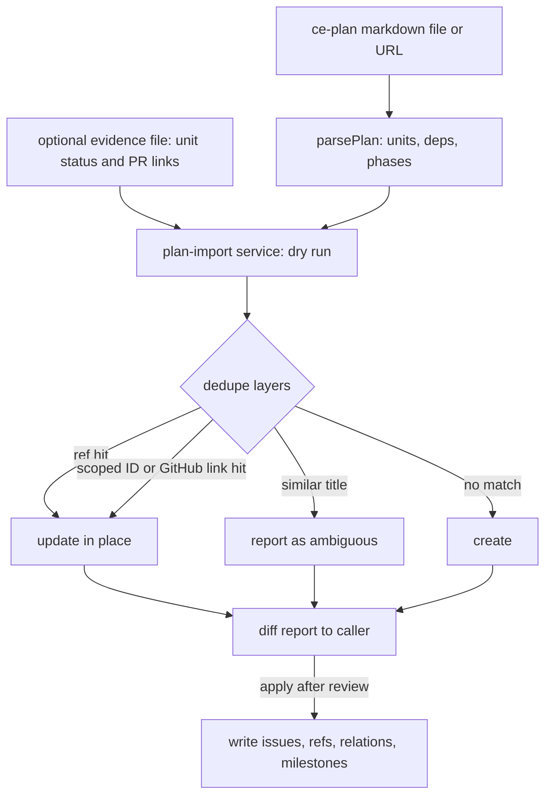
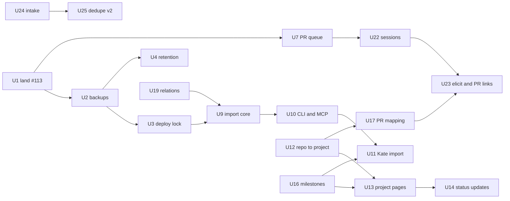

# Tallyline Full Roadmap, PM-Ready - Plan

## Goal Capsule

- **Objective:** Luke runs all of his projects, Kate first and then Cairn and the rest, on Tallyline day to day. The project plans he and his agents write become tracked work without retyping, and the data is safe.
- **Means:** Close the production risks first, then ship a small PM-ready slice (plan-to-project import, project views, cycles, status updates, PR mapping), then the agent-protocol work the existing plans already specify (KTD1, KTD2).
- **Authority:** Product behavior lives on the R-IDs. This plan is the single status ledger and sequencing source. The unit specs for L1-L8 stay in the Linear teardown plan (PR #132) and for intake in PR #138, and this plan only changes their order and scope where a KTD says so.
- **Scale test:** One human plus AI agents. Anything that only helps teams, billing or multi-tenant hosting is deferred (see the Deferred ledger).
- **Stop conditions:** Stop and ask before any unit that needs a paid model call, a new datastore, a production data write not named in a unit, or a deploy outside the U3 procedure.
- **Execution profile:** `ce-work` per unit, one PR per unit. Production deploys happen only on the production host under U3.

## Product Contract

### Summary

Tallyline already has the tracker core (issues, states, labels, projects, milestones, cycles, views, insights, notifications, MCP, CLI, GitHub sync, OAuth connector). What stops Luke from living in it is not features but four things: his real projects are not in it, the plans that define his work cannot be imported, his data is not reliably backed up, and the deploy path is shared with another agent. This plan fixes those, adds the thin PM layer a solo operator needs, and sequences the remaining agent-protocol plans behind that.

### Problem Frame

Prod holds 146 issues. 123 came from GitHub sync across 19 repos, 125 belong to no project, the "Tallyline" project is empty, there are zero cycles, zero milestones and zero comments, and the Kate project has 21 issues written by hand. Kate's three plans define 50 units across `duketopceo/kate`, most already merged, and none of them flow into the tracker. The last backup is from Oct 11 and predates Kate. `github_webhook_events` is 97 percent of a 69 MB database and grows about 8 MB per day with no retention. Agent keys cannot be revoked. A Devin session also deploys, with no lock and no ordering check. Twelve PRs were open at audit time; a security fix (#113) has been approved but conflicting since Oct 11. `ROADMAP.md` still lists work that shipped as "Now".

### Requirements

**Safety and operations**

- R1. Prod is backed up on a schedule to encrypted off-host storage, and a restore into a scratch database is proven. Backups include every project, including Kate.
- R2. `github_webhook_events` has a retention policy that keeps the table bounded and keeps delivery de-duplication working.
- R3. An admin can revoke and rotate an agent key. New keys may carry an expiry. Existing long-lived keys are replaced.
- R4. Exactly one process deploys prod. A deploy never builds a commit older than the one running, always takes a backup first, and records which commit each image was built from.
- R5. Production host housekeeping is done: the orphan redis volume, dangling swarm container records that break `docker system df`, and loose `.env.bak-*` files.
- R6. Every open PR has a recorded fate, and the approved security fix #113 lands before any feature work.

**PM-ready for daily use**

- R7. A markdown plan in the ce-plan format imports into a project as issues with one command or agent tool call, re-runs idempotently, and shows a dry-run report before writing.
- R8. Import de-duplicates against existing issues in layers: external reference, plan unit ID in the title, GitHub link, then title similarity. Ambiguous matches are reported, never merged silently.
- R9. Units already merged import as done issues with their PR links, and open units import as backlog or todo. Dependencies between units become relations.
- R10. The Kate project is imported from its three plans, the Luke-action lists, the 30-day GTM calendar and the open kate-ios tab-audit issues, reusing the existing Kate project and its issues TLY-108 to TLY-129.
- R11. Every issue can belong to a project, and GitHub-synced issues land in the right project by repo, with the 125 existing unassigned issues backfilled.
- R12. Each project has a detail page with progress, milestones, linked repos and recent activity, and an overview shows every project's health on one screen.
- R13. A project can carry dated status updates with a health value. An agent can draft the weekly update from the event log without a model call, and Luke approves it.
- R14. Cycles run on a weekly cadence without manual creation, and Luke plans the next cycle from the web or by agent.
- R15. Milestones link to issues so a phase such as "launch slice" shows real progress, and a small label set marks Luke-only work (`hitl`) and launch blockers.
- R16. A GitHub PR that names an issue key in its branch, title or body links to that issue, and merging a closing PR moves the issue to done. The issue shows its PRs.
- R17. Search covers title, description and comments across the workspace from the web, REST and MCP.
- R18. An agent can ask "what is waiting for me" in one call (assigned, delegated, mentioned, answered) and a blocked issue is excluded from "ready".
- R19. The web app is usable on a phone for capture, triage and review without a native app.

**Agent protocol and intake (after the PM slice)**

- R20. Agent sessions, delegate versus assignee, elicitation, and plan and PR links on sessions ship as specified in the Linear teardown plan, split into reviewable PRs. Linear's loops, sync-engine cache and a skills registry stay deferred until a trigger in the Deferred ledger fires.
- R22. The repo docs and workspace layout describe what exists: no BullMQ or Redis claims, no stub workspaces, and `ROADMAP.md` points at this plan.
- R21. External signals (GlitchTip errors, bug reports) enter through one intake pipe that lands triage issues, bumps occurrences instead of duplicating, and never auto-accepts.

### Key Decisions

- **Dogfood order is Tallyline, then Kate, then the rest.** The slice is cut so Kate can be live in the tracker within days. Governs R7, R10.
- **Kate-sized scale, not Linear-sized.** One operator, so no entitlements, billing, multi-workspace or SLA work. Governs the Deferred ledger.
- **No paid model calls in the core PM path.** Import, dedupe, status drafts and search run on rules and Postgres. A model is optional and only for triage ranking (U24). Governs R8, R13, R17.
- **A human decision stays with the human.** Agents cannot approve reviews (existing rule), and intake never auto-accepts (decided by the intake plan default, open question OQ4). Governs R21.

### Scope Boundaries

**Deferred to follow-up work** (each has a trigger, see the Deferred ledger): Loops (L6), delta sync (L7), skills registry (L8 skill half), native iOS app (program U15), WordInk intake (#41), entitlements and usage metering (#108), account lifecycle mailer and deletion (#111), multi-workspace hardening, integration trimming, issue templates, web virtualization.

**Outside this product's identity for this plan:** hosted billing, a Linear-style sync engine, initiatives and customer requests, SLA schedules.

### Success Criteria

- By the end of Phase 1 (target: about 12 days from the start of work, ahead of the Kate 2026-10-26 launch where Luke's approvals allow), Kate and Tallyline are tracked in Tallyline, and Luke plans a week in it.
- Restoring last night's backup into a scratch Postgres succeeds and shows the Kate project.
- A new ce-plan file becomes a project with a dry-run diff and one apply command, with zero duplicate issues on a second run.
- Prod's running commit is always an ancestor-or-equal of `origin/main` and is readable from the image labels.

### Open Questions

Blocking questions carry a recommended default so work proceeds. Luke can overrule any of them.

- OQ1. (blocking U22) Should agent sessions replace `dispatches` for the n8n recipe, or only add a parallel record? Default: add alongside, as the Linear plan D1 says, and deprecate dispatches later.
- OQ2. (blocking U21) Native iOS app now or later? Default: later, after U21 (mobile web and PWA) and four weeks of daily use. Revisit trigger: three or more times Luke could not complete capture, triage or review on the phone.
- OQ3. (blocking U12) Project granularity: one project per product (Kate spans `kate` and `kate-ios`) or per repo? Default: per product, with a repo-to-project map. Proposed map: Kate = `kate`, `kate-ios`; Tallyline = `tallyline`; the other 16 synced repos are assigned in the U12 dry run for Luke to approve.
- OQ4. (blocking U24) May a high-confidence triage verdict auto-accept into backlog? Default: never. Add a workspace threshold only if Luke asks.
- OQ5. (blocking U11) Historical Kate issues are written as done by a human credential. Which credential? Default: an owner PAT minted for the run and revoked afterward. The audit could not confirm which stored secret is a human token versus the fleet agent key, so U11 runs `whoami` first.
- OQ6. (deferred) Public launch of tallyline.app: privacy, terms and security pages (from #108) and the account mailer (#111) wait for that decision. Default: not before the PM slice has run for a month.

## Planning Contract

### Status ledger (every unit in every existing plan)

Status: done, partial, PR (open PR), todo, deferred. "Now" names where it lands in this plan.

| Source unit | What | Status | Now |
|---|---|---|---|
| Docketry plan R1-R25 | Original product contract | done (v1.0.0) | reference only |
| Program U1 | Reconcile docs, delete stubs | partial: `services/dispatch`, `packages/ui`, `packages/config` stubs remain, and `AGENTS.md` still names BullMQ and Redis | U8 |
| Program U2 | CI gate | done (#94) | none |
| Program U3 | e2e without host ports | done (#96, #100) | none |
| Program U4 | Agent key revoke and rotate | todo | U5 |
| Program U5 | Hosted dogfood (#88) | done, issue still open | U8 closes #88 |
| Program U6 | Redis | done (#124) | volume cleanup in U6 |
| Program U7 | Push SSE | done (#125) | none |
| Program U8 | Agent session ack | partial: timeout only (#126); full protocol in #133/#134 | U22 |
| Program U9 | Transition dispatch | done as docs recipe (#127); rule engine deferred | Deferred (L6) |
| Program U10 | Web virtualization and overflow | partial (#128 and overhaul 1-4) | Deferred |
| Program U11 | WordInk voice intake (#41) | deferred | Deferred |
| Program U12 | OAuth agent install | done (#98) | none |
| Program U13 | Multi-workspace hardening | partial (#90, #100, #104) | Deferred |
| Program U14 | Trim integrations | todo | Deferred |
| Program U15 | iOS app | plan only | OQ2, Deferred |
| Next-tier U1-U8 | Redis removal, shared poller, ack timeout, n8n recipe, board collapse, notifications, settings admin, review badge | done (#124-#131) | none |
| Next-tier open question | Saved views in the UI | deferred | Deferred ledger |
| OAuth/org-identity U1-U9 | Schema, guards, providers, identity, admin API, web auth, settings, agent parity, env docs | done in #90 and #98; not re-verified unit by unit | U8 spot-checks |
| iOS plan U1-U8 | Native app | todo | Deferred (OQ2) |
| Edge-states plan U1-U4 | Edge states, loading, typography | done (#135, #136 merged) | none |
| Teardown L1 | Agent sessions and activities | PR #133 | U22 |
| Teardown L2 | Delegate versus assignee | PR #134 | U22 |
| Teardown L3 | Elicitation | PR #134 | U23 |
| Teardown L4 | Suggestions, duplicates | PR #134 | U25 (reshaped, KTD4) |
| Teardown L5 | Relations | PR #134 | U19 (extracted, pulled forward) |
| Teardown L6 | Loops | PR #134 | Deferred |
| Teardown L7 | Delta sync | PR #134 | Deferred |
| Teardown L8 | Skills registry, plan and PR links | PR #134 | PR links in U23, skills registry Deferred |
| Intake U1-U5 (#138) | Intake pipe and ranking | todo (plan approved) | U24 |

### Open PR fates

| PR | What | State at audit | Fate | Where |
|---|---|---|---|---|
| #113 | Middleware treated every route as public | approved, conflicting 6 days, 6 files | **Land first.** Rebase, run the gate, merge | U1 |
| #107 | Agent workspace design section | approved, conflicting, e2e check red on a docs-only change | Land after rebase. The red check is base drift | U7 |
| #138 | Intake plan | approved, mergeable | Land as is | U7 |
| #132 | Linear teardown plan | changes requested (three doc clarifications, one already reflected in the text) | Rework the doc to the review notes, then land. It is the L-unit spec | U7 |
| #137 | Split the issues god-route | changes requested, 9 findings, mergeable | Rework and land before the L-stack, because #133 and #134 both edit the file it splits | U7 |
| #133 | L1 agent sessions | changes requested (atomic activity write, human stop guard, ack default) | Rework to the review, rebase on #137, land | U22 |
| #134 | L2-L8, 12.8k lines, stacked on #133 | changes requested, two Argus blockers | Do not land as one PR. Retarget to main after #133 lands, then split: L2 to U22, L3 and PR links to U23, L5 to U19, L4 to U25. Drop L6 and L7 | U22, U23, U19, U25 |
| #135, #136 | Edge states, typography | merged | none | none |
| #102 | Settings: GitHub connect, agents and keys, tokens | stale 6 days, 66 files, typecheck red, conflicting | **Close** with a salvage note. #130 and #98 covered most of it, and GitHub is already connected in prod. Re-cut the agent-keys and tokens screens inside U5 | U5, U7 |
| #108 | Usage metering, entitlements, legal pages | changes requested, conflicting, 53 files | **Close**, keep the branch. Entitlements are SaaS work (see the Deferred ledger, OQ6). Re-open the legal pages as a small PR at the public launch decision | U7 |
| #111 | Account lifecycle (mailer, reset, deletion, exports) | review required, conflicting, 62 files, 8.7k lines | **Close**, keep the branch. Cut a workspace export slice later if wanted (Deferred) | U7 |

### Key Technical Decisions

- KTD1. **Sequence as safety, then PM slice, then agent protocol.** The existing plans put agent work first; the audit shows the data and deploy risks are the real blockers to dogfooding.
- KTD2. **One PR per unit; the L-stack splits.** #134 is too large to review. `ce-work` retargets children to main before merge, as the stacked-PR memory requires.
- KTD3. **Import is a service plus a pure parser.** `packages/types` gets a pure `parsePlan(markdown)` returning units; `apps/api` gets `services/plan-import.ts`; one REST route `POST /v1/workspaces/:ws/import/plan` serves the CLI and the MCP tool. The route has `mode: "dry_run" | "apply"` and `dry_run` is the default. Input also takes `resolutions`, a map of plan-scoped unit ID to existing issue key, which resolves ambiguous matches: apply writes a `plan` external ref for each pair so the next run matches at the ref layer.
- KTD4. **Dedupe on Postgres, no model.** Layers in order: `issue_external_refs` (existing table, system `plan`, external id `<repo>:<planFile>:<unitId>`), then scoped unit-ID match in titles, then `github_issue_links`, then `pg_trgm` title similarity above a threshold, reported as "ambiguous" rather than merged. pgvector and embeddings from L4 are dropped from this plan: they add an image dependency and a paid call per issue for a workspace of about 150 issues. Verify `pg_trgm` is installable on the `postgres:17-alpine` image during U9.
- KTD5. **Namespace unit IDs per plan.** Kate has two plans that both use U1-U13, and existing TLY titles carry bare IDs such as `[U27 + HP-U15]`. Titles imported by this plan carry a plan scope, for example `[KP-U12]` (production launch), `[KM-U27]` (monetization), `[KI-U41]` (marketplace). The matcher treats a bare ID as ambiguous unless the plan source and the existing issue's description agree.
- KTD6. **Historical state needs a human credential.** Agents cannot move `in_review` to `done`. A new `historical: true` import option, allowed only for owner or admin human credentials, writes an issue directly as done or in progress with one `imported` event carrying the evidence (PR links, merge date). It does not weaken the agent review rule.
- KTD7. **PR link data lives in `issue_external_refs`.** System `github_pr`, external id `<owner>/<repo>#<n>:<issueKey>`, because the table is unique on workspace, system and external id and one PR can name several issues. No new table for the PM slice.
- KTD8. **Cycles auto-schedule from a team setting** (length, start weekday, how many to keep ahead) evaluated by a daily tick in the API process. Roll-over already exists in `services/cycles.ts`.
- KTD9. **Status updates are drafted from `events`**, not by a model. A template summarizes issues moved to done, opened, blocked, PRs merged and milestone progress; Luke edits and posts it. A model may polish it later, optional.
- KTD10. **Backups use the existing `ops/backup.sh`** (pg_dump, gzip, age-encrypt, S3-compatible upload) run by a systemd timer on the production host, with a local copy kept as well. The age private key never lives on the production host.
- KTD11. **Deploy is a script, not a habit.** `ops/deploy.sh` takes an exclusive lock, refuses a non-fast-forward or older target, runs the backup, builds all three images with a revision label, runs health checks, and appends to a deploy log. The Devin session gets a dedicated unix user outside the docker group whose sudoers entry allows only the root-owned `ops/deploy.sh`; the script owns the docker calls and the backup credentials, and Luke's own user is the only other deployer. Convention alone (telling Devin) is not the control.

### High-Level Technical Design

Directional sketch of the import path (not code).

Sequencing and dependencies.

U19 improves U9 but does not block it: before U19, imports write "Depends on" lines in descriptions, and a re-run converts them to relations.

### Assumptions

- Prod is `~/apps/tallyline` on the production host with `docker-compose.selfhost.yml`. Issue prefix `TLY`, a single workspace.
- The workspace has one human user, so role checks on a PAT are met by Luke's own token.
- The sources in this plan's Kate section are the plans on `main` of `duketopceo/kate` at import time; the import records the commit SHA it read.

### Phase map and the PM-ready slice

| Phase | Window | Units | Exit gate |
|---|---|---|---|
| 0 Safe | days 1-5 | U1, U2, U3, U4, U5, U6, U7, U8 | Backup restore proven, #113 live, one deploy path, #137 landed or explicitly bypassed |
| 1 PM-ready slice | days 4-12 | U9, U10, U11, U12, U13, U15, U16 | Kate tracked, first weekly cycle running |
| 1b Daily-use polish | days 12-26 | U14, U17, U18, U19, U20, U21 | A full week planned and closed in Tallyline, one status update posted from the web app |
| 2 Agent protocol | after 1b | U22, U23, U24, U25 | Sessions, intake live, release gate |

**The PM-ready slice** (usable within days of the Phase 0 gate; batch the U12, U15 and U16 migrations into one release and one approval to keep the gated deploys few) is U9, U10, U11, U12, U13, U15 and U16, riding on U1-U3. After it, Luke can import a plan, see Kate and Tallyline as projects with milestones, and run weekly cycles. Status updates, PR mapping, relations, search, the agent inbox and mobile follow in 1b.

## Implementation Units

| U-ID | Title | Files touched (key) | Depends on |
|---|---|---|---|
| U1 | Land the middleware fix (#113) | `apps/web/middleware.ts`, `apps/web/lib/public-paths.ts` | none |
| U2 | Scheduled backups and restore drill | `ops/backup.sh`, `ops/restore.sh`, `ops/systemd/`, `docs/deploy.md` | U1 |
| U3 | Deploy lock, provenance, catch-up deploy | `ops/deploy.sh`, `docker-compose.selfhost.yml`, `docs/deploy.md` | U2 |
| U4 | Webhook-event retention | `apps/api/src/services/`, `apps/api/src/db/schema.ts` | U2 |
| U5 | Agent key revoke, rotate, expiry | `apps/api/src/routes/agents.ts`, `apps/web/app/(app)/settings/` | U2 |
| U6 | Production host housekeeping | `docs/deploy.md` (operator steps) | U2 |
| U7 | Clear the PR queue | PRs #102, #107, #108, #111, #132, #137, #138 | U1 |
| U8 | Docs and stub reconciliation | `ROADMAP.md`, `AGENTS.md`, `README.md`, `services/`, `packages/ui` | none |
| U9 | Plan import core | `packages/types/src/plan.ts`, `apps/api/src/services/plan-import.ts`, `apps/api/src/routes/import.ts` | U2, U3 |
| U10 | Import CLI, MCP tools, ce-plan hook | `tools/cli/src/`, `apps/mcp-server/src/tools.ts`, `plugins/tallyline/skills/` | U9 |
| U11 | Kate project import (run) | none in repo; operator run | U5, U10, U12, U16 |
| U12 | Repo-to-project binding and backfill | `apps/api/src/db/schema.ts`, `apps/api/src/services/github-sync.ts`, `apps/api/src/routes/issues/` | U3, U7 |
| U13 | Project pages and portfolio overview | `apps/web/app/(app)/projects/`, `apps/web/components/roadmap-client.tsx` | U12, U16 |
| U14 | Project status updates | `apps/api/src/db/schema.ts`, `apps/api/src/routes/resources.ts`, `apps/web/` | U13 |
| U15 | Weekly cycle auto-schedule | `apps/api/src/services/cycles.ts`, `apps/api/src/db/schema.ts`, `apps/web/app/(app)/cycle/` | U3 |
| U16 | Milestone-issue link and labels | `apps/api/src/db/schema.ts`, `apps/api/src/routes/issues/`, `apps/api/src/routes/resources.ts`, `apps/web/` | U3, U7 |
| U17 | PR-to-issue mapping v2 | `apps/api/src/services/github-automation.ts`, `apps/web/components/issue-detail.tsx` | U3, U12 |
| U18 | Workspace search | `apps/api/src/routes/issues/`, `apps/web/components/command-palette.tsx`, `apps/mcp-server/src/tools.ts` | U3, U7 |
| U19 | Issue relations (L5 extracted) | `apps/api/src/db/schema.ts`, `apps/api/src/routes/issues/`, `apps/mcp-server/src/tools.ts` | U3, U7 |
| U20 | Agent inbox and ready-excludes-blocked | `apps/mcp-server/src/tools.ts`, `apps/api/src/services/notifications.ts` | U19 |
| U21 | Mobile web and installable PWA | `apps/web/components/app/shell.tsx`, `apps/web/app/layout.tsx` | none |
| U22 | Agent sessions and delegate (L1, L2) | PR #133 files, `apps/api/src/routes/issues/` | U7 |
| U23 | Elicitation and session PR links (L3, L8 part) | `apps/api/src/services/dispatch.ts`, `apps/web/components/session-timeline.tsx` | U22, U17 |
| U24 | Automated intake and ranking | per the intake plan (#138) | U7 |
| U25 | Duplicate and label suggestions (L4 reshaped) | `apps/api/src/services/assist.ts`, `apps/web/` triage view | U9, U24 |

### U1. Land the middleware fix (#113)

- **Goal:** the web middleware stops treating every route as public. (R6)
- **Files:** `apps/web/middleware.ts`, `apps/web/lib/public-paths.ts`, `apps/web/lib/public-paths.test.ts`.
- **Approach:** rebase the branch on `main`; the six-file diff conflicts with the overhaul. No `/privacy`, `/terms` or `/security` paths exist on main, so the note about adding them applies only if the legal pages are ever revived (OQ6).
- **Test scenarios:** `/` is public; `/my-issues`, `/settings/agents` and `/integrations/github/callback` redirect a signed-out user to `/login`; `/loginx` is not public; static brand images and the OAuth consent page still load as intended.
- **Verification:** `pnpm turbo run typecheck lint`, `pnpm --filter ./apps/web test`, `pnpm lint:design`, CI green, then merge. U1 deploys ahead of U2 and U3 as the single exception to release gate items 2 and 3: take a one-off local backup with `ops/backup.sh` and `BACKUP_SKIP_UPLOAD=1`, deploy by hand, and record the commit and time.

### U2. Scheduled backups and restore drill

- **Goal:** nightly encrypted backups off the host, restore proven, Kate included. (R1)
- **Files:** `ops/backup.sh`, `ops/restore.sh`, new `ops/systemd/tallyline-backup.service` and `.timer`, `docs/deploy.md`.
- **Approach:** KTD10. Generate the age key pair on Luke's laptop and put only the public key on the production host. Choose the upload target (Cloudflare R2 per the script header, or a second host) and set the healthcheck ping URL. Keep 14 daily and 8 weekly files using a bucket lifecycle rule, not the timer. Use a bucket with versioning or object lock and a write-only upload token (put, no delete or list) for the production host, so a compromised host cannot erase the off-host copies. Run the restore drill from Luke's laptop with the private key, and store a second offline copy of that key; the key never moves to the production host. Take one backup before U3 and U4 touch prod. Drill: restore into a throwaway Postgres container and compare table row counts against prod.
- **Test scenarios:** the timer fires and a new dump appears; a failed upload sends the failure ping; a dump decrypts with the private key and restores; the restored `projects` table contains Kate; a missing `BACKUP_AGE_RECIPIENT` or a private key in that variable aborts the script; the production host token cannot delete an uploaded object; the lifecycle rule keeps the newest 14 dailies.
- **Verification:** `systemctl list-timers` shows the timer, the healthcheck shows a green run, and the drill's row counts match.

### U3. Deploy lock, provenance, and catch-up deploy

- **Goal:** one deployer, never an older commit, every image traceable. (R4)
- **Files:** new `ops/deploy.sh`, `docker-compose.selfhost.yml` (image revision labels, web and mcp healthchecks), `docs/deploy.md`.
- **Approach:** KTD11. Lock with `flock` on a file in the app directory. The running commit is the api image's revision label; the bootstrap run, which has no labels yet, requires `--assume-running <sha>` from the operator's deploy record. Refuse unless `git merge-base --is-ancestor <running commit> <target>` passes and the target is on `origin/main`. Run the U2 backup, run every compose command with `--profile mcp` (mcp-server sits behind that profile in the selfhost file, which is why its image lagged), build api, web and mcp-server with `org.opencontainers.image.revision`, so the mcp image can no longer lag silently, run migrations through API boot, poll `/health` on all three, and append commit, time and actor to a deploy log. Write the same procedure into `docs/deploy.md`. Create the restricted Devin user and sudoers entry described in KTD11, and tell the Devin session to deploy only through the script. The first run catches prod up two commits to current main (#114, #110) and rebuilds the older mcp-server image.
- **Test scenarios:** the Devin user gets permission denied on `docker ps` and cannot read the backup environment file; two concurrent invocations (the second exits with the lock holder named); a target older than the running commit is refused; a dirty tracked tree is refused; a failing health check exits non-zero and prints the previous SHA, and recovery is a redeploy of that SHA through the same script (migrations are additive, and the single-replica api has already migrated, so containers are not kept running); labels read back the exact built SHA; a dry-run flag prints the plan without building.
- **Verification:** `docker inspect` shows matching revision labels on all three images, `/health` is `ok`, and the deploy log has the entry.

### U4. Webhook-event retention

- **Goal:** `github_webhook_events` stays small. (R2)
- **Files:** a new `apps/api/src/services/retention.ts` with a daily sweep started where the other sweeps start, `apps/api/src/db/schema.ts` (an index on `received_at`) and its migration, `docs/github-sync.md`.
- **Approach:** null the `payload` of processed rows after 24 hours (the payload is nearly all of the bytes), and delete whole rows that are processed and older than 7 days, in batches. Keep the 7-day window longer than GitHub's redelivery window so `delivery_id` de-duplication still works. Unprocessed rows are never deleted and are logged if older than a day. Normal autovacuum reuses the freed pages; no `VACUUM FULL`. Make the retention days an env var.
- **Test scenarios:** a processed row older than 24 hours has its payload cleared and keeps its delivery id; a processed 8-day-old row is deleted and a 6-day-old one kept; an unprocessed old row survives and logs; a redelivery of a kept delivery id is still ignored; batches stop at the configured size; the sweep is a no-op on an empty table.
- **Verification:** `pnpm --filter ./apps/api test`; after a week the table row count stops growing past the window.

### U5. Agent key revoke, rotate, expiry

- **Goal:** keys can be killed and replaced. (R3)
- **Files:** `apps/api/src/routes/agents.ts`, `apps/api/src/openapi.ts`, tests beside it, `docs/agents.md`, the Agents screen under `apps/web/app/(app)/settings/`, `tools/cli/src/commands.ts`.
- **Approach:** add `DELETE /v1/workspaces/:ws/agents/:id/keys/:keyId` and `POST .../keys/:keyId/rotate` (returns a new key). Both are owner or admin only; agent credentials get `FORBIDDEN_AGENT`. Expiry already exists as `expiresInDays` on `POST .../keys` and is enforced at auth; new work is an env default (90 days) applied when the caller omits it, and showing expiry in the UI. Rotate takes `graceSeconds` (default 0, so the old key dies at once; capped at 24 hours) for planned rotations. Minting requires a cookie session, so the owner PAT and any new agent are created from the web screen. Revocation is immediate and writes an event. Build the settings screen from the useful half of #102 (agents and keys, tokens). After shipping: mint an owner PAT for U11 from the web screen (revoked after the run; agent keys cannot do the historical import), rotate `fleet-key`, and revoke the unused `default` key after confirming its last use.
- **Test scenarios:** a revoked key returns 401 on its next call; rotate returns a new key and by default the old key is 401 on its next call, while `graceSeconds` keeps it valid only inside that window; an expired key is refused; a member or agent cannot revoke; revoking another workspace's key is 404; the plaintext shows once and is not in event payloads.
- **Verification:** `pnpm --filter ./apps/api test`, web e2e for the screen, and the fleet's own calls keep working after rotation.

### U6. Production host housekeeping

- **Goal:** clean host, working Docker tooling. (R5)
- **Files:** `docs/deploy.md` (an "Operator housekeeping" section recording what was done and the commands).
- **Approach:** all operator steps, run after a U2 backup and with Luke's confirmation: confirm no container mounts `tallyline-redis`, then remove the volume; list `docker ps -a` and remove only the exited swarm-era container records (meshcentral, portainer, cloudflared leftovers) that Luke confirms are retired, which should restore `docker system df`; never run a blanket prune; move the `.env.bak-*` files' contents into omaseal if needed and delete them; keep the compose healthchecks from U3.
- **Test scenarios:** `docker system df` succeeds after cleanup; `docker volume ls` no longer lists `tallyline-redis`; the live stack's three containers and Postgres are untouched (same container ids, `/health` ok).
- **Verification:** before and after output of `docker ps`, `docker volume ls`, `docker system df` recorded in the PR description.

### U7. Clear the PR queue

- **Goal:** every PR has landed, been reworked or been closed as the fate table says. (R6)
- **Approach:** close #102, #108 and #111 with a comment that names the salvage plan and keeps the branches. Land #138 and #107 after rebase. Rework #132 to its three review notes and land it. Rework #137 to its nine findings (cursor validation, assignee pair validation, an in-transaction review guard, and the rest) and land it before any L-stack rebase. Update issue #88 and the PR descriptions to point at this plan.
- **Test scenarios:** `Test expectation: none -- process unit`. Each landed PR passes its own gate; #137 keeps `pnpm --filter ./apps/api test` and the permission matrix green.
- **Verification:** `gh pr list -R duketopceo/tallyline` shows only the L-stack PRs (#133, #134) as open work.

### U8. Docs and stub reconciliation

- **Goal:** the repo describes what exists. (R22; program U1 leftovers)
- **Files:** `ROADMAP.md` (replaced by a pointer and summary), `AGENTS.md`, `README.md`, `CONTRIBUTING.md`, `services/dispatch/`, `packages/ui/`, `packages/config/`, `pnpm-workspace.yaml`, `turbo.json`.
- **Approach:** `ROADMAP.md` becomes a short summary with a link to this plan. Remove BullMQ, Redis and "no GitHub Actions" claims from `AGENTS.md`, `README.md` and `CONTRIBUTING.md`. Delete the stub `services/dispatch` and empty `packages/ui` and `packages/config` workspaces after checking workspace filters. Spot-check the OAuth and org-identity units (auth guards, providers, admin API) against main and record gaps as issues. Close #88 with a link to prod and the status ledger, and update #1.
- **Test scenarios:** `rg -i "bullmq|redis"` finds nothing live outside the changelog; `pnpm install` and `pnpm check` pass after the deletions.
- **Verification:** `pnpm check` exit code recorded on its own, not piped.

### U9. Plan import core

- **Goal:** a ce-plan markdown file becomes issues in a project, safely and repeatably. (R7, R8, R9)
- **Files:** new `packages/types/src/plan.ts` (parser and zod types), new `apps/api/src/services/plan-import.ts`, `apps/api/src/routes/import.ts` (adds `POST /import/plan`), `apps/api/src/openapi.ts`, a trigram migration, tests beside each, `docs/import.md`.
- **Approach:** KTD3, KTD4, KTD5, KTD6, KTD7. The parser reads the unified-plan shape (`### U<N>. title` headings, Goal, Dependencies, Files, Test scenarios, Verification, plus phase headings and Luke-action lists) and a legacy `### U<N>.` shape, and returns units, dependencies and phases without touching the database. The service takes `{ project, teamKey, plan: { scope, source: { repo, path, sha, url } }, evidence?, historical?, mode }`. Each unit becomes one issue whose body holds the Goal and Verification and a source footer. Phases become milestones. Evidence (a map of unit ID to state and PR links) sets the state and writes `github_pr` refs, and the service rejects any evidence-supplied state of done or in progress unless the credential is a human owner or admin, regardless of the `historical` flag. Agent imports ignore evidence state and only create or update backlog and todo issues. `createIssue` takes no project, milestone or labels today and `issues` has no completed-at column, so U9 extends it or writes rows directly, using the merge date on the `imported` event. Milestone membership and the `hitl` label take effect once U16 ships. Dependencies become relations once U19 exists; before that they become a "Depends on" line. The response is a diff: create, update, unchanged, ambiguous, with counts. Apply writes in one transaction per plan and logs one event per issue. Apply is blocked unless the caller echoes the hash from a reviewed dry run. The hash covers the plan input, evidence, resolutions and the computed per-unit action set; apply recomputes the diff and returns 409 with the new diff if it differs, since sync and webhooks write to the same tables between the two calls.
- **Test scenarios:** a plan of five units dry-run creates nothing and reports five creates; apply creates five with `plan` refs; a second apply reports five unchanged; changing one title updates it in place; two plans both using `U1` do not collide because of scope; an existing issue titled with a bare `[U3]` and no scope is reported ambiguous; an ambiguous unit becomes an update once a resolution maps it to its issue key, and the next dry run reports it unchanged; a diff that changed between dry run and apply returns 409; an issue linked through `github_issue_links` is matched and assigned to the project, not duplicated; a title at 0.85 trigram similarity is reported ambiguous and not merged; `historical` is refused for an agent credential and accepted for an owner; an agent key with evidence marking a unit done returns 403 and writes nothing; evidence marks a unit done with one `imported` event and a PR ref; a malformed unit (no title) is reported and the rest proceed; a plan over the issue cap is rejected before any write; cross-workspace project id is 404.
- **Verification:** `pnpm --filter ./apps/api test`, `pnpm --filter ./packages/types test`, and the permission matrix test. Run the dry-run against a copy of prod data restored from U2 before any prod apply.

### U10. Import CLI, MCP tools, and the ce-plan hook

- **Goal:** Luke and his agents run the import without writing curl. (R7)
- **Files:** `tools/cli/src/commands.ts`, `apps/mcp-server/src/tools.ts`, `apps/mcp-server/src/tools.test.ts`, `plugins/tallyline/skills/tallyline/SKILL.md` and the root `SKILL.md` (CI requires them to match), `docs/mcp.md`.
- **Approach:** `tallyline import-plan <path|url> --project <name> [--evidence file] [--apply]` with dry-run as the default and a printed diff. MCP gets `import_plan`, plus the missing `create_project` and `update_project` tools. The skill text adds a step: after a plan file is written, run the dry run and show the diff. The CLI fetches remote plans client-side so the API never needs repo credentials.
- **Test scenarios:** the CLI defaults to dry run and prints counts; `--apply` without a prior dry run still runs the dry run first; the MCP tool returns the same diff shape; an agent key with `read` only cannot apply; `create_project` rejects a duplicate name.
- **Verification:** `pnpm --filter ./tools/cli test`, `pnpm --filter ./apps/mcp-server test`, `cmp SKILL.md plugins/tallyline/skills/tallyline/SKILL.md`.

### U11. Kate project import (run)

- **Goal:** Kate is fully tracked: done work recorded, open work ready, Luke's actions visible, GTM dated. (R10)
- **Files:** none in the repo. An operator run using U10, with an evidence file kept outside the repo.
- **Approach:** a reusable procedure, executed once now and re-runnable as units merge.
  1. Preconditions: U2 backup taken, U9 and U10 live in prod through U3, `whoami` confirms the credential (OQ5), the repo-to-project map from U12 is applied so the tab-audit issues are already bound.
  2. Reuse the existing Kate project. `PATCH` its description, set status `started` and target date to the 2026-10-26 launch. Do not create a second project.
  3. Sources, each read at a recorded commit: the production launch plan (U1-U15, scope `KP`), the monetization plan (U16-U32, scope `KM`), the idea marketplace plan (U40-U57, scope `KI`), the Luke-action lists in those plans, the 30-day GTM calendar, and the open kate-ios tab-audit issues.
  4. Evidence file from Kate's merged PRs. Known state at planning time: production plan U1-U8, U10-U13 done, U9 partial (11 tab-audit issues open), U14 not started, U15 partial; monetization U16, U18, U19, U21, U22, U23, U25, U27, U29, U30, U31, U32 done, U24, U26, U28 partial, U17 and U20 not started; marketplace U40-U57 not started. The operator regenerates this from PR titles at run time and does not trust this snapshot.
  5. Milestones: launch slice (2026-10-26), Phase B weeks 1-4, GTM week 1-4 with dates, marketplace launch slice (U40-U47), engine and catalog (U48-U57). A unit joins the milestone its plan names.
  6. Luke-action items import as issues labeled `hitl`, assigned to Luke, grouped under the milestone they gate, de-duplicated against TLY-110 (Sign in with Apple), TLY-111 (install on Kate's iPhone) and TLY-112 (account deletion).
  7. The 11 open tab-audit issues attach to the project through their GitHub links.
  8. Review the dry-run diff with Luke, supply `resolutions` for each ambiguous TLY-113 to TLY-129 pairing, re-run the dry run, apply, then spot-check TLY-108 to TLY-129 are unchanged or updated in place and that no issue appears twice.
- **Test scenarios:** the dry run reports TLY-110/111/112 as matches, not creates; every bare-ID title among TLY-113 to TLY-129 appears in the ambiguous list with its candidate scoped unit; the dry run creates zero duplicates of the 11 tab-audit issues; a second apply is all unchanged; the done units carry PR links and a merge date; the counts (created, updated, ambiguous, skipped) are recorded in the PR or issue that tracks the run.
- **Verification:** once U13 is live, the project page shows milestone progress that matches the evidence, and a backup taken after the run contains the new issues.

### U12. Repo-to-project binding and backfill

- **Goal:** every issue has a project and new synced issues land correctly. (R11)
- **Files:** `apps/api/src/db/schema.ts` and migration (`github_repos.project_id`), `apps/api/src/services/github-sync.ts` and `github-automation.ts` (set `projectId` on intake), `apps/api/src/routes/issues.ts` (a bulk project and label update, capped at 200 per call, owner or admin), `apps/web/components/github-repos.tsx` (project picker per repo), tests.
- **Approach:** OQ3 default map. The backfill is a dry-run-first operation over the 125 unassigned issues: group by `github_issue_links.repo_id`, show the proposed project per repo, apply on approval. Issues from repos with no mapping stay unassigned and are listed.
- **Test scenarios:** a synced issue from a mapped repo gets the project on create; an unmapped repo's issue stays unassigned; the bulk call refuses more than 200 ids and refuses another workspace's issues; the backfill dry run changes nothing; a rerun after apply changes nothing; an issue already in a project is not moved.
- **Verification:** `pnpm --filter ./apps/api test` and a post-run count of unassigned issues recorded.

### U13. Project pages and portfolio overview

- **Goal:** one screen per project and one across projects. (R12)
- **Files:** new `apps/web/app/(app)/projects/page.tsx` and `projects/[id]/page.tsx`, `apps/web/components/roadmap-client.tsx`, `apps/web/lib/api.ts`, e2e tests.
- **Approach:** the detail page shows state counts and a progress bar, milestones with progress (from U16), linked repos (from U12), the latest status update (from U14 once shipped), and recent events. The overview lists each project with progress, target date, open blockers and health. The roadmap page already draws projects, cycles and milestones; fix what the real data exposes (many projects, undated milestones) rather than redesign it. Follow `DESIGN.md` and the edge-state contract from #135: every page has loading, empty and error states.
- **Test scenarios:** a project with no issues shows the empty state; progress equals done over total excluding canceled; a milestone with no issues shows zero; the overview sorts by target date and handles projects without dates; keyboard navigation reaches every row; axe finds no violations in both themes.
- **Verification:** `pnpm lint:design`, `pnpm test:contrast`, the web e2e suite, and a manual look at Kate and Tallyline with real data.

### U14. Project status updates

- **Goal:** a dated health note per project, drafted from facts. (R13)
- **Files:** `apps/api/src/db/schema.ts` and migration (`project_updates`: project, health `on_track|at_risk|off_track`, body, author type and id, created), `apps/api/src/routes/resources.ts`, `apps/api/src/services/project-update-draft.ts`, `apps/mcp-server/src/tools.ts` (`draft_project_update`, `post_project_update`), web feed on the project page.
- **Approach:** KTD9. The draft reads `events` for the window since the last update and groups done, newly blocked and opened issues, merged PRs and milestone progress. Posting needs a human or an agent with write scope; agent-posted updates are marked as agent-authored. Health is suggested by rule (target date passed with open issues is `off_track`) and always editable.
- **Test scenarios:** the draft for a window with no activity says so and posts nothing automatically; a draft counts only events inside the window; health rule flips to `off_track` past the target date; a member can post and an outsider gets 403; update bodies render markdown safely; an agent-authored update shows its author.
- **Verification:** `pnpm --filter ./apps/api test`; Luke posts the first real Kate update from the page.

### U15. Weekly cycle auto-schedule

- **Goal:** cycles exist without manual setup and Luke can plan the next one. (R14)
- **Files:** `apps/api/src/db/schema.ts` and migration (team cycle settings including a nullable IANA `timezone`, since teams have none today), `apps/api/src/services/cycles.ts`, a daily tick beside the U4 sweep, `apps/web/app/(app)/cycle/`, `apps/web/components/cycles-settings.tsx`, `apps/mcp-server/src/tools.ts` (`create_cycle`, `assign_cycle`).
- **Approach:** KTD8. Defaults: one-week cycles starting Monday, keep two upcoming, roll-over to the next cycle on completion (existing). The cycle page gains a "plan next cycle" list of todo and backlog issues sorted by priority with a multi-select assign. Turn it on for the TLY team and run cycle 1 from the Monday after U11.
- **Test scenarios:** the tick creates the missing upcoming cycles once and a second tick adds none; a team with the setting off creates none; clock-driven (use `services/clock.ts`) day-boundary and DST week starts produce Monday 00:00 in the team timezone; completing a cycle rolls open issues forward; assigning another workspace's issue is refused.
- **Verification:** `pnpm --filter ./apps/api test` and the cycle page shows an active cycle in prod after the first Monday.

### U16. Milestone-issue link and labels

- **Goal:** phases show real progress, and Luke-only work is findable. (R15)
- **Files:** `apps/api/src/db/schema.ts` and migration (`issues.milestone_id`, nullable), `apps/api/src/routes/issues.ts`, `apps/api/src/routes/resources.ts`, `apps/web/components/issue-detail.tsx`, `apps/web/components/projects-settings.tsx` (milestone create and edit), `apps/mcp-server/src/tools.ts`.
- **Approach:** the schema comment says issues do not link to milestones today and progress derives from project issues. Add the nullable link, include it in issue create, patch and list filters, and compute milestone progress from linked issues. Seed labels `hitl` (needs Luke), `launch-blocker` and keep the five existing ones. Label groups stay deferred.
- **Test scenarios:** deleting a milestone clears the link and keeps the issue; a milestone from another project is refused; progress counts only linked issues; filtering by milestone returns exactly those; `hitl` can be filtered in the issue list and MCP `list_issues`.
- **Verification:** `pnpm --filter ./apps/api test` and the project page milestones match counts.

### U17. PR-to-issue mapping v2

- **Goal:** PRs show on issues and close them reliably. (R16)
- **Files:** `apps/api/src/services/github-automation.ts` (today `issueForBranch` reads only a key prefix in the branch name), `apps/api/src/services/github-sync.ts`, `apps/web/components/issue-detail.tsx`, tests.
- **Approach:** KTD7. Resolve keys from branch, PR title and body, with `Closes`, `Fixes` and `Refs` semantics; only closing keywords in the title or body move an issue to done, and only when the PR merged into the repo's default branch and the issue's project equals the project bound to that repo (U12); otherwise the PR links and state is unchanged. Never backwards (existing `transitionTo` rule). Branch-name resolution keeps today's behavior, which moves an issue to done on any merged PR with the key in its branch; the narrowing for title and body is a deliberate change to note in release notes. Write `github_pr` external refs and show PR chips with number, state and link on the issue. Works for any repo with the GitHub App installed and bound to a project (U12). Keep review verdict events.
- **Test scenarios:** a branch `tly-42-fix` links TLY-42; a PR body `Closes TLY-42` links and marks done on merge; `Refs TLY-42` links without moving state; a PR naming two keys links both (one ref row per issue); `Closes TLY-n` from a repo bound to a different project links without moving state; a PR merged to a non-default branch links without moving state; a key from another workspace is ignored; a closed-unmerged PR links but does not move; redelivery of the same webhook creates one ref.
- **Verification:** `pnpm --filter ./apps/api test`, and a real PR in a bound repo shows on its issue.

### U18. Workspace search

- **Goal:** find anything fast, from web, REST and agents. (R17)
- **Files:** `apps/api/src/db/schema.ts` and migration (generated `tsvector` columns and GIN indexes on issue title and description and comment body), `apps/api/src/routes/issues.ts` (the current `search` filter is a title `ilike`), a new `GET /search`, `apps/web/components/command-palette.tsx`, `apps/mcp-server/src/tools.ts` (`search`).
- **Approach:** Postgres full-text with title weighted above description and comments, keyset pagination, results capped, workspace scoped. The palette gains a "search all" row.
- **Test scenarios:** a word only in a comment finds its issue; title hits rank above description hits; another workspace's issue never appears; an empty query returns nothing; punctuation does not break the query; results page stably.
- **Verification:** `pnpm --filter ./apps/api test` and the palette finds a known phrase in prod data after deploy.

### U19. Issue relations (L5 extracted)

- **Goal:** blocks, related and duplicate links as real edges. (R9, R18)
- **Files:** `apps/api/src/db/schema.ts` and migration (`issue_relations`), `apps/api/src/routes/issues.ts` (or its split modules after #137), web relations section, MCP and CLI, OpenAPI.
- **Approach:** as the Linear teardown plan L5 specifies, minus the `similar` kind that U25 would write. Importing a plan converts "Depends on" lines to `blocks` edges on re-run.
- **Test scenarios:** the inverse edge is kept; a cycle in `blocks` is rejected; deleting an issue removes its edges; a `duplicate` relation sets the duplicate state; events are logged; the board shows a blocked badge; creating a relation where either issue belongs to another workspace returns 404 and writes nothing.
- **Verification:** `pnpm --filter ./apps/api test`; re-running the Kate import creates the dependency edges without creating issues.

### U20. Agent inbox and ready-excludes-blocked

- **Goal:** an agent starts a session by asking what needs it. (R18)
- **Files:** `apps/mcp-server/src/tools.ts`, `apps/api/src/services/notifications.ts`, `apps/api/src/routes/notifications.ts`, `docs/mcp.md`.
- **Approach:** add an `inbox` tool returning, for the calling agent, items assigned or delegated, mentions, and replies since a cursor, plus `ack`. `ready` skips issues with an open blocking relation. Notifications are created for agent recipients the same way they are for humans. A weekly digest to Luke is the U14 update; no email is added.
- **Test scenarios:** an issue assigned to the agent appears once and disappears after ack; a mention appears; `ready` excludes an issue blocked by an open issue and includes it when the blocker is done; an agent cannot read another agent's inbox.
- **Verification:** `pnpm --filter ./apps/mcp-server test`, `pnpm --filter ./apps/api test`.

### U21. Mobile web and installable PWA

- **Goal:** capture, triage and review work on a phone without a native app. (R19)
- **Files:** `apps/web/components/app/shell.tsx` (the fixed sidebar squeezes content at 390px), `apps/web/app/layout.tsx`, a web app manifest and icons, `apps/web/components/quick-create-dialog.tsx`, `apps/web/components/review-queue.tsx`.
- **Approach:** collapse the sidebar to a bottom or drawer nav under the tablet breakpoint, make quick create, triage and review one-hand usable, add a manifest so it installs to the home screen. Native iOS stays deferred (OQ2).
- **Test scenarios:** at 390px no horizontal scroll on issues, triage, review, cycle and project pages; quick create works with the on-screen keyboard; the manifest validates and the app installs; axe passes at 390 and 1440.
- **Verification:** the web e2e suite at both widths and a real-phone check by Luke.

### U22. Agent sessions and delegate (L1, L2)

- **Goal:** each agent run is a typed session and humans keep ownership. (R20)
- **Files:** per the Linear teardown plan L1 and L2 (`apps/api/src/db/schema.ts`, `packages/types/src/agent.ts`, `apps/api/src/services/dispatch.ts`, session routes, `apps/mcp-server/src/tools.ts`).
- **Approach:** rework #133 to its three review items (atomic activity write with a status guard, human `stop` signals cannot bypass the prompt-only rule, ack default matched to the 600 second delivery budget), rebase on the landed #137, merge. Then cut L2 from #134 as its own PR after retargeting to main (KTD2). OQ1 default applies.
- **Test scenarios:** one case per allowed and per rejected state transition (from L1); concurrent activity posts leave a consistent status; a human posting a non-prompt activity is 403 including with `signal: stop`; delegate set dispatches and assignee set does not; legacy agent-assignee still dispatches with a deprecation event.
- **Verification:** `pnpm check`; an adapter script completes a session end to end on the local stack.

### U23. Elicitation and session PR links (L3, L8 part)

- **Goal:** an agent can ask and resume, and a session shows its plan and PRs. (R20)
- **Files:** per the Linear teardown plan L3 and the plan and PR half of L8, `apps/web/components/session-timeline.tsx`.
- **Approach:** split from #134 after U22. PR links come from the U17 refs, not a second mechanism. The skills registry half of L8 stays deferred.
- **Test scenarios:** per the plan L3 list (one coalesced notification per 60 seconds, first reply wins, concurrent replies yield one success and one conflict, 24 hour timeout to stale) plus a session header showing deduplicated PR links.
- **Verification:** `pnpm check`; manual run where an agent asks, Luke answers in the web app, and the adapter receives the prompt.

### U24. Automated intake and ranking

- **Goal:** one intake pipe for GlitchTip errors, bug reports and help requests, ranked but never auto-accepted. (R21)
- **Files:** per the intake plan U1-U5 (`apps/api/src/services/intake.ts`, `intake_events` schema, intake routes, triage UI badges).
- **Approach:** execute the intake plan as written once #138 has landed. OQ4 default: no auto-accept. Ranking uses the existing assist path only when a model is configured and is optional. First real source: Kate's GlitchTip errors into the Kate project.
- **Test scenarios:** per the intake plan (duplicate delivery id returns 200 and drops; same fingerprint bumps the count and adds one comment; a declined fingerprint is not resurrected; malformed model output leaves the issue unranked; a bad token is 401).
- **Verification:** `pnpm check`; a test error from a Kate staging build appears once in triage and a repeat bumps its count.

### U25. Duplicate and label suggestions (L4 reshaped)

- **Goal:** triage suggestions without embeddings, reusing the import matcher for duplicates. (R8, R21)
- **Files:** `apps/api/src/services/assist.ts`, the suggestion routes from L4, triage view chips.
- **Approach:** reuse U9's layered matcher on triage create for duplicates (`pg_trgm`), and rule-based label and project suggestions from repo binding (U12) and past labels. Accept and dismiss store a reason. A model may add suggestions when configured, with the daily cap L4 describes. No pgvector (KTD4).
- **Test scenarios:** suggestions are idempotent per issue version; accept applies exactly the suggested field; dismiss records a reason; a duplicate candidate appears above the similarity threshold and not below; with no model configured triage still works.
- **Verification:** `pnpm --filter ./apps/api test`; ten seeded issues produce sensible chips on review.

## Deferred ledger

| Item | Why deferred | Trigger to revisit |
|---|---|---|
| Loops, L6 | n8n recipe (#127) covers dispatch on transition | Luke writes the same manual automation three times |
| Delta sync, L7 | One operator, agents use REST and MCP | Measured cold navigation over 300 ms on real data |
| Skills registry, L8 half | No consumer | A second agent platform needs capability discovery |
| Native iOS app, program U15 and iOS plan U1-U8 | OQ2: PWA first | Three failed phone tasks, or Kate-style TestFlight need |
| WordInk intake, #41 | Blocked on the owner's WordInk Phase 2 choice | That choice, then it becomes an intake source on U24 |
| Entitlements and usage, #108 | Hosted SaaS only | A decision to open signup |
| Account lifecycle, #111 (mailer, reset, deletion, exports) | Single user | Open signup, or a request for a workspace export |
| Multi-workspace hardening, integration trimming | One workspace | Second workspace, or a quarter of use data |
| Saved views UI (API exists) | No repeated filter pain yet | Luke re-applies the same filter combination three times a week |
| Issue templates | Plan import gives structured issues; no recurring manual form yet | Luke files the same shape of issue three times a week |
| Web virtualization | Board is fine at 150 issues | Board render over 100 ms at real size |

## System-Wide Impact

- Schema: nine additive migrations (`github_repos.project_id`, `project_updates`, team cycle settings, `issues.milestone_id`, search vectors, `issue_relations`, the `pg_trgm` extension, the retention index, and the key expiry default) plus L1 and intake tables. Land each with a compatibility read and run all through the U3 backup and health gate.
- Auth: new routes (`DELETE` key, rotate, import, bulk update, search, project updates) follow the existing role model, and agent credentials stay unable to mint credentials, approve reviews or import as historical.
- MCP and CLI parity: every new capability ships an MCP tool and a CLI command, and `docs/mcp.md` and OpenAPI are updated in the same PR.
- GitHub sync: U12 and U17 both touch `github-automation.ts`; land U12 first.

## Risks and Dependencies

| Risk | Mitigation |
|---|---|
| A production write (import, backfill) goes wrong | U2 backup immediately before, dry-run first, apply gated on a reviewed hash, idempotent re-run |
| Bare unit IDs collide across Kate's plans and wrongly merge issues | KTD5 scoped titles, ambiguous matches reported and never merged |
| Devin deploys around the lock | KTD11 unix-user and sudoers restriction, deploy log shows the actor, the ancestor check refuses an older build |
| Reworking #133 and #134 churns schema three ways | KTD2 split, #137 lands first, one migration per unit |
| Kate state in the evidence file goes stale | Evidence is regenerated from PR titles at run time and the import is re-runnable |
| `pg_trgm` unavailable in the image | Verified in U9 first; fallback is `ilike` plus normalized-title equality and a louder ambiguous list |
| Retention deletes something GitHub redelivers | 7-day window longer than redelivery, unprocessed rows never deleted |

## Documentation and Operational Notes

- `docs/deploy.md` gains the backup timer, deploy script, deploy log and housekeeping record. `docs/import.md` documents the import format and dedupe layers. `docs/agents.md` loses the "tracked for a later milestone" line when U5 ships.
- Prod deploys use only `ops/deploy.sh` on the production host (`~/apps/tallyline`). No deploy or prod data write happens in the planning run that produced this document.

## Verification Contract

| Gate | Command or check | Applies to |
|---|---|---|
| Static | `pnpm turbo run typecheck lint` | every code unit |
| Unit and integration | `pnpm turbo run test --concurrency=1` (recorded on its own, not piped to `tail`) | every code unit |
| Aggregate | `pnpm check` | every PR before merge |
| Design | `pnpm lint:design`, `pnpm test:contrast`, `pnpm test:token-parity` | U13, U14, U21 and any web unit |
| e2e | `pnpm --filter ./tools/e2e test` on a fresh database | U1, U5, U13, U21 |
| Plugin | `claude plugin validate . --strict`, `cmp SKILL.md plugins/tallyline/skills/tallyline/SKILL.md` | U10 |
| Ops | restore drill rows match, `flock` contention test, labels equal built SHA, `docker system df` works | U2, U3, U6 |
| Import | dry run on a restored prod copy shows zero duplicates and a reviewed ambiguous list | U9, U11 |

### Release gate

No deploy of a unit that touches the database, auth or the web shell until all of these hold, and each exit code is read separately before anything merges or deploys:

1. (Exception: the U1 deploy, see U1.) The PR is green in CI and was reviewed; no merge happens in the same command as the tests.
2. A backup from the last 24 hours exists with a matching checksum, and a restore drill has passed within the last 30 days and since the last schema change (U2).
3. The deploy runs through `ops/deploy.sh` (U3); the target is a fast-forward of the running commit; migrations are additive.
4. After deploy: `/health` is ok on api, web and mcp, image labels equal the target SHA, and a smoke check creates and reads one issue through each of REST, MCP and web.
5. Rollback is a redeploy of the previous SHA through the same script; restore from backup is the last resort and is listed in the PR.
6. Luke approves each production migration and each production data write by name (backfill, import).

## Definition of Done

- All 25 units are merged or explicitly deferred with a trigger; no open PR lacks a fate; `ROADMAP.md` is the pointer and this plan is the ledger.
- Global: `pnpm check` passes on main; prod runs the latest main commit through U3; the backup timer has produced at least seven consecutive backups and one drill passed.
- Per unit: its Test scenarios exist as tests and pass, its Verification line is met, OpenAPI, MCP, CLI and docs are updated together.
- Phase 1 done means: Kate and Tallyline are tracked with milestones, and there is an active weekly cycle. Phase 1b done adds one status update posted from the web app.
- Cleanup: abandoned branches, the closed PRs' salvage notes, the stub workspaces, `.env.bak-*` files and the redis volume are gone or recorded; no experimental code from dead ends remains in a diff.

## Luke actions

1. Confirm the OQ defaults, in particular OQ3 (project map for the 19 synced repos) and OQ5 (the credential for the Kate import).
2. Generate the age key pair on the laptop and give the production host only the public key; choose the backup target (U2).
3. Approve the restricted Devin unix user and sudoers entry on the production host, and tell the Devin session to deploy only through `ops/deploy.sh` (U3).
4. Confirm which exited swarm containers and which `.env.bak-*` files may be deleted (U6).
5. Approve each production write by name: migrations, repo backfill, Kate import.
6. Review the Kate dry-run ambiguous list before apply (U11).
7. Close #102, #108 and #111, or tell the agent to (U7).

## Sources

- Status and storage audit of 2026-10-17 (code, prod containers, SELECT-only database counts, API surface).
- `plans/2026-10-10-program-roadmap-plan.md`, `docs/plans/2026-10-13-1535-feat-next-tier-plan.md`, `docs/plans/2026-10-10-1506-feat-oauth-org-identity-plan.md`, `docs/plans/2026-10-12-2107-feat-ios-app-plan.md`, `plans/2026-10-15-1030-edge-states-loading-identity-plan.md`.
- Linear teardown plan on PR #132 (`docs/plans/2026-10-16-001-feat-linear-teardown-agent-protocol-plan.md`) and intake plan on PR #138 (`plans/2026-10-16-0100-automated-intake-decision-model-plan.md`).
- Kate plans in `duketopceo/kate`: `docs/plans/2026-10-15-2155-feat-kate-production-launch-plan.md`, `docs/plans/2026-10-16-0000-feat-kate-monetization-growth-plan.md`, `docs/plans/2026-10-16-0100-feat-kate-idea-marketplace-plan.md`, and Luke's GTM plan.
- Code anchors: `apps/api/src/routes/resources.ts` (projects, milestones, cycles, views, insights), `apps/api/src/services/cycles.ts`, `apps/api/src/services/github-automation.ts` (`issueForBranch`), `apps/api/src/services/import.ts`, `apps/api/src/db/schema.ts` (`issue_external_refs`, `github_webhook_events`), `ops/backup.sh`, `docs/agents.md`.
- Competitor grounding: Linear (cycles with auto-creation and roll-over, project updates with health, initiatives, triage, relations, issue templates) and Plane (cycles, modules, views, pages), as summarized in `docs/research/2026-10-10-landscape.md`. This plan adopts the Linear behaviors a solo operator uses (cycles, project updates, relations, triage) and leaves out the team-scale ones.
