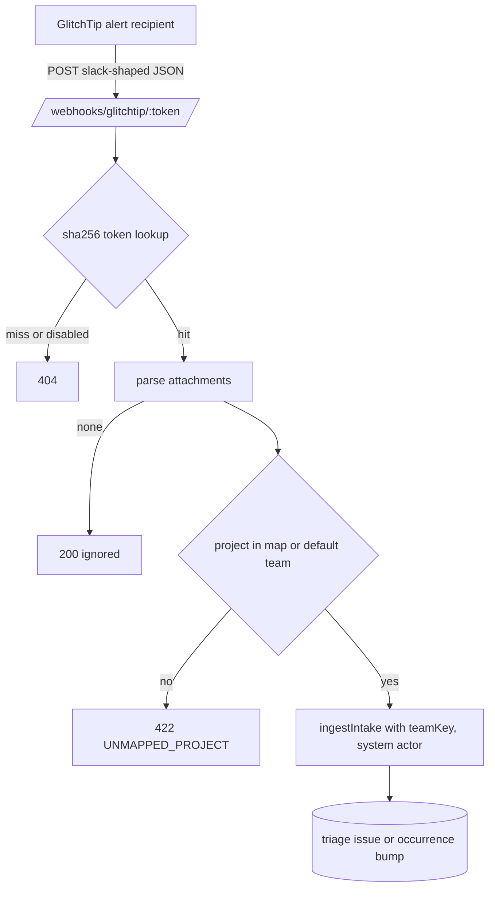

# Native GlitchTip Integration and Pace/Wisp Onboarding - Plan

## Goal Capsule

- **Objective:** Errors that GlitchTip at `https://errors.pacehq.io` raises for Pace services, Wisp and Kate show up in the matching team's triage queue on the Tallyline instance, once per GlitchTip issue, with repeat alerts raising an occurrence count instead of duplicating, and Luke can reach that state by running one script.
- **Means:** A public GlitchTip-shaped webhook receiver in the API that feeds the existing intake service, a per-workspace hashed secret managed from admin API and web, and an idempotent operator script that creates the teams and configures GlitchTip (KTD1, KTD2, KTD6).
- **Authority:** User request (session-settled decisions below) > this plan > the intake plan `plans/2026-10-16-0100-automated-intake-decision-model-plan.md` > repo conventions in `AGENTS.md`.
- **Stop conditions:** Stop if `ingestIntake` cannot take an options argument without changing `POST /v1/workspaces/:ws/intake` behavior. Never write to the live instance or to GlitchTip from the agent; the script is delivered, not run with `--apply`.
- **Execution profile:** One PR. API, web card, docs, operator script. Deploy and `--apply` stay with Luke.

## Product Contract

### Summary

Add a native GlitchTip receiver to Tallyline. A workspace admin generates an integration secret, maps GlitchTip project names to teams, and points GlitchTip alert recipients at `https://api.tallyline.app/webhooks/glitchtip/<secret>`. Alerts become triage issues through the existing intake pipe. An operator script creates the Pace and Wisp teams on the live instance and wires every GlitchTip project to the right team.

### Problem Frame

R21 of the roadmap calls for GlitchTip errors to enter through one intake pipe, but today only an agent-keyed `POST /v1/workspaces/:ws/intake` with a normalized body exists, and GlitchTip cannot produce that body. GlitchTip alert webhooks post a Slack-style payload with no signature and no delivery id, so a translator would have to sit in between. Luke wants no translator. Intake also lands every event on the workspace's first team, which cannot separate Pace, Wisp and Kate errors. The live instance has no Pace or Wisp team yet.

### Requirements

**Receiver**

- R1. `POST /webhooks/glitchtip/:token` accepts GlitchTip's own generic or Slack-type alert payload with no transformation in front of it.
- R2. Each issue attachment in a delivery becomes one intake event with `provider: "glitchtip"`, a fingerprint stable per GlitchTip issue, the issue URL, severity from the attachment color, and the project, environment and culprit in the body.
- R3. A repeat alert for the same GlitchTip issue bumps the existing issue's occurrence count (existing intake behavior); an immediate retry of the same body is dropped as a duplicate delivery.
- R4. A payload with no issue attachment (uptime alerts, test pings) returns 200 and creates nothing.
- R5. An unknown, rotated or disabled token returns 404 `NOT_FOUND` and does no work.
- R6. A GlitchTip project that is not in the workspace's map lands on the configured default team; with no default team the delivery is rejected 422 `UNMAPPED_PROJECT`.
- R7. Created issues land in `triage`, are never auto-accepted, and carry `source: "intake"`.

**Configuration**

- R8. A workspace admin or owner can create, read the status of, update the project map and default team of, rotate and delete one GlitchTip integration per workspace through `/v1/workspaces/:ws/glitchtip`.
- R9. The secret is shown once at create or rotate, stored only as a sha256 hash plus its last four characters, and absent from exports; rotation invalidates the old secret immediately.
- R10. Settings > Integrations shows the integration status, the project map, a create/rotate action that reveals the URL once, and works from the keyboard like the rest of settings.

**Operator onboarding**

- R11. `ops/glitchtip-onboard.py` (copied to `~/Downloads/claude/tallyline/`) is dry-run by default and acts only with `--apply`.
- R12. With `--apply` it creates the Pace and Wisp teams when missing, creates the integration when missing, and gives each mapped GlitchTip project one alert named `tallyline` that posts to the integration URL; re-running changes nothing.
- R13. Credentials come from omaseal and are never printed; the integration URL secret is stored in omaseal, never in a file or on the terminal.

**Documentation**

- R14. `docs/glitchtip.md` documents setup, payload mapping, limits and the access-log redaction caveat, and README links it.

### Scope Boundaries

- Deferred for later: GlitchTip recipient types other than generic webhook and Slack (Discord, Google Chat, ntfy, Teams, Zulip, Feishu send other shapes); a fatal severity (GlitchTip colors error and fatal the same); auto-resolving the Tallyline issue when GlitchTip resolves; multiple integrations per workspace; Tallyline-side sourcemap or event detail pulls.
- Outside this plan: changing the existing agent-key intake route, LLM triage ranking, any paid model call.

### Key Decisions

- Teams are the Pace and Wisp unit: they own issue keys and the triage queue; projects stay optional. (Kate precedent: R21 targets a Kate team; the script maps Kate only when a `KATE` team already exists.) Governs R6, R12.
- No translator service. (session-settled: user-directed — chosen over an n8n or Worker translator in front of intake: Luke asked for a native integration.) Governs R1.
- Existing intake service is reused. (session-settled: user-directed — chosen over a new GlitchTip-only issue writer: Luke's brief points at the existing intake pipe so dedupe and triage rules stay in one place.) Governs R2, R3, R7.
- The agent does not touch production. (session-settled: user-directed — chosen over the agent running `--apply` itself: production data, Luke runs the script.) Governs R11, R12.

### Success Criteria

- A recorded GlitchTip alert posted to a freshly created integration URL in the test database produces one triage issue on the mapped team; the same alert minutes later bumps its count to 2.
- Operator dry-run against fake HTTP prints the full plan and makes no mutating call; `--apply` against the same fake makes each call once and a second run makes none.

## Planning Contract

### Key Technical Decisions

- KTD1. **Token in the URL path, lookup by hash.** GlitchTip webhook recipients take a URL only, so the secret rides in `/webhooks/glitchtip/:token`. Format `tly_gt_<24 random bytes, base64url>`. Lookup is `sha256(token)` against a unique index, so no timing oracle and no plaintext at rest, same hashing as `hashToken` in `apps/api/src/services/tokens.ts`. The docs warn that reverse-proxy access logs record the path; rotate if logs leak. (session-settled: user-directed — chosen over a header secret: GlitchTip cannot send custom headers.)
- KTD2. **Receiver feeds `ingestIntake`, extended with an optional `teamKey`.** The existing first-team fallback stays when no team is passed, so `POST /v1/workspaces/:ws/intake` is unchanged. The receiver passes a `{ type: "system", id: null }` actor and `skipRank: true`, so untrusted error text never reaches the LLM triage ranker (the optional fourth parameter carries `teamKey` and `skipRank`); enabling ranking for this provider needs a separate plan that delimits the content as untrusted data; `actor_type` enums on issues, comments and events already include `system`. (session-settled: user-directed — see Key Decisions.)
- KTD3. **Fingerprint and delivery id.** Fingerprint is `glitchtip:<host>/<org-slug>/<issue-pk>` parsed from `title_link` (`<GLITCHTIP_URL>/<org-slug>/issues/<pk>` per `Issue.get_detail_url`). GlitchTip sends no delivery id and does not retry, so `externalId` is per attachment, `sha256(rawBody + ':' + attachmentIndex)` plus the minute bucket of the injectable clock, so the unique `(workspace, provider, externalId)` index never collapses items of one batch (`apps/api/src/services/clock.ts`): a same-minute duplicate of the whole delivery dedupes as `duplicate_delivery`, an identical alert a later minute reaches the fingerprint path and bumps `occurrenceCount`.
- KTD4. **Severity from color.** `#e52b50` maps to `error`, `#e9b949` to `warning`, `#4b60b4` to `info`, anything else to `error`. `fatal` is unreachable because GlitchTip colors error and fatal alike; documented.
- KTD5. **Failure semantics.** Bad token, disabled integration: 404. Malformed JSON: 400 `MALFORMED_PAYLOAD`. No issue attachments: 200 ignored. Unmapped project with no default team: 422 `UNMAPPED_PROJECT` for the whole delivery, decided before any attachment is ingested so a batch never half-lands. At most 25 attachments are ingested per delivery (extras dropped, count returned in the response) and each text field is length-capped. Body capped at 256 KB with `bodyLimit` (`apps/api/src/routes/import.ts` pattern). No per-IP limiter: `/webhooks/` is already exempt from the anonymous limiter and a 192-bit secret makes guessing infeasible; a leaked token is bounded by the attachment cap, the `enabled` flag and rotation. Project map keys are lowercased GlitchTip project names, because the payload carries the name, not the slug.
- KTD6. **Operator script is Python 3 stdlib**, like `~/Downloads/claude/tallyline-deploy.sh`'s embedded Python, with an `--self-test` that runs against an in-process fake HTTP layer and a fake secret store so dry-run and idempotency are checkable offline. Credentials: Tallyline token via `omaseal get tallyline personal` (override `--tally-secret service/account`); GlitchTip token via `omaseal get glitchtip api`, falling back to `omaseal get glitchtip Personal`. The integration URL is stored in omaseal as `tallyline glitchtip-webhook` via `omaseal set` over stdin. If the integration exists but that secret is missing, the script stops and says to rerun with `--rotate`; it never prints a secret.
- KTD7. **Admin surface mirrors webhook endpoints.** `requireRole(c, "admin")`, mask on read, reveal-once on create and rotate (`apps/api/src/routes/webhook-endpoints.ts`). Agent keys are denied; the permission matrix pins it.

### High-Level Technical Design

Operator flow (directional): discover teams, ensure `PACE` and `WISP`, ensure integration with map, list GlitchTip projects, classify each project to a team by name rules, upsert the `tallyline` alert on each. Dry-run prints each intended call as `would ...` and exits 0.

### Assumptions

- GlitchTip project names containing `wisp` map to `WISP`; names for Pace services (`pace`, `portal`, `ui`, `strut`, `relay`, `sidecar`, `tenant-stackd`) map to `PACE`; `kate` maps to `KATE` only if that team exists. Projects matching none are listed and skipped, not guessed. The rules live at the top of the script and `--map project=TEAM` overrides them. Real project names were not inspected (production access is not granted to the agent).
- The Tallyline token in omaseal (`tallyline personal`) belongs to a workspace admin or owner; the script verifies with a GET and fails clearly otherwise.
- GlitchTip's `GET /api/0/projects/` lists organization slug and project slug and name for the token's organizations; alert upsert uses the `projects/{org}/{project}/alerts/` endpoints verified in glitchtip-backend `apps/alerts/api.py`. Field names on the live server are confirmed by the dry-run's GET calls before any write.

## Implementation Units

### U1. Schema, migration and tenancy bookkeeping

- **Goal:** Persist one integration per workspace.
- **Requirements:** R8, R9
- **Files:** `apps/api/src/db/schema.ts`, `apps/api/drizzle/0033_glitchtip_integration.sql`, `apps/api/drizzle/meta/_journal.json`, `apps/api/drizzle/meta/0033_snapshot.json`, `apps/api/src/services/tenant-tables.ts`, `apps/api/test/tenancy.test.ts`, `apps/api/test/tenants.ts`
- **Approach:** Table `glitchtip_integrations`: `id`, `workspace_id` (unique, FK cascade), `token_hash` (unique), `token_last4`, `glitchtip_host` nullable, `project_map` jsonb default `{}`, `default_team_key` nullable, `enabled` default true, `created_at`, `rotated_at`, `last_received_at`. Generate the migration with drizzle-kit so snapshot and journal agree. Register in `TENANT_TABLES` with `export: true, redact: ["token_hash"]`. In `tenancy.test.ts` bump the hard-coded tenant-table count from 36 to 37, add the table to `TABLE_ENDPOINTS` with the U5 admin ops, and in `tenants.ts` seed a row and add its `token_hash` to the export secrets query. The ops exist only after U5, so the tenancy gate runs after U5. Run `drizzle-kit generate` directly with `apps/api/drizzle.config.ts` (no package script exists) and keep the journal `when` monotonic after 0032.
- **Patterns to follow:** `webhook_endpoints` in `apps/api/src/db/schema.ts`, migration `0028_intake.sql`.
- **Test scenarios:** migration applies on the template database; the tenancy suite passes with the new table; workspace export omits `token_hash`.
- **Verification:** migration applies (`pnpm --filter @tallyline/api test -- schema`); the tenancy suite is verified after U5.

### U2. Intake team override

- **Goal:** Let a caller choose the receiving team without changing existing behavior.
- **Requirements:** R6, R7
- **Dependencies:** none
- **Files:** `apps/api/src/services/intake.ts`, `apps/api/src/routes/intake.test.ts`
- **Approach:** Add an optional fourth parameter `{ teamKey?, skipRank? }` after `(workspaceId, event, actor)` (not body fields, so the public route schema is untouched); `skipRank` bypasses the `llmEnabled()` ranking step. When set, resolve that team in the workspace and throw `HttpError(422, "NO_TEAM")` when absent; when unset keep the first-team query.
- **Test scenarios:** existing intake tests unchanged and green; with `teamKey` the issue key uses that team's prefix; unknown `teamKey` gives 422; the dedupe path is unaffected by the override; with `skipRank` no `suggestTriage` call occurs even when ranking is enabled.
- **Verification:** `pnpm --filter @tallyline/api test -- intake`.

### U3. GlitchTip payload parser and integration service

- **Goal:** Pure parsing plus token and project-map logic, separately testable.
- **Requirements:** R2, R4, R5, R6, R9
- **Dependencies:** U1, U2
- **Files:** `apps/api/src/lib/glitchtip.ts`, `apps/api/src/lib/glitchtip.test.ts`, `apps/api/src/services/glitchtip.ts`, `apps/api/test/fixtures/glitchtip/` (recorded payloads)
- **Approach:** `parseGlitchtipAlert(raw)` drops any item whose `title_link` is not `https` on the host of the first accepted delivery's link (stored on the integration as `glitchtip_host`, added to U1's table), caps title, culprit and tag fields, and returns `{ items: [...] }` with title, culprit, url, fingerprint, project name, severity, environment and other tag fields, or an empty list when no attachment has an issue-shaped `title_link`. The service holds `generateToken`, `hashToken` reuse, `resolveByToken`, `ingestAlert(integration, rawBody, parsed)` which resolves each item's team (map, then default, else reject the whole delivery before ingesting), computes the KTD3 `externalId`, calls `ingestIntake`, stamps `last_received_at`. Fixtures are written to match the GlitchTip source shape (`WebhookPayload.to_dict`) for: one error, a batch of three issues across two projects, warning, info, and an uptime-style payload with no issue link.
- **Test scenarios:** each fixture parses to the expected items; unknown color maps to `error`; `title_link` without `/issues/<pk>` is skipped; a `javascript:` link, a foreign host and oversized fields are dropped or capped; more than 25 attachments ingest only 25; fingerprint is stable across two different alert texts for the same pk; missing project field is treated as unmapped; mixed batch with one unmapped project and no default rejects entirely.
- **Verification:** `pnpm --filter @tallyline/api test -- glitchtip`.

### U4. Public receiver route

- **Goal:** `POST /webhooks/glitchtip/:token`.
- **Requirements:** R1, R3, R4, R5, R6, R7
- **Dependencies:** U3
- **Files:** `apps/api/src/routes/glitchtip-webhook.ts`, `apps/api/src/index.ts`, `apps/api/src/openapi-extra.ts`, `apps/api/test/matrix-ops.ts`, `apps/api/test/permission-matrix.csv`, `apps/api/src/routes/glitchtip.test.ts`
- **Approach:** Read raw text, `bodyLimit` 256 KB, JSON parse, delegate to the service, return `{ ok: true, results: [...] }`. Mount next to `slackRoutes` under `/webhooks`. Document in `openapi-extra.ts` and add the matrix op (the builder posts a bogus token path) and the CSV row `POST,/webhooks/glitchtip/{token}` as `ALLOW` for all nine credentials, because the matrix only admits `ALLOW` or 401/403 cells; the 404 `NOT_FOUND` is asserted in `glitchtip.test.ts`.
- **Patterns to follow:** `apps/api/src/routes/webhooks.ts`, `apps/api/src/routes/slack.ts`.
- **Test scenarios:** recorded single-error fixture creates one triage issue on the mapped team with source `intake`; batched fixture creates three issues routed by project; identical body in the same minute returns duplicate and creates nothing; identical body after advancing the test clock one minute bumps `occurrenceCount` to 2 and adds one comment; wrong token 404 with no rows written; disabled integration 404; rotated old token 404 while the new one works; unknown project with default team lands on the default team; unknown project without default 422 and no rows; uptime fixture 200 ignored; invalid JSON 400; oversized body rejected; plaintext token not present in `glitchtip_integrations` or `intake_events.payload`; no `suggestTriage` call for glitchtip deliveries; `docs/glitchtip.md` confirms by reading the app code that no logger emits the `/webhooks/glitchtip` path (verify, then document proxy-level redaction).
- **Verification:** `pnpm --filter @tallyline/api test`.

### U5. Admin management routes

- **Goal:** Create, status, update map, rotate and delete.
- **Requirements:** R8, R9
- **Dependencies:** U1, U3
- **Files:** `apps/api/src/routes/glitchtip.ts`, `apps/api/src/index.ts`, `apps/api/src/openapi.ts`, `apps/api/test/matrix-ops.ts`, `apps/api/test/permission-matrix.csv`, `apps/api/test/tenancy.test.ts`, `apps/api/src/routes/glitchtip.test.ts`
- **Approach:** `GET /workspaces/:ws/glitchtip` (null-safe status, last4, map, default team, last received), `PUT` (create when absent, otherwise update map, default team, enabled; validate that each referenced team key exists), `POST /rotate` (new secret, old one dead, secret and `webhookUrl` returned once), `DELETE`. `webhookUrl` is built from `config.apiBaseUrl` (`API_BASE_URL`, `apps/api/src/env.ts`). The operator script refuses to store or post a returned URL that does not start with `--tally-url`, which catches an unset production `API_BASE_URL`.
- **Patterns to follow:** `apps/api/src/routes/webhook-endpoints.ts`.
- **Test scenarios:** member gets 403, admin and owner allowed, agent keys 403 (matrix); create returns the URL once and later GETs show only last4; PUT with an unknown team key 422; second create is an update, not a second row; delete then old token 404; cross-workspace access 403.
- **Verification:** `pnpm --filter @tallyline/api test -- permission-matrix tenancy glitchtip`.

### U6. Settings card in the web app

- **Goal:** Admin UI for the integration.
- **Requirements:** R10
- **Dependencies:** U5
- **Files:** `apps/web/components/glitchtip-integration.tsx`, `apps/web/lib/glitchtip-form.ts`, `apps/web/lib/glitchtip-form.test.ts`, `apps/web/app/(app)/settings/integrations/page.tsx`
- **Approach:** A panel under the GitHub panel: status chip, project-map rows (name to team select), default team select, "Create"/"Rotate" button revealing the URL once with a copy action. Follow `apps/web/components/github-repos.tsx` for data flow and `DESIGN.md` plus the Silver Lining lint (`pnpm lint:design`) for tokens; buttons and selects keyboard reachable.
- **Test scenarios:** the web package has only node-environment tests (no jsdom), so the pure logic lives in `glitchtip-form.ts` and is unit-tested: map rows convert to the PUT body (names lowercased, blank rows dropped, duplicates rejected); the reveal-once state shows the URL after create or rotate and never after a reload. Rendering is covered by typecheck, lint and the e2e gate.
- **Verification:** `pnpm turbo run typecheck lint`, `pnpm lint:design`, web tests.

### U7. Docs

- **Goal:** Operator and self-host documentation.
- **Requirements:** R14
- **Files:** `docs/glitchtip.md`, `README.md`, `CHANGELOG.md`
- **Approach:** Follow `docs/github-sync.md` and `docs/slack.md`: setup, URL shape, payload mapping table, fingerprint and dedupe rules, severity limits, unmapped-project behavior, rotation, log-redaction caveat, supported recipient types, the operator script usage.
- **Test scenarios:** none; link check by `rg` that README references the page.
- **Verification:** read-through against the implemented behavior.

### U8. Operator script and offline self-test

- **Goal:** Idempotent onboarding for the live instance.
- **Requirements:** R11, R12, R13
- **Dependencies:** U5
- **Files:** `ops/glitchtip-onboard.py` (usage documented in `docs/glitchtip.md`), copy to `~/Downloads/claude/tallyline/glitchtip-onboard.py`
- **Approach:** Arguments `--apply`, `--rotate`, `--tally-url` (default `https://api.tallyline.app`), `--workspace` (default from the token's `whoami`), `--glitchtip-url` (default `https://errors.pacehq.io`), `--map`. Steps run as read-only discovery, then a printed plan, then mutations only under `--apply`. Alert upsert matches by name `tallyline` per project and compares recipient URL and type; the script never prints a token or a webhook URL, only the last four characters. `--self-test` swaps the HTTP and omaseal layers for in-memory fakes and asserts dry-run makes zero writes, apply makes each write once, and a second apply makes none.
- **Test scenarios:** the self-test cases above; secret missing with integration present stops with the `--rotate` instruction; project matching no rule is reported and skipped; GlitchTip token fallback order; no secret appears in captured output.
- **Verification:** `python3 -I ops/glitchtip-onboard.py --self-test`.

## Verification Contract

| Gate | Command | Applies to |
|---|---|---|
| Typecheck and lint | `pnpm turbo run typecheck lint` | all units |
| API tests (needs `DATABASE_URL` for a non-default test Postgres, see `apps/api/test/db-guard.ts`) | `pnpm turbo run test --filter=@tallyline/api --concurrency=1` | U1-U5 |
| Permission and tenancy suites | included in the API tests | U1, U4, U5 |
| Design gates | `pnpm lint:design` | U6 |
| Script self-test | `python3 -I ops/glitchtip-onboard.py --self-test` | U8 |
| CI | `.github/workflows/check.yml` (static, unit with Postgres 17, e2e) | whole PR |

## Definition of Done

- All requirements R1-R14 are met and traced by a test or the docs.
- The migration, journal and snapshot agree; the permission matrix and tenancy suites include the new routes and table.
- Dry-run and idempotency are proven by the script self-test; no secret appears in output or files.
- No abandoned experiment code remains in the diff.
- PR is open with CI decided; merge, production deploy and `--apply` stay with Luke.

## Risks & Dependencies

- Secret in the URL path can leak through access logs; mitigated by hashing at rest, rotate-on-demand, and documentation (KTD1).
- GlitchTip payload fields are verified from source, not from a live capture; the fixtures are source-derived, and the script's first dry-run against the live server confirms project names before any write.
- A migration is added; deploy order is API image (runs migrations via the existing deploy script) before running `--apply`.
- Real GlitchTip project names are unknown to the plan; unmatched projects are skipped and reported, never auto-mapped.
