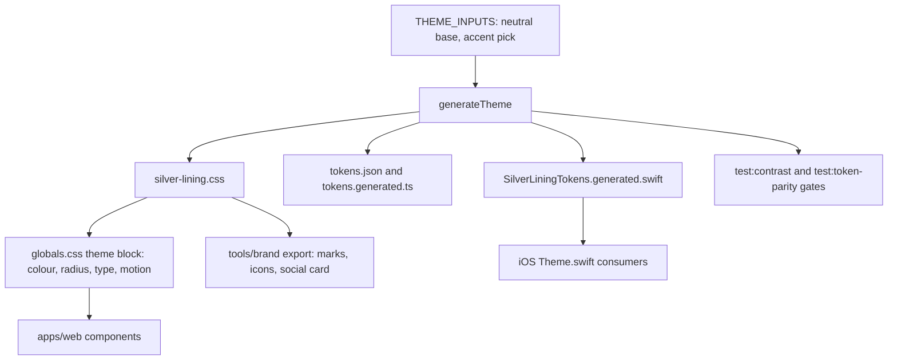
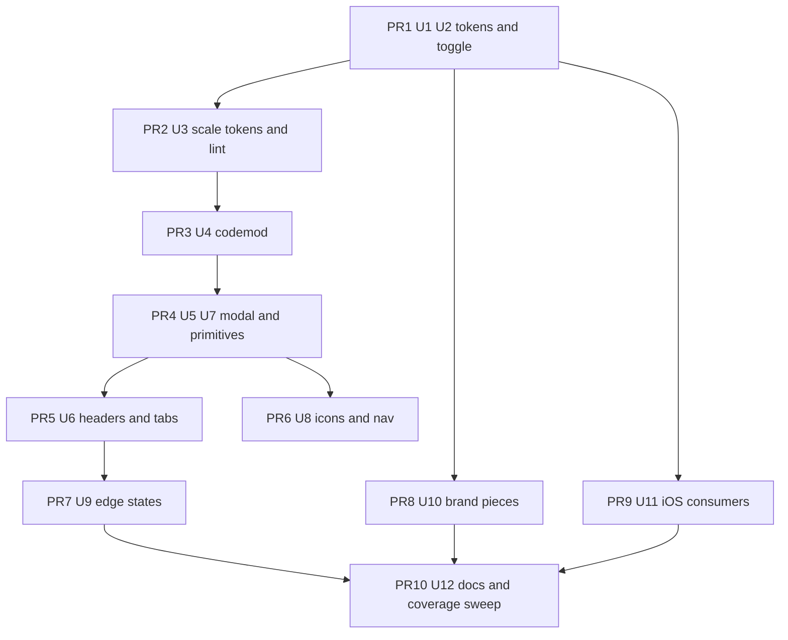

# Frontend Polish and Neutral Theme - Plan

**Target repo:** tallyline (`duketopceo/tallyline`), base `main` at 730037d. Scope is `apps/web`, `packages/silver-lining`, `tools/brand`, `tools/e2e`, and the generated iOS theme in `apps/ios`.

---

## Goal Capsule

- **Objective:** Someone opening Tallyline on the web or iPhone, in light or dark, sees one finished product: a neutral deep-black or clean light surface, one visible way to switch modes, no leftover navy, and no screen that looks like it came from a different app.
- **Means:** Token-first, reviewable PR sequence (KTD1, KTD7). Tokens and the visible theme toggle land first, scale tokens and lint gates second, mechanical migration third, then primitives, nav and icons, edge states, brand pieces, iOS and docs.
- **Authority:** Owner decisions recorded under Key Decisions beat this plan; this plan beats `DESIGN.md` prose where they differ, and the plan's docs unit updates `DESIGN.md` to match.
- **Stop conditions:** Stop and return to the owner if evidence shows a Key Decision cannot work. (The accent, Open Question 1, is resolved: A Azure.)
- **Execution profile:** Standard code work across web, a design-token package, brand tooling and iOS generated code. Smoke and gate verification (lint, contrast, parity, axe) matter more than unit tests for the styling units.
- **Finishes and ships:** Each PR is opened by the implementer and merged by the owner. This plan does not authorise merging.

---

## Product Contract

### Summary

Replace the blue-tinted dark theme with a neutral near-black dark mode and a real light mode, both generated from the same Silver Lining tokens, with system-following behaviour and a visible toggle in the app chrome. Wire the DESIGN.md radius, type and motion scales into Tailwind so the arbitrary `text-[Npx]` classes and off-by-2px radii disappear, extend `lint:design` so raw Tailwind palette classes cannot return, and polish every page against one set of primitives. Ship the matching iOS theme from the same generator and hand-build the brand pieces from tokens.

### Problem Frame

The dark theme's surface ladder (`#0a0f15` to `#192535`) reads as navy, which the owner dislikes. Light mode exists but is reachable only through Settings > Appearance or the command palette, so most users never see it, and several surfaces ignore the chosen theme (browser theme colour, manifest, landing screenshots, favicon).

Underneath the colour, the app has drifted from `DESIGN.md`. The radius, type and motion scales are not in the Tailwind theme, so `rounded-sm` renders 4px where the spec says 6px, and type is about 800 arbitrary pixel classes. There are three page-header systems, five hand-built modals (three with raw `bg-red-600` and `bg-black/50`), dead and duplicated primitives, four copies of a glint star with the wrong geometry, icon collisions in the sidebar, Unicode characters standing in for icons, and "All clear" shown when the API fails. Several pages cannot be reached from navigation. The inventory in the Appendix is the verified starting point.

### Key Decisions

- **Neutral deep-black dark mode, real light mode, both first-class.** (session-settled: user-directed — chosen over the current blue-tinted dark surfaces and over "navy like every AI app": the owner dislikes navy and wants a Linear-like deep black.) Surfaces, linings and ink carry no blue tint in either mode. Governs R1, R2.
- **System-following by default with a manual toggle visible in the app chrome; `hc-dark` and the custom theme keep working.** (session-settled: user-directed — chosen over keeping light mode reachable only from Settings and the palette: light must be discoverable.) Governs R3.
- **iOS takes the new palette from the same generated tokens.** (session-settled: user-directed — chosen over a web-only change: the apps should read as one product.) Governs R18.
- **Brand and custom pieces are hand-built SVG and code generated from tokens.** (session-settled: user-approved — chosen over image-model generation, which would be paid calls.) Governs R16, R17.

### Requirements

**Theme and tokens**

- R1. Dark mode uses the neutral palette: canvas `#08090a`, surfaces `#0f1011 / #151617 / #1c1d1f`, line `#26282c`, ink `#ededef` (swatch-page values; exact output is whatever the generator produces within contrast floors).
- R2. Light mode uses the neutral palette: canvas `#f7f7f8`, surfaces `#ffffff / #f1f1f3 / #e8e8eb`, line `#dcdde0`, ink `#16171a`, and is verified to the same standard as dark.
- R3. The default appearance follows the OS; a toggle in the shell chrome (desktop sidebar, rail, mobile drawer) switches system, light and dark without reload or flash, and persists per device. `hc-dark` and the custom theme remain selectable in Settings > Appearance.
- R4. The accent is a single input to the token generator, chosen by the owner (Open Question 1), and flows to web, iOS, brand assets and docs from that one value.
- R5. DESIGN.md radius (4/6/8/10/14), type (24/17/15/14/13/12/11) and motion (90/140/200ms, two eases) scales exist as Tailwind theme tokens, so no component needs an arbitrary pixel type size, an off-spec radius or an ad hoc duration.
- R6. `lint:design` fails on Tailwind palette classes (`bg-red-600`, `bg-black/50`, `text-white`), arbitrary colour, shadow and font-size values, and off-scale named sizes, with the existing allowlist ratcheted to zero by the end of the sequence.

**Pages and primitives**

- R7. Every `(app)` and settings page uses one page-header system, and `/welcome` and the settings tab strip behave consistently, including a scroll affordance for the 15 tabs on a phone.
- R8. One modal primitive replaces the five hand-built dialogs, with focus trap, focus restore, Escape, scrim and destructive-action styling from tokens.
- R9. Dead primitives are deleted and overlapping ones merged: `Sparkle`, `StateDot`, `StatePill`, `PriorityIcon`, `Avatar`, `LabelChip`, `LoadingState` in `components/primitives.tsx`, the three `Notice`/`ErrorState` tone implementations, and the unused `IconUnassigned` export. Status is shown one way (icon plus label).
- R10. Icon collisions are fixed (Roadmap vs Projects, Review vs `done`, Funnel vs FunnelSimple), Unicode glyph icons are replaced with the Phosphor facade, and Appearance and Sign out carry icons in the sidebar footer and rail.
- R11. `/notifications` and `/activity` show a real error state with retry when the API call fails, never "All clear" or "No activity yet".
- R12. The app has a root `not-found`, a `global-error`, and a `loading.tsx` for `/projects`, `/projects/[id]`, `/welcome` and the settings pages that lack one.
- R13. `/projects` no longer issues one `issues?project=` request per project, using existing endpoints only.
- R14. `/welcome`, `/projects/[id]`, Tokens and Account (for non-admin members), and dev-inbox are reachable from navigation or an explicit gated entry point.
- R15. Light and dark leaks are closed: browser theme colour, favicon, landing screenshots and chart fonts follow the active theme; manifest colours use the dark canvas because a manifest cannot be theme-aware (KTD2).

**Custom pieces, iOS and docs**

- R16. TallyMark, favicon and app icons (including a maskable icon), empty-state and not-found art are generated from tokens with automatic light and dark variants; the social preview is generated from tokens in a single variant (social crawlers).
- R17. One glint implementation with the DESIGN.md geometry replaces the four copies, and the missing `glint-silver` variant exists.
- R18. The generated iOS token file and iOS-side colour consumers match the web palette, and the parity gate passes.
- R19. Documentation matches reality: `DESIGN.md` (accent-soft, overlay, font weights, default theme, surface ladder), `docs/design/silver-lining.md` section 2, and `assets/brand/README.md` accent and ink values.
- R20. Work ships as small reviewable PRs, tokens and toggle first.
- R21. Each PR is verified with existing Playwright e2e and axe in both modes at 390 and 1440, `lint:design`, and the token-parity gate (which covers the iOS generated file).

### Scope Boundaries

- Out of scope: new product features, API changes, iOS screens beyond the theme, image-model generation, per-agent identity colours.
- Considered and not built: a light variant of `hc-dark` (no owner request; evidence that would change this is a contrast complaint from a light-mode user).
- Considered and not built: a new visual-regression suite. The existing axe and e2e gates plus a one-time before/after screenshot pass per PR are sufficient for a polish sequence.

#### Deferred to Follow-Up Work

- An API aggregate for per-project issue counts, only if U9 finds no existing endpoint that serves `/projects` (API changes are out of scope here).
- Re-thinking the four-slot phone bottom bar so Inbox and Triage get a slot (Open Question 3).

### Dependencies and Assumptions

- The vendored open-computer copy of `silver-lining.css` is checked by `pnpm test:token-parity` only when present. After U1 that sibling repo needs `pnpm --filter @tallyline/silver-lining sync:open-computer` or its own update; this is outside the repo.
- Assumption: the generator can reach the neutral palette by changing `THEME_INPUTS` (chroma near zero) while keeping the DESIGN.md floor of canvas L at or above 0.13. The generator floors text and lining chroma at 0.006 and takes its hue from `base.h`, so U1 either sets a neutral hue and defines the bias bound at or above that floor, or lowers the clamp floors in `generator.ts`, in the same change as the regenerated outputs. U1 tests this first; if the ladder step sizes cannot reproduce the swatch values within tolerance, the generator gains a low-chroma path instead of per-theme hex overrides (KTD1).
- Assumption: the repo is active (iOS and web feature PRs land weekly), so the codemod PRs must be small and land fast to limit rebase conflicts.

### Open Questions

Blocking:

1. **Accent colour — RESOLVED 2026-10-31: A Azure** (dark `#339fee`, light `#005fba`), picked by the owner from the swatch page (session-settled: user-directed — chosen over B Iris, C Amber and D Mint: keeps today's accent and the "blue is never a status colour" rule; only the surfaces lose their blue tint). The original options are kept below for the record. Options, each on the neutral surfaces: A Azure dark `#339fee` / light `#005fba` (equals today's accent), B Iris `#8b8cf8` / `#4b4ccf`, C Amber `#f0a63c` / `#9a5b00`, D Mint `#3fcf8e` / `#0b7a4b`. U1 reads the pick as its single accent input and cannot finish without it; the neutral surface, lining and ink half of U1 does not depend on it. Consequences to weigh when picking: C collides with `status-attention` (`#f59e0b`) and D with `status-healthy` (`#10b981`), so either needs a status remap and a rewrite of the DESIGN.md rule "blue is never a status colour" into "the accent never shares a hue with a status"; A and B keep that rule intact. Iris and Mint dark values also need a contrast check as link text on `surface-1`.

Deferred (do not block execution):

2. Whether the landing page "Pricing" copy ("Hosted plans are not available yet") is stale given the hosted instance. Content owner confirms; U12 edits it if so.
3. Which two of My issues, Board, Review, New, Inbox and Triage deserve the phone bottom bar. Default if unanswered: keep the current four and add nothing.
4. Toggle control shape (three-state segmented control vs single cycle button). Default: popover with System, Light, Dark and a link to Appearance settings.

---

## Planning Contract

### Key Technical Decisions

- KTD1. **Realise the neutral palette through `THEME_INPUTS` in `packages/silver-lining/src/themes.ts`, not hex overrides.** The generator already feeds CSS, JSON, TS, Swift, the contrast tests and the custom-theme path, so one change reaches every consumer and the section 3 floors keep holding. `hc-dark` is neutralised the same way. Rejected: pinning swatch hex per theme, which would fork the web palette from the generator and from iOS.
- KTD2. **Appearance mechanics.** `DEFAULT_APPEARANCE` becomes `system`, the root layout keeps reading the `sl-appearance` cookie for flash-free first paint, and `viewport.themeColor` becomes a media-conditioned pair so browser chrome follows the active scheme. The cookie has two writers today (`components/app/theme-toggle.tsx` writes a raw string; `components/appearance-settings.tsx` uses `serializeAppearance`); both move behind one helper that uses the package serializer. The web manifest cannot follow the theme, so its colours take the dark canvas.
- KTD3. **Redefine Tailwind theme values to the DESIGN.md scales instead of renaming classes.** `--radius-*`, `--text-*`, `--ease-*`, `--duration-*` (and a shadow token if any) are added to `apps/web/app/globals.css`, which today holds only a colour `@theme inline` block. Existing class names such as `rounded-sm` then snap to spec. The accepted cost is a visible 2px shift on about 340 radius sites, reviewed once in PR2 rather than discovered piecemeal.
- KTD4. **Lint first, then migrate, using the existing ratchet.** U3 adds the new rules with the allowlist (`apps/web/lint-design-allowlist.json`) pre-seeded at current counts so the gate stays green and no new violation can enter; U4 pays the allowlist down to zero in the same change that lowers each entry, as the ratchet requires.
- KTD5. **One shared glint geometry module** consumed by the React component, the SVG exports in `tools/brand/export.mjs` and a parity check against `apps/ios/Sources/TallylineDesign/GlintShape.swift`, so the three renderings cannot drift again. Colours come from tokens (`glint`, `glint-silver`).
- KTD6. **Brand assets are generated, never hand-edited.** `tools/brand/export.mjs` is extended to read the generated tokens and emit light and dark variants; `tools/brand/verify.mjs` gains checks for the new files and for geometry hashes.
- KTD7. **PR sequence is part of the design.** Order: tokens and toggle; scale tokens and lint rules; codemod; modal and primitives; headers and tabs; icons and nav; edge states; brand pieces; iOS consumers; docs and test-coverage sweep. Each PR is green on its own and touches either tokens, mechanical migration, or behaviour, never a mix.
- KTD8. **Modal primitive lives in `components/app/`.** Whether it wraps native `dialog` or a custom portal is an implementation choice deferred to U5; the contract is fixed by R8 and the existing e2e dialog roles (`role="dialog"`, accessible names such as "Quick create issue").

### High-Level Technical Design

Token flow after this plan, with the single accent input and the three outputs the gates compare:

PR dependency order:

### System-Wide Impact

- Every screen changes appearance in PR1 and PR2 (palette, radius); this is intended and gets one before/after screenshot review per PR.
- `docs/design/silver-lining.md` and `DESIGN.md` are test-pinned to the generator (`packages/silver-lining/test/design-md.test.ts`), so doc and token changes must land together in U1.
- Landing screenshots in `apps/web/public/landing/` and `docs/screenshots/` show the old palette and are recaptured once, in U10 (PR8), after the nav, header and icon PRs have merged.

### Risks

| Risk | Mitigation |
|---|---|
| Neutral lining or ink fails section 3 contrast floors on near-black | U1 runs `test:contrast` before anything else; adjust `contrast` input or generator clamps, never the floors |
| Radius redefinition shifts ~340 sites at once | KTD3 single reviewed change; screenshot pass in PR2 |
| Codemod conflicts with feature PRs | Split U4 by directory, land within a day each, no behaviour changes in the same PR |
| Accent options C or D collide with status colours | Open Question 1 lists the consequence; the owner decides before U1 finishes |
| Default flip to `system` surprises existing users | Users with an explicit cookie keep it; only cookie-less first visits change |
| e2e fixtures assume dark default | `a11y.spec.ts` `setTheme` only toggles an `html` class and works today because the default cookie emits `data-theme`; U2 rewrites it and audits other specs for implicit dark |
| open-computer vendored CSS drifts | Called out in Dependencies; parity check reports it when the vendored copy is present |

---

## Implementation Units

| U-ID | Title | Key files | Depends on |
|---|---|---|---|
| U1 | Neutral token set | `packages/silver-lining/src/themes.ts`, `DESIGN.md` | Open Question 1 (accent input only) |
| U2 | System default and visible theme toggle | `apps/web/components/app/theme-toggle.tsx`, `shell.tsx`, `app/layout.tsx` | U1 |
| U3 | Scale tokens and lint rules | `apps/web/app/globals.css`, `packages/silver-lining/eslint/index.mjs` | U1 |
| U4 | Migrate arbitrary values and palette leaks | `apps/web/app`, `apps/web/components` | U3 |
| U5 | One modal primitive | `apps/web/components/app/modal.tsx` (new), five call sites | U4 |
| U6 | One page-header system, settings tabs, welcome shell | `components/app/page-header.tsx`, `components/settings-tabs.tsx` | U5 |
| U7 | Dead primitives and status consolidation | `components/primitives.tsx`, `components/app/ui.tsx`, `slow-note.tsx` | U4 |
| U8 | Icons and navigation | `components/app/icons.ts`, `nav-icons.tsx`, `shell.tsx`, `command-palette.tsx` | U7 |
| U9 | Edge states, loading, projects fetch | `app/not-found.tsx` (new), `app/global-error.tsx` (new), `(app)/projects` | U6 |
| U10 | Brand and custom pieces | `tools/brand/export.mjs`, `components/tally-mark.tsx`, glint modules | U1 |
| U11 | iOS theme consumers | `apps/ios/Sources/TallylineDesign/Theme.swift`, `Resources/Assets.xcassets` | U1 |
| U12 | Docs and coverage sweep | `DESIGN.md`, `assets/brand/README.md`, `tools/e2e/tests/a11y.spec.ts` | U2, U9, U10, U11 |

### U1. Neutral token set

**Goal:** Dark, light and `hc-dark` themes generate the neutral palette, with the owner's accent as the single accent input, and every generated output and doc pin regenerates in one change.

**Requirements:** R1, R2, R4, R19 (DESIGN.md pin). Key Decisions 1 and 2; KTD1.

**Dependencies:** none blocking; the accent input is A Azure (Open Question 1, resolved).

**Files:**
- Modify: `packages/silver-lining/src/themes.ts`, `packages/silver-lining/src/generator.ts` (only if KTD1's fallback is needed)
- Regenerate: `packages/silver-lining/silver-lining.css`, `packages/silver-lining/tokens.json`, `packages/silver-lining/src/tokens.generated.ts`, `apps/ios/Sources/TallylineCore/SilverLiningTokens.generated.swift`
- Modify: `DESIGN.md` (front matter colours), `docs/design/silver-lining.md` section 2 inputs table
- Test: `packages/silver-lining/test/design-md.test.ts`, `packages/silver-lining/test/generator.test.ts`, iOS `Tests/TallylineCoreTests` where they pin colours

**Approach:**
- Tune dark and light `base` to near-zero chroma and lightness that reproduces the R1 and R2 ladders within a small tolerance; add an assertion test that generated canvas, surfaces, line and ink are within a tolerance the test fixes (a small per-channel OKLCH delta) of the swatch values and have zero blue bias.
- Keep status colours fixed per theme; verify each status passes floors on the new surfaces.
- Neutralise `hc-dark` base the same way and keep its contrast input.
- Set the accent input to the owner's pick for dark and light; the swatch pair is the target, the generator clamps for contrast.
- Run generate once; commit all four generated outputs together.
- Update DESIGN.md front matter and the section 2 table to the generated values so the pin test passes; leave prose drift to U12.

**Execution note:** Run `test:contrast` and the generator property tests before hand-checking visuals; the floors are the first proof.

**Patterns to follow:** existing `THEME_INPUTS` shape; `docs/design/silver-lining.md` section 13 gates.

**Test scenarios:**
- Generated dark canvas, `surface-1..3`, line and ink are each within tolerance of the R1 values.
- Generated light canvas, surfaces, line and ink are each within tolerance of the R2 values.
- No generated surface, lining or ink colour has a blue hue bias above a small chroma bound in dark, light or `hc-dark`.
- Every text-by-surface pair in all three themes meets the section 3 floors (`test:contrast`).
- Dark canvas lightness is at least 0.13 and no text is pure white or surface pure black.
- The accent for dark and light matches the recorded owner pick.
- `DESIGN.md` front matter equals the generated tokens (existing pin test).
- The custom theme default (`DEFAULT_CUSTOM`) follows the new dark inputs.

**Verification:** token-parity, contrast, silver-lining tests and `swift test` (core) all pass; web builds with the new CSS.

### U2. System default and visible theme toggle

**Goal:** First visit follows the OS, and a toggle in the chrome switches system, light and dark with no flash or reload.

**Requirements:** R3, R15 (browser theme colour, manifest). Key Decision 2; KTD2.

**Dependencies:** U1.

**Files:**
- Modify: `packages/silver-lining/src/appearance.ts` (default), `apps/web/app/layout.tsx` (themeColor pair), `apps/web/app/manifest.ts`, `apps/web/components/app/theme-toggle.tsx`, `apps/web/components/app/shell.tsx`, `apps/web/components/appearance-settings.tsx`, `apps/web/components/app/icons.ts` (Sun, Moon, Monitor)
- Test: `apps/web/app/manifest.test.ts`, a new toggle spec under `tools/e2e/tests/`, `tools/e2e/tests/a11y.spec.ts`

**Approach:**
- Change `DEFAULT_APPEARANCE` to `system`; confirm the CSS media-query path in `silver-lining.css` covers cookie-less first paint.
- Extract one `applyAppearance` helper using `serializeAppearance`; palette commands, the new toggle and Settings > Appearance all call it.
- Add the toggle to the sidebar footer (replacing the "Aa" text link), the collapsed rail (icon only) and the mobile drawer footer. The popover lists System, Light, Dark and a link to Appearance settings; when `hc-dark` or custom is active the trigger shows that state and choosing a mode replaces it.
- Make `viewport.themeColor` a light/dark media pair using the generated canvas tokens; point manifest colours at the dark canvas.
- Keep the palette "Theme:" commands working.
- Rewrite `setTheme` in `tools/e2e/tests/a11y.spec.ts` to force each theme (including `hc-dark`) through the `sl-appearance` cookie or `data-theme`, and assert the computed `color-scheme` matches before axe runs; otherwise, with no default `data-theme`, the light media query outranks the `html.dark` class and every dark scan silently runs light.
- Persist the custom theme definition when the toggle switches mode, so choosing Custom or High contrast again in Settings restores the prior values.

**Patterns to follow:** existing `applyTheme` and the Appearance settings `applyToDocument`; icon imports only through `components/app/icons.ts`.

**Test scenarios:**
- Covers R3. With no cookie and the browser set to light, the first paint is light with no theme flash; with dark preference, dark.
- Clicking Light then reloading keeps light; choosing System removes the explicit choice and follows the OS again.
- Toggle is reachable by keyboard, has an accessible name, and announces its current state.
- In rail mode the toggle shows an icon with an accessible name; in the mobile drawer it is present and closes cleanly.
- With `hc-dark` or a custom theme selected in Settings, the toggle reflects it and selecting Light replaces it without leaving stale `--sl-*` inline styles; reopening Appearance settings and reselecting Custom restores the earlier custom values.
- The a11y spec's dark scans assert a dark computed `color-scheme` under Playwright's default light OS scheme.
- The palette "Theme: dark / light / follow system" commands still apply and persist.
- `themeColor` meta resolves to the light canvas under light preference and the dark canvas under dark.
- axe reports zero violations on `/my-issues` in both modes at 390 and 1440 with the toggle open.

**Verification:** e2e toggle spec and the a11y spec pass; no other spec relied on implicit dark.

### U3. Scale tokens and lint rules

**Goal:** The DESIGN.md radius, type and motion scales exist in Tailwind, and `lint:design` blocks arbitrary and palette values from returning.

**Requirements:** R5, R6. KTD3, KTD4.

**Dependencies:** U1.

**Files:**
- Modify: `apps/web/app/globals.css`, `packages/silver-lining/eslint/index.mjs`, `packages/silver-lining/eslint/design.config.mjs`, `packages/silver-lining/scripts/lint-design.ts`, `apps/web/lint-design-allowlist.json`, `docs/design/silver-lining.md` section 13
- Test: `packages/silver-lining/test/` (new lint rule tests)

**Approach:**
- Define radius, type (with paired line-heights), ease and duration tokens in the theme block; add a shadow token only if DESIGN.md calls for one.
- Cover every DESIGN scale step with a named type token, including 11px (which also gives the currently undefined `text-2xs` a valid meaning) and keep `text-xs`/`text-sm` aligned with 12 and 14.
- Add rules: no Tailwind palette colour classes or opacity-slash variants of black and white, no arbitrary `bg-[...]`/`text-[...]` colour, shadow or font-size values, no off-scale named sizes (`text-lg`, `text-xl`, ...).
- Seed the allowlist at current counts per file so the gate is green; new files get zero allowance.

**Resolved during document review (binding for U3):**
- Register new or extended rules in `packages/silver-lining/eslint/design.config.mjs`, which is the config `lint:design` actually loads; add it to the Files list. Extend `no-offscale-font` (it already owns `TW_NAMED_OFF` such as `text-lg`) to also ban arbitrary `text-[Npx]` sizes instead of adding a duplicate rule, and add one palette/arbitrary-value rule that skips anything `no-raw-color` already reports (`bg-[#fff]`) and any `var(--...)` or `length:`/`color:`-hinted value, so no hit is double-counted.
- Palette rule uses an enumerated Tailwind palette-name list with a mandatory numeric shade, plus `white`/`black` with optional `/NN`. App token classes such as `bg-neutral` and `bg-neutral-soft` must stay clean.
- Publish a type mapping table in `globals.css` comments and `docs/design/silver-lining.md` section 13 (px, token class, line-height): 11, 12, 13, 14, 15, 17, 24, with names chosen in U3 (for example `text-micro` for 11) so U4's codemod has a target. Reset the default scales (`--text-*: initial`, `--radius-*: initial`) before defining the DESIGN steps (radius xs 4, sm 6, md 8, lg 10, xl 14, plus `--radius-full`), and decide bare `rounded`.
- Tailwind v4 may not expose a `--duration-*` theme namespace (`--ease-*` is real). Verify against the installed version; if absent, define plain CSS variables consumed as `duration-(--duration-base)` and state that form here.
- Shadow tokens are unconditional: DESIGN.md defines overlay/tooltip shadows. Build them from `color-mix()` over `--sl-*` variables so they pass the CSS raw-colour scan; do not paste `rgba()` into `globals.css`.
- Seed the allowlist only via `--update-allowlist` (never by hand), write a stable `tracking` value ("U4 migration") instead of the TODO text, refresh the stale `_comment`, and state the seed size in the PR. Roughly 600 arbitrary `text-[Npx]` sites exist today, so expect hundreds of seeded hits; note in the PR that in-flight PRs must lower entries in the same change.
- Test placement: ESLint rule cases (`RuleTester`) in `packages/silver-lining/test/`; ratchet over/under behaviour tested by running `scripts/lint-design.ts` against a fixture allowlist; the computed-radius browser check (xs, sm, md, lg, xl, full) lives in `tools/e2e/tests/` because the token package has no browser tooling.

**Patterns to follow:** existing `no-raw-color` and `no-offscale-font` rules and their ratchet.

**Test scenarios:**
- Rule flags `bg-red-600`, `text-white`, `bg-black/50`, `bg-[#fff]` and `text-[13px]` in a fixture className.
- Rule passes token classes such as `bg-surface-2`, `text-ink-muted`, and the new type tokens.
- A file over its allowlist count fails; a file under it also fails until the entry is lowered.
- Rendered `rounded-sm`, `rounded-md` and `rounded-lg` computed radii equal the DESIGN.md values in a browser check.

**Verification:** `pnpm lint:design` green with the seeded allowlist; a seeded violation in a scratch file turns it red.

### U4. Migrate arbitrary values and palette leaks

**Goal:** All arbitrary type, radius and motion values and every raw palette class resolve to tokens, and the allowlist reaches zero.

**Requirements:** R5, R6, R15 (chart font). KTD4, KTD7.

**Dependencies:** U3.

**Files:** `apps/web/app/**`, `apps/web/components/**` (split by directory across several PRs), `apps/web/components/insights-charts.tsx`, `apps/web/lint-design-allowlist.json`.

**Approach:**
- Mechanical mapping `text-[Npx]` to the matching type token; map `text-lg` and `text-[10px]` sites to the nearest scale step and note each in the PR.
- Replace `bg-black/50` with the `scrim` token and `bg-red-600 ... text-white` with `urgent`/`on-accent` tokens (including the three confirm dialogs, which U5 then replaces with the shared modal).
- Add the first `transition` and `duration` usage for hover and focus where DESIGN.md specifies motion, keeping the reduced-motion clamp.
- Replace the hardcoded `"monospace"` axis font in the insights charts with the Commit Mono variable.
- Lower the allowlist entries in the same commit as each fix.

**Execution note:** Prefer a scripted rewrite per directory over hand edits; review by diffing class strings, not screenshots, then do one screenshot pass at the end.

**Test scenarios:**
- Test expectation: none for behaviour; the gate is `lint:design` reporting zero violations and an empty allowlist.
- After migration, no `text-[` arbitrary pixel class remains under `apps/web/app` or `apps/web/components`.
- Insights chart axis labels render in Commit Mono.
- Landing and one list page keep their layout at 390 and 1440 (axe plus a visual check).

**Verification:** `lint:design`, typecheck, build and the e2e a11y spec green after each PR.

### U5. One modal primitive

**Goal:** One accessible modal replaces the five hand-built dialogs.

**Requirements:** R8, R6. KTD8.

**Dependencies:** U4.

**Files:**
- Create: `apps/web/components/app/modal.tsx`
- Modify: `apps/web/components/account/ui.tsx`, `apps/web/components/settings/ui.tsx`, `apps/web/components/member-list.tsx`, `apps/web/components/invite-form.tsx`, `apps/web/components/provider-form.tsx`; review `quick-create-dialog.tsx`, `keymap-dialog.tsx` and `command-palette-dialog.tsx` for adoption where it does not disturb cmdk or the e2e roles
- Test: component test plus `tools/e2e/tests/account-lifecycle.spec.ts`, `a11y.spec.ts`

**Approach:**
- The primitive provides title, description, `role="dialog"` with `aria-modal`, focus trap, focus restore to the opener, Escape and scrim click, token-only styling, a destructive confirm variant using `urgent` and `on-accent`, a busy state (confirm disabled, Escape and scrim ignored while a request is pending), an inline error slot using the shared notice from U7, and a full-width sheet layout with safe margins at 390.
- Migrate the three confirm dialogs and the account and settings modals; keep accessible names that existing specs query.
- Adopt in the palette, keymap and quick-create dialogs only if the trap and restore behaviour are equivalent; otherwise leave them and record why in the PR.

**Test scenarios:**
- Tab and Shift+Tab stay inside the open modal; closing returns focus to the triggering button.
- Escape closes and does not trigger underlying list shortcuts.
- Destructive confirm in the members list removes the member only after the confirm control is activated.
- Modal renders correctly in light and dark with scrim and urgent colours from tokens (no `bg-red-600` or `bg-black/50` remains).
- Opening a modal from the mobile drawer works at 390.
- A failed submit shows the inline error and keeps the modal open; while pending, Escape does not close it.
- axe zero violations with each migrated modal open, both modes, both widths.

**Verification:** account-lifecycle and a11y specs pass; `lint:design` shows no palette classes in modal code.

### U6. One page-header system, settings tabs, welcome shell

**Goal:** One page-header component serves every page, and the settings tab strip and `/welcome` behave consistently.

**Requirements:** R7, R14 (welcome). 

**Dependencies:** U5.

**Files:** `apps/web/components/app/page-header.tsx`, `apps/web/components/settings/ui.tsx`, `apps/web/components/settings-tabs.tsx`, the hand-rolled headers in `app/(app)/activity`, `components/notifications-client.tsx` and about ten settings pages, `app/(app)/welcome/page.tsx`.

**Approach:**
- Keep `components/app/page-header.tsx` as the owner; give it a tabs slot and an actions slot, and delete the settings variant and the hand-rolled `<header>` blocks.
- Add a scroll affordance (edge fade and scroll-into-view of the active tab) to the settings tab strip.
- Render `/welcome` inside the settings shell with tabs, or with a back link, so the Setup tab is not a dead end (pick one at implementation; both satisfy R7).
- Align `/projects`, `/activity`, `/notifications` and `/welcome` card and header tokens with DESIGN.md `card-panel` (surface-1 plus `lining`).

**Test scenarios:**
- Every route in the Appendix page table renders a header with the same height, type token and landmark structure.
- At 390, the active settings tab is scrolled into view and the strip shows it can scroll.
- `/welcome` reached from the Setup tab keeps the tab strip or a visible way back.
- Headers expose one `h1` per page (axe).

**Verification:** a11y spec across settings pages in both modes and widths.

### U7. Dead primitives and status consolidation

**Goal:** One implementation per concept for status, priority, notices, loading and error.

**Requirements:** R9. 

**Dependencies:** U4.

**Files:** `apps/web/components/primitives.tsx`, `apps/web/components/app/ui.tsx`, `apps/web/components/roadmap-client.tsx`, `apps/web/components/account/ui.tsx`, `apps/web/components/settings/ui.tsx`, `apps/web/components/app/slow-note.tsx`, `apps/web/components/app/icons.ts`

**Approach:**
- Replace `StateDot` use in `roadmap-client.tsx` with `StateGlyph`, then delete `StateDot`, `StatePill`, `PriorityIcon`, `Avatar`, `LabelChip`, `LoadingState` and the `IconUnassigned` export once a repo-wide search shows no consumers.
- Merge the three `Notice` tone implementations and `ErrorState`/`SegmentError` overlap into one notice and one error-state component.
- Fix `slow-note.tsx` to use defined tokens (`text-ink-subtle` style names that exist), so the slow-load note and Retry chip are styled.
- `Sparkle` stays until U10 owns its deletion with the glint consolidation; R9 is met by U7 and U10 together.

**Test scenarios:**
- Roadmap project and cycle status render with icon plus label via `StateGlyph`, in both modes.
- A deliberately slow request shows the styled slow note with a working Retry.
- Notice tones (healthy, attention, urgent, neutral) render identically in account, settings and auth screens.
- No import of a deleted primitive remains (typecheck).

**Verification:** typecheck, lint, unit tests and the a11y spec.

### U8. Icons and navigation

**Goal:** Every nav destination has a distinct icon, text-character icons are gone, and all intended pages are reachable.

**Requirements:** R10, R14. 

**Dependencies:** U7.

**Files:** `apps/web/components/app/icons.ts`, `apps/web/components/app/nav-icons.tsx`, `apps/web/components/app/shell.tsx`, `apps/web/components/command-palette.tsx`, `apps/web/components/account/ui.tsx`, `apps/web/components/welcome-checklist.tsx`, `apps/web/components/account-gate.tsx`, cycle bar, roadmap, picker, issue-detail files carrying Unicode marks

**Approach:**
- Give Projects a distinct icon from Roadmap, give Review a different icon from `done`, and make saved views visibly distinct from Triage's Funnel; record the chosen Phosphor names in the facade.
- Replace Unicode marks (check, cross, bang, circle, triangle, arrow) with facade icons; welcome-checklist "done" uses the healthy status colour, not accent.
- Add icons for Appearance (now the toggle from U2) and Sign out in the footer and rail; fix the "Toggle sidebar [" tooltip text.
- Footer layout: in the full sidebar one row holds the theme toggle, the Account entry (members) and Sign out, with collapse last; in the rail only the theme toggle and a user-menu icon that opens Account and Sign out.
- Remove the duplicate admin "Go to Settings" palette entry (`settings` vs `nav-settings`).
- Reachability: link `/welcome` from the empty `/my-issues` state; keep the Setup tab and palette entry for `/welcome`; the `/projects` card title already reaches `/projects/[id]`; give non-admin members an Account entry (profile, tokens, appearance) in the sidebar footer; gate `/settings/dev-inbox` behind the dev-mail flag and keep it out of production nav.

**Test scenarios:**
- Sidebar Roadmap and Projects icons differ; Review and the `done` state glyph differ; a saved view differs from Triage.
- Admin palette shows exactly one "Go to Settings".
- A non-admin member can reach Tokens and Account without typing a URL; they still cannot reach admin-only settings.
- `/welcome` is reachable from the empty `/my-issues` state and the Setup tab for an admin on a fresh workspace.
- The rail footer does not overflow at 700px viewport height.
- Rail mode shows icons with accessible names for Appearance and Sign out.
- No `aria-hidden` Unicode status mark remains in the files listed (search check).

**Verification:** keymap, palette and a11y specs; manual rail and mobile drawer pass.

### U9. Edge states, loading, projects fetch

**Goal:** Failures look like failures, every route has a loading or not-found state, and `/projects` loads without a per-project request.

**Requirements:** R11, R12, R13. 

**Dependencies:** U6.

**Files:** `apps/web/app/not-found.tsx` (new), `apps/web/app/global-error.tsx` (new), new `loading.tsx` for `(app)/projects`, `projects/[id]`, `welcome` and settings account, agents, ai, tokens, usage, workspace, dev-inbox, connect, openrouter; `apps/web/components/notifications-client.tsx`, `apps/web/components/activity-feed.tsx`, `apps/web/app/(app)/projects/page.tsx`; the repeated `Not signed in.` branches in about 14 pages

**Approach:**
- Notifications and Activity render the shared error state with Retry when the fetch fails; empty states only for a successful empty response.
- Root `not-found` and `global-error` use tokens and the quiet mark, work in both modes without relying on the layout, and link back to the app.
- Add layout-matched `loading.tsx` using the existing skeleton set; `/projects/[id]` uses the shared not-found component instead of hand-rolled text.
- For `/projects`, source per-project counts and recent issues from the existing roadmap summary endpoint (`apps/api/src/services/roadmap-summary.ts`, already used by `/roadmap`, exact counts with no row cap), keeping the repos and events fetches. If a field the page shows is not in that response, render it from data already loaded rather than adding a per-project request; any resulting API gap goes under Deferred.
- Replace the dead `Not signed in.` stubs with a shared guard or remove them where the layout already redirects.

**Test scenarios:**
- With the notifications API returning 500, the page shows an error with Retry, not "All clear"; Retry succeeds when the API recovers.
- Same for Activity, including after the SSE stream drops and polling fails.
- An unknown URL renders the branded 404 in light and dark; a thrown root-layout error renders `global-error`.
- `/projects` with 5 and with 20 projects makes the same number of API calls. The page loads data in a server component, so assert via an API request log or a test double on the loader, not a browser network log.
- Navigating to each page that gained a `loading.tsx` shows its skeleton, not a blank frame, under throttled network.
- `/projects/[id]` for a missing id shows the shared not-found.

**Verification:** e2e for lists and project-updates, a11y spec for the new pages, server-side call-count assertion.

### U10. Brand and custom pieces

**Goal:** Every custom visual is hand-built from tokens, has light and dark variants, and one glint implementation exists.

**Requirements:** R15 (favicon, screenshots), R16, R17. KTD5, KTD6.

**Dependencies:** U1 (and the accent pick).

**Files:** `tools/brand/export.mjs`, `tools/brand/verify.mjs`, `assets/brand/*.svg`, `apps/web/components/tally-mark.tsx`, `apps/web/components/app/ui.tsx` (`Glint`), `apps/web/components/primitives.tsx` (`Sparkle`), `apps/web/components/landing/landing.tsx`, `apps/web/components/landing/board-loop.tsx`, `apps/web/app/icon.svg`, `apps/web/app/manifest.ts`, `apps/web/public/brand/`, `tools/e2e/scripts/landing-shots.mjs`, `apps/ios/Sources/TallylineDesign/GlintShape.swift`

**Approach:** Deliver the pieces in the Custom Pieces table below. Create one glint geometry module with the DESIGN.md path, render it through one React component with `accent` and `silver` variants, and delete the `Sparkle` and inline copies (four sites including `board-loop.tsx`). Generate light and dark mark, lockup, favicon (system-scheme aware SVG plus ICO), apple icon, 192 and 512 icons, a maskable icon, OG and Twitter cards, and recapture the landing screenshots with the new palette.

**Test scenarios:**
- `tools/brand/verify.mjs` confirms every export exists at its size, and that mark and glint geometry hashes match the shared module.
- The glint renders with the DESIGN.md path and the silver variant uses the `glint-silver` token; agent-filed rows keep the accessible label.
- Favicon and `apple-icon` render on light and dark browser chrome; the manifest lists a maskable icon.
- Empty states and 404 show the quiet mark with `lining` strokes per DESIGN.md.
- Landing `<picture>` shows screenshots matching the active palette.
- iOS `GlintShape` path matches the shared geometry (parity check).

**Verification:** `node tools/brand/verify.mjs`, landing e2e spec, a11y on `/` and `/login` in both modes.

### U11. iOS theme consumers

**Goal:** iOS uses the regenerated tokens everywhere and nothing is hand-coloured.

**Requirements:** R18. 

**Dependencies:** U1.

**Files:** `apps/ios/Sources/TallylineDesign/Theme.swift`, `apps/ios/Sources/TallylineDesign/GlintShape.swift`, `apps/ios/Resources/Assets.xcassets` (AppIcon, any AccentColor), widget and extension colour use, `apps/ios/Tests/TallylineCoreTests`, `apps/ios/UITests/AccessibilityAuditTests.swift`

**Approach:**
- Confirm no hand-written colours exist outside the generated file (a search found none outside `SilverLiningTokens.generated.swift` at plan time) and that `Theme.swift` reads the new tokens, including `hcDark`.
- Regenerate the app icon from U10 output; align launch and widget backgrounds with canvas tokens.
- Keep radius constants equal to DESIGN.md (already 4/6/8/10/14).

**Test scenarios:**
- Core tests that pin colour values pass against the new generated table.
- `token-parity` reports the Swift file in sync.
- Accessibility audit UI test still passes in light, dark and Increase Contrast.
- Test expectation for macOS-only UI tests: run in the `ios.yml` workflow; Linux runs the core-only suite.

**Verification:** `TALLYLINE_CORE_ONLY=1 swift test` locally or in CI, token-parity, `ios.yml` green.

### U12. Docs and coverage sweep

**Goal:** Docs match the shipped system and the a11y gate covers every page in the inventory in every mode.

**Requirements:** R19, R21. 

**Dependencies:** U2, U9, U10, U11.

**Files:** `DESIGN.md` prose, `docs/design/silver-lining.md`, `assets/brand/README.md`, `apps/web/components/landing/landing.tsx` (pricing copy if confirmed stale), `tools/e2e/tests/a11y.spec.ts`

**Approach:**
- Fix `DESIGN.md` prose: accent-soft and overlay values, font weights actually loaded (Atkinson 400/400i/500/600, Commit Mono 400/500), the default-theme statement, the status-versus-accent rule per the accent pick, and the surface ladder wording.
- Update `assets/brand/README.md` accent and ink values from the tokens (and keep them generated or referenced rather than copied).
- Extend `APP_PAGES` in `a11y.spec.ts` with the pages it lacks (`/notifications`, `/projects`, `/welcome`, `/settings/account`, `/settings/agents`, `/settings/tokens`, `/settings/usage`, `/settings/workspace`, `/settings/appearance`, `/settings/integrations`, `/settings/labels`, `/settings/projects`, `/settings/cycles`) and add `hc-dark` at both widths for a representative subset (`/my-issues`, `/settings/appearance`, one modal-bearing settings page); the full page list runs in dark and light.

**Test scenarios:**
- Every page row in the Appendix has an axe pass in dark and light at 390 and 1440, or an explicit documented exclusion; `hc-dark` is covered on the representative subset.
- `design-md.test.ts` still passes with the updated prose.
- A search finds no remaining `#3ea1f7`, `#0b66cc` or `#06080c` references in docs.

**Verification:** full `pnpm test:e2e`, `pnpm turbo run typecheck lint`, token-parity.

---

## Coverage

Grounded in a read of `main` (routes, shell, tokens, generator, lint, e2e, iOS theme, brand tooling) with spot checks of the modal, glint, slow-note and `@theme` claims. No external research ran; every approach is local to the repo. No cross-model peer review ran because the owner prohibits paid model calls; document review used sonnet reviewers only.

---

## Custom Pieces

| Piece | Today | Needs |
|---|---|---|
| TallyMark | inline SVG in `components/tally-mark.tsx`; `public/brand` has only dark mark and small dark mark | light and dark file variants, lockup in `public/brand`, optional wordmark use in the sidebar header |
| Favicon and app icons | `app/icon.svg` follows OS scheme; PNGs dark only; no maskable | scheme-aware SVG and ICO from tokens, maskable 512, apple icon on neutral canvas |
| Social preview | `opengraph-image.png`, `twitter-image.png` on old palette | regenerated from tokens, light variant not required (social crawlers) |
| Empty-state art | quiet TallyMark, strokes `lining-strong` | strokes in `lining` per DESIGN.md; same piece reused for 404 and error pages |
| Glint | four copies with non-spec geometry, accent only | one module, spec geometry, `accent` and `silver` variants, iOS parity check |
| Status glyph set | `assets/brand/status-glyphs.svg` unused | keep Phosphor in the app (icons stay on the single Phosphor facade); retire or regenerate the SVG so it does not mislead |
| Landing screenshots | `public/landing/*-{dark,light}.webp` show the old navy UI | recaptured once in U10 via `tools/e2e/scripts/landing-shots.mjs` |

---

## Verification Contract

| Gate | Command | Applies to |
|---|---|---|
| Type and lint | `pnpm turbo run typecheck lint` | every PR |
| Design lint | `pnpm lint:design` | every PR; allowlist ratchet |
| Contrast | `pnpm test:contrast` | U1, U3, any token change |
| Token and iOS parity | `pnpm test:token-parity` (checks the generated Swift file) | U1, U10, U11 |
| Package and unit tests | `pnpm turbo run test --filter='!@tallyline/e2e'` | every PR |
| iOS core tests | `TALLYLINE_CORE_ONLY=1 swift test` in `apps/ios` | U1, U11 |
| Web build and bundle budget | `pnpm turbo run build --filter=@tallyline/web...` then `node tools/e2e/scripts/bundle-budget.mjs` | PR2 onward |
| e2e plus axe | `pnpm test:e2e` (the a11y spec runs dark and light at 1440 and 390; U12 adds `hc-dark` on a subset) | every PR touching UI |
| Brand exports | `node tools/brand/verify.mjs` | U10 |

## Definition of Done

- All 21 requirements are met and every unit's verification passes on `main`.
- Accent colour is recorded in Open Question 1's resolution and appears as one generator input.
- `lint:design` has an empty allowlist and flags palette classes.
- The a11y gate covers every Appendix page in dark and light at both widths, and `hc-dark` on a representative subset.
- No navy-tinted token, `Sparkle`, `StateDot`, hand-built modal, Unicode status icon or unstyled `slow-note` remains.
- Experimental or abandoned code from approaches that did not pan out is removed from the diff.

---

## Appendix: Inventory (verified from `main` at 730037d)

Stack: Next.js app router, Tailwind v4 (`@import "tailwindcss"` plus a colour `@theme inline` block in `apps/web/app/globals.css`), tokens from `packages/silver-lining`, Phosphor via the single facade `apps/web/components/app/icons.ts`, recharts, cmdk. 47 pages, 82 BFF `route.ts` handlers (not UI), 19 `loading.tsx`, 5 `error.tsx`, one `not-found.tsx` (`issues/[key]`), no root `not-found`, `global-error`, `robots` or `sitemap`.

Shared chrome: the `(app)` layout fetches the session and meta, redirects to `/login`, `/login?error=no_workspace` or `/workspaces`, and wraps pages in the shell (sidebar, peek panel, account gate, quick create, command palette, g-chord nav, keymap overlay).

### Pages

| URL | Opens or shows | Reached from | Gaps this plan closes |
|---|---|---|---|
| `/` | Landing: hero, board loop, screenshots, pricing note | direct, logo | glint copy, screenshots, pricing copy |
| `/privacy` `/terms` `/security` `/status` | Legal pages with mark header | legal footers | glint-free, token check |
| `/login` | Sign in (password, OAuth) | redirects, landing | bespoke card, mark 28px |
| `/bootstrap` | First-run owner and workspace setup | login footer | off-scale type allowlist |
| `/join/[token]` | Accept workspace invite | email | allowlist |
| `/link` | OAuth account link confirm | OAuth callback | allowlist |
| `/forgot-password` `/reset-password` `/verify-email` | Password reset and email verify via `AuthCard` | login, email | header consistency |
| `/workspaces` | Workspace chooser | landing, layout bounce | allowlist |
| `/device` | CLI device-code approval | CLI | mono eyebrow instead of mark |
| `/oauth/consent` | MCP and OAuth consent | external client | mono eyebrow |
| `/my-issues` | Assigned issues plus delegated-to-agents group | sidebar, `g i`, PWA start | none beyond tokens |
| `/notifications` | Inbox | sidebar, `g n` | error state shown as "All clear" (U9) |
| `/triage` | Triage queue with suggestions | sidebar, `g t` | icon (U8) |
| `/review` | Review queue, approve or send back | sidebar, `g r` | icon (U8) |
| `/board` | Kanban with drag and keyboard grab | sidebar, `g b` | tokens |
| `/issues` | All issues, saved views, display options | sidebar, `g a` | saved-view icon |
| `/issues/[key]` | Issue detail, comments, sessions, LLM actions | rows, palette, peek | none beyond tokens |
| `/cycle` | Cycles and progress | sidebar, `g c` | Unicode marks |
| `/roadmap` | Roadmap, milestones, `?push=1` pulse | sidebar, `g p` | `StateDot`, shared icon |
| `/projects` | Project cards with counts | sidebar, `g o` | no loading, N+1, shared icon |
| `/projects/[id]` | Project status feed and composer | card title only | no loading, hand-rolled not-found, reachability |
| `/activity` | Event feed (SSE, polling fallback) | sidebar, `g e` | own header, no error state |
| `/insights` | Burnup, velocity, cycle time, throughput | sidebar, `g s` | monospace axis font |
| `/welcome` | First-run checklist | Settings "Setup" tab only | no loading, drops tabs, unreachable otherwise |
| `/settings` | Redirects to `/settings/members` | sidebar (admin), `g ,` | none |
| `/settings/members` | Members, roles, remove | tab | hand-built confirm modal |
| `/settings/invites` | Invites | tab | hand-built confirm modal |
| `/settings/agents` | Agents and API keys | tab | no loading |
| `/settings/agents/connect` | Connect-agent steps | agents panel | no loading |
| `/settings/tokens` | Personal access tokens | tab (admin only) | no loading; unreachable for members |
| `/settings/labels` `/settings/projects` `/settings/cycles` | Workspace config CRUD | tabs | header consistency |
| `/settings/integrations` | GitHub repos, GlitchTip | tab | none |
| `/settings/ai` | AI provider, OpenRouter OAuth | tab | no loading |
| `/settings/ai/openrouter` | OAuth callback | redirect | no loading |
| `/settings/providers` | Sign-in providers | tab | hand-built modal |
| `/settings/workspace` | Workspace info, export, delete | tab | no loading |
| `/settings/account` | Profile, password, export, delete | tab (admin only) | no loading; unreachable for members |
| `/settings/appearance` | System, dark, light, hc-dark, custom | tab, sidebar footer link | toggle added in U2 |
| `/settings/usage` | 30-day usage meters and charts | tab | no loading |
| `/settings/dev-inbox` | Dev captured mail | Account settings button | half-built, gate (U8) |

Also served: `manifest.webmanifest`, `icon.svg`, `apple-icon.png`, `favicon.ico`, `opengraph-image.png`, `twitter-image.png`.

### Navigation

Sidebar (232px default, 200 to 320 resizable, 56px rail via `[`): header mark and slug; search field (`Cmd+K`) and New issue (`c`); My issues (`g i`) and Inbox (`g n`); Work: Triage (`g t`), Review (`g r`), Board (`g b`), Issues (`g a`), Cycles (`g c`), Roadmap (`g p`), Projects (`g o`); Views (saved, hidden in rail); Workspace: Activity (`g e`), Insights (`g s`), Settings (`g ,`, admin only); footer: user name, Appearance link, Sign out, collapse. Mobile below `lg`: drawer, top bar with menu, mark and search; below `sm` a four-slot bottom bar (My issues, Board, Review, New). Palette groups: Issues, Recent, Navigate, Create, View (including Theme commands), Edit, Account, Help, Issue, Triage, Board, plus colon commands.

### Icons

| Icon (Phosphor) | Used for | Opens or does |
|---|---|---|
| Tray | Inbox | `/notifications` |
| Kanban | Board | `/board` |
| Funnel | Triage, and the triage state glyph | `/triage` |
| CheckCircle | Review and the `done` state (collision) | `/review`, state picker |
| ArrowsClockwise | Cycles | `/cycle` |
| Rows | Issues, nav fallback | `/issues` |
| ChartBar | Insights | `/insights` |
| MapTrifold | Roadmap and Projects (collision) | `/roadmap`, `/projects` |
| Pulse | Activity | `/activity` |
| Gear | Settings | `/settings/members` |
| MagnifyingGlass | Search | opens palette |
| Plus | New issue | opens quick create |
| List | Mobile menu | opens drawer |
| CaretLeft | Collapse sidebar | toggles rail |
| FunnelSimple | Saved view (close to Funnel) | `/issues?<filters>` |
| User | My issues | `/my-issues` |
| X, Check | Close, remove filter, selection | local actions |
| Circle, CircleDashed, CircleHalf, CircleHalfTilt, CheckCircle, XCircle, MinusCircle | Issue states | state picker |
| CellSignal None to High, Warning | Priorities | priority picker |
| SidebarSimple | Row peek button | opens peek |
| UserCircleDashed | `IconUnassigned`, no live use | dead export |
| TallyMark (custom) | Brand, empty states | home link or decorative |
| Glint (custom, four copies) | Agent provenance | not interactive |
| Unicode marks (check, cross, bang, circles, triangle, arrows) | Notices, checklist, cycle bar, roadmap, picker, detail | replaced in U8 |
