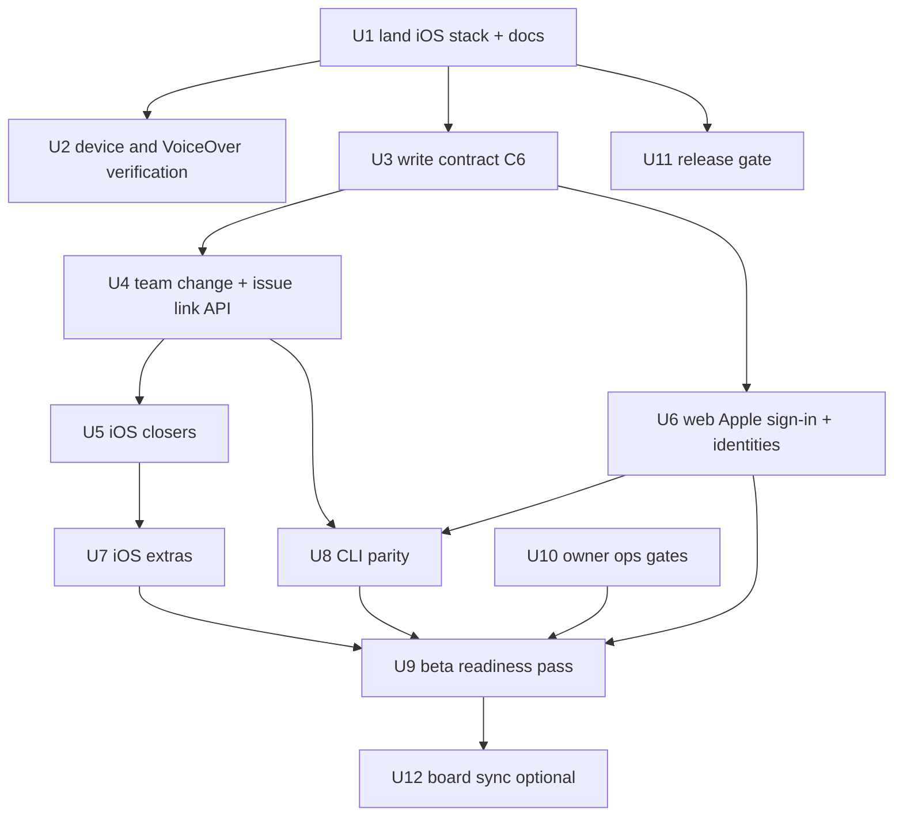

# Tallyline Cloud Beta Roadmap - Plan

## Goal Capsule

- **Objective:** The owner can run all of their own work on the hosted Tallyline from the web, the iPhone and the CLI, trust that nothing they write is lost or silently overwritten, and invite a few other people, with every shipped surface verified on real hardware rather than assumed.
- **Means:** Close the gaps that separate "shipped to TestFlight" from "usable every day": land and verify the iOS stack, make writes safe (C6), finish the missing cross-surface features, then gate the cloud beta on owner-only ops. Units are ordered by daily-use value. (KTD1, KTD2)
- **Authority:** This plan sequences work. Unit specs that already exist stay in their plans and are cited, not copied. [docs/plans/CE-PLAN.md](./CE-PLAN.md) stays the ledger for pricing and the identity track; this plan supersedes its section 6 ordering for work after 2026-11-04.
- **Stop:** Do not open public signup, flip `BILLING=on`, or submit to App Review inside this milestone. Those start the next milestone (see Scope Boundaries).
- **Who ships:** An implementing agent builds and tests units locally and opens PRs. The owner merges, runs every deploy decision, performs on-device checks, and holds all Apple, host and credential steps.

## Problem Frame

State as of 2026-11-04, read from `main` at the commit that merged #240 and from the open PR list.

- Most agent-buildable units of the PM-ready and self-hosted programs have shipped. [ROADMAP.md](../../ROADMAP.md) still reads "None buildable" and is dated 2026-10-31. It misses Sign in with Apple (#241), the semver iOS release tag (#242), public intake and the helpdesk (#240) and the iOS rebuild.
- The iOS UI rebuild (all 12 units of [the iOS plan](./2026-11-03-1400-feat-ios-projects-roadmap-native-plan.md)) lives in seven stacked PRs, #244 to #250, and in `release/ios-v1.1.0`, which was tagged `ios-v1.1.0` and shipped to TestFlight. None of it is on `main`. Until it lands, `main` and the installed app disagree, and a hot fix on `main` would build the old UI.
- The shipped build has had no device, VoiceOver or signed-in snapshot verification. The `testflight` environment has no required reviewer, so any `ios-v*` tag publishes a build without a human gate.
- Known product gaps on iOS: no team change (the API cannot patch a team), no shareable issue link, no alternate icons, no workspace switching, no test notification, no TestFlight feedback row, no Blocked rotor, no roadmap snap-scroll.
- Two correctness gaps cross every client: writes have idempotency keys on the server but no documented conflict contract (a stale write can overwrite silently; C6 in the CE ledger), and web has no Sign in with Apple while iOS does.
- The hosted API at `api.tallyline.app` is deployed separately from the repo. This plan does not assume who deploys. A second automated session is also known to deploy, so ownership is an explicit open question, not a default.
- Intake work orders #232 to #239 are still open on the repo although #240 merged. The plan board and the repo have drifted.

## Product Contract

### Requirements

- R1. `main` contains everything shipped as `ios-v1.1.0`, reached by merging the stacked PRs in order, each retargeted to `main` before the previous one merges.
- R2. The shipped iOS build is verified on a physical iPhone and iPad in light and dark, with VoiceOver and Dynamic Type, and by checked-in signed-in snapshot tests that run without network.
- R3. A TestFlight upload requires a named human approval.
- R4. Every issue and comment mutation from web, iOS and the CLI carries an idempotency key, and a stale write fails with a recoverable `409 STALE_WRITE` that carries the server version. No write is silently overwritten.
- R5. A user can change an issue's team through the API, web, iOS and CLI.
- R6. Every issue has one stable link that opens it on web, and opens it in the iOS app when the app is installed; "Copy link" exists on iOS and web.
- R7. iOS gains the Blocked rotor, roadmap snap-scroll, workspace switching, a test-notification row, a TestFlight feedback row, and alternate icons, each only where its backing capability exists.
- R8. A person can sign in to web with Apple and see linked identities in Settings, matching iOS.
- R9. The CLI covers the new API surface (team change, issue link) and `doctor` reports whether the hosted server advertises Apple sign-in and write-contract support.
- R10. The owner-only ops gates (backups, restricted deploy user, push relay, App Review demo access) each have a verified checklist, so none blocks the beta by being unknown.
- R11. Docs match reality: ROADMAP.md, the CE ledger and the iOS plan state what is shipped.
- R12. Optional: each unit is mirrored as an issue on the hosted board, in a project per repo, without duplicating existing items.

### Success Criteria

- The owner can install the build from `main`, sign in with Apple, work a full day of issues offline and online, and see no lost or overwritten edit.
- Every UI unit passes the polish bar: design tokens only, one accent per screen, few primary actions, spring motion, checked in light and dark.
- No test in this plan makes a live call.

### Scope Boundaries

**Deferred to Follow-Up Work (next milestone, "public cloud"):** extending the write contract to labels, relations, projects, cycles and bulk updates; Stripe checkout and `BILLING=on` (C3), pricing page copy (W3), opening public signup, App Store submission and external TestFlight (S7), Google sign-in on iOS, Icon Composer assets beyond the optional unit.

**Outside this milestone's identity:** Attachments, rich-text comments, rewriting MCP, cloning Linear features for their own sake.

**Owner-only, never done by an agent:** Apple Developer console changes, App Store Connect, host access, secrets, GitHub environment settings, merging, deploying.

## Planning Contract

### Key Technical Decisions

- KTD1. **Merge before building more.** U1 lands the iOS stack first because every later iOS unit builds on it and a fix on `main` would otherwise ship the old UI. Chosen over rebasing the new work onto the release branch, which would leave `main` permanently behind.
- KTD2. **Order by daily-use value, owner-gated work in parallel.** Data safety and the shipped build outrank new features, so U1 to U4 precede features. Owner-only gates (U10) run beside, never inside, the agent queue.
- KTD3. **One write contract, owned by the API.** C6 is specified in [CE-PLAN.md](./CE-PLAN.md) section 5.1; U3 implements it and U4 to U7 consume it. Clients never invent per-screen conflict handling.
- KTD4. **Issue link is the web permalink.** `https://<web origin>/issues/<KEY>` already exists in `apps/web/app/(app)/issues/[key]/page.tsx`. iOS opens it through an associated-domains universal link rather than a second custom scheme; the existing `tallyline://open/...` scheme stays for in-app and push routing.
- KTD5. **Deploys are never assumed.** Each unit that changes `apps/api` ends with a "Deploy" line stating "owner decides who and when". The plan names no deployer. The deploy-ownership question is U10's first output.
- KTD6. **Tests run offline.** API tests use the existing Vitest fixtures and stubbed identity provider; iOS tests use `TALLYLINE_CORE_ONLY=1 swift test` plus snapshot tests against recorded fixtures; web tests use typecheck and component tests. Live checks are listed as owner steps, never as automated gates.
- KTD7. **Board sync reuses plan import.** U12 uses the existing `tallyline import-plan` dry-run/apply flow ([docs/import.md](../import.md)), which is idempotent and diff-hashed, instead of new sync code.

### Assumptions

- The next milestone the owner can call "done" is **Cloud beta**: invite-only, Free tier, all three clients verified, owner ops gates green. Money and public signup are the milestone after. If the owner wants billing inside this milestone, add C3 as a unit after U9.
- `docs/plans/2026-11-02-001-feat-app-review-demo-access-plan.md` is cited by the CE ledger but is not on `main`. U10 treats the App Review demo plan as unwritten and writes it only if the owner confirms it is needed for this milestone.
- The seven stacked PRs are green on their own checks; U1 re-verifies rather than trusts this.

### Sequencing

## Implementation Units

| U-ID | Title | Primary files | Depends on |
|---|---|---|---|
| U1 | Land the iOS stack on main and reconcile docs | `ROADMAP.md`, `docs/plans/CE-PLAN.md`, iOS plan | none |
| U2 | Device, VoiceOver and snapshot verification | `apps/ios/Tests`, `apps/ios/README.md` | U1 |
| U11 | Release gate for TestFlight | `.github/workflows/ios-release.yml`, `docs/releasing.md` | U1 |
| U3 | Write contract C6 | `apps/api/src/lib/idempotency.ts`, `apps/ios/Sources/TallylineCore/Outbox.swift` | U1 |
| U4 | Team change and issue link API | `apps/api/src/routes/issues.ts` | U3 |
| U5 | iOS closers: team, Copy link, Blocked rotor, snap-scroll | `apps/ios/Sources/tallyline_ios` | U4 |
| U6 | Web Apple sign-in and linked identities | `apps/web/app/(auth)`, `apps/api/src/routes/apple-auth.ts` | U3 |
| U7 | iOS extras: workspace switching, test notification, feedback row, alternate icons | `apps/ios/Sources/tallyline_ios` | U5 |
| U8 | CLI parity and doctor | `tools/cli/src` | U4, U6 |
| U10 | Owner ops gates | `docs/next-tasks.md`, `docs/deploy.md` | none |
| U9 | Cloud beta readiness pass | `docs/plans`, `ROADMAP.md` | U6, U7, U8, U10 |
| U12 | Sync units to the hosted board (optional) | none in repo | U9 |

Order of execution is the row order above read top to bottom within dependency limits: U1, U2 and U11 and U10 in parallel, then U3, U4, U5, U6, U7, U8, U9, U12. U-IDs are stable; the numbering reflects discovery, not order.

### U1. Land the iOS stack on main and reconcile docs

**Goal:** `main` equals the shipped iOS state and the written status equals reality.

**Requirements:** R1, R11.

**Dependencies:** None. Owner decides the merge moment.

**Files:** `ROADMAP.md`, `docs/plans/CE-PLAN.md`, `docs/plans/2026-11-03-1400-feat-ios-projects-roadmap-native-plan.md`, `docs/plans/2026-11-03-1600-feat-intake-helpdesk-agent-first-home-plan.md`, `docs/plans/2026-10-31-0100-feat-error-intake-automation-plan.md`.

**Approach:**
- Prepare the merge order #244 to #250, each retargeted to `main` before its parent merges, because merging a stack onto a deleted base strands work. The agent prepares the sequence and checks CI per PR; the owner presses merge.
- Confirm `main` after the last merge builds the same tree as `release/ios-v1.1.0` (diff the two); record any difference as a follow-up unit instead of resolving it silently.
- Update ROADMAP.md: move Sign in with Apple, semver release tags, intake and helpdesk and the iOS rebuild into Done; refresh the "needs owner" table; replace the stale "None buildable" line with a pointer to this plan.
- Update CE-PLAN.md section 5 statuses (C1a to C1b, I1, C4, W4, I4, I5 shipped) and set plan frontmatter on the iOS and intake plans to reflect shipped units (drop `status: draft`; plans carry no status, so delete the field).

**Test scenarios:**
- Test expectation: none -- documentation and merge sequencing only.

**Verification:** `git diff origin/main release/ios-v1.1.0 --stat` for `apps/ios` is empty after the merges, or every remaining difference is a recorded follow-up issue named in the PR; ROADMAP.md lists no shipped item as open; every link in the touched docs resolves.

### U2. Device, VoiceOver and snapshot verification

**Goal:** Prove the shipped iOS build behaves, using checked-in tests for what can be automated and a written protocol for what cannot.

**Requirements:** R2.

**Dependencies:** U1.

**Files:** `apps/ios/Tests/TallylineSnapshotTests/` (new), `apps/ios/Tests/Fixtures/` (recorded API JSON, no secrets), `apps/ios/README.md` (verification protocol section).

**Approach:**
- Snapshots need the iOS SDK, so they run through an `xcodebuild test` invocation on a simulator destination in a macOS CI job, not host `swift test`; the unit names the snapshot library (added to `project.yml`) and the job. Add snapshot tests per root screen (Now, Issues, Projects, Roadmap, Review, Detail, Create, Settings) in light and dark, at default and the largest accessibility text size, driven by recorded fixtures through the existing mock client.
- Add an accessibility audit test per screen where the toolchain supports it (labels present on every control, no unlabeled image buttons).
- Write the owner's device protocol: iPhone and iPad checklist covering VoiceOver reading order, rotor, Dynamic Type, Reduce Motion, signed-in cold launch from a push, offline outbox state strip. The owner runs it; results go in the README as a dated list of pass/fail items.
- Record every defect found as an issue, not as silent edits to this plan.

**Patterns to follow:** `apps/ios/Tests/TallylineCoreTests/OutboxTests.swift` for fixture style; the accessibility pass in #218.

**Test scenarios:**
- Happy path: each of the eight screens renders a snapshot in light and dark from fixtures and matches the committed reference.
- Edge case: the largest accessibility text size does not truncate the issue key or title below one line each and does not overlap the pinned composer.
- Edge case: an empty workspace fixture renders each root's empty state with exactly one action.
- Error path: an outbox-parked fixture renders the parked state with a retry action and a VoiceOver label naming the failure.
- Integration: a signed-in fixture session reaches Now without any network call (the mock client records zero outbound requests).

**Verification:** the simulator test run passes offline with the new snapshots; a dated owner protocol result exists for one iPhone and one iPad.

### U11. Release gate for TestFlight

**Goal:** No `ios-v*` tag publishes a build without a named human approval.

**Requirements:** R3.

**Dependencies:** U1.

**Files:** `.github/workflows/ios-release.yml`, `docs/releasing.md`, `apps/ios/README.md`.

**Approach:**
- The workflow already declares `environment: testflight`; the missing piece is the repository setting. This is an owner step: add at least one required reviewer to the `testflight` environment and restrict it to `main` and `ios-v*` tags. The unit records the exact steps in docs/releasing.md and adds a workflow preflight step (a script runnable locally, with the checkout set to `fetch-depth: 0` so `origin/main` history exists) that fails with a clear message when the tag is not reachable from `main` (so a release branch cannot ship what `main` lacks).
- Do not touch secrets or runner configuration.

**Test scenarios:**
- Happy path: the preflight passes for a tag on a commit reachable from `main`.
- Error path: the preflight fails with the named message for a tag on a commit that is not an ancestor of `main`.
- Test expectation for the environment setting: none -- an owner action verified by the next release run waiting for approval.

**Verification:** A release run shows "waiting for review" before any signing step; docs/releasing.md states the setting and who holds it.

### U3. Write contract C6

**Goal:** Replaying any write is a no-op and a stale write fails recoverably, on every client.

**Requirements:** R4.

**Dependencies:** U1.

**Files:** `apps/api/src/lib/idempotency.ts`, `apps/api/src/routes/issues/core.ts`, `apps/api/src/routes/issues/comments.ts`, `apps/api/src/openapi.ts`, `apps/api/src/routes/issues/core.test.ts` (colocated tests), `apps/ios/Sources/TallylineCore/Outbox.swift`, `apps/ios/Sources/TallylineCore/TrackerClient.swift`, `apps/ios/Tests/TallylineCoreTests/OutboxTests.swift`, `apps/web/lib/` (the shared fetch wrapper), `docs/offline-sync.md`.

**Approach:**
- Follow the contract text in CE-PLAN.md C6; U3 adds to it only the mechanics: a per-issue version (or `updatedAt` etag) returned on reads and sent on writes, `409 STALE_WRITE` with the current server representation, and an OpenAPI schema for both.
- Covers issue create, issue patch and comment create, the routes that carry the idempotency middleware today.
- The shipped Outbox retries every 409 (the existing idempotency middleware uses 409 for "first request still in flight"). The classifier must branch on the error body code: `STALE_WRITE` parks as needs-decision, the in-flight 409 stays retryable. The API returns `STALE_WRITE` only when the client sent a version, so shipped builds never see it.
- Reuse the error body shape of the existing `STALE_DIFF` 409 so clients parse one shape.
- The per-issue version type (an integer column versus `updatedAt`) is the first decision of the unit and is recorded in the PR; it must not break the delta cursor.
- iOS Outbox treats `STALE_WRITE` as a recoverable state: fetch, show the single-line "changed elsewhere" prompt with Keep mine / Use theirs, never retry silently.
- Web uses one optimistic-update helper that rolls back on `STALE_WRITE` and shows the same prompt.
- Document the shape once in docs/offline-sync.md.
- Deploy: owner decides who and when; clients must tolerate an API that predates this change (missing version field means "no precondition").

**Execution note:** Start with failing API contract tests for replay and stale write, then wire clients.

**Test scenarios:**
- Happy path: replaying a create with the same key returns the original result and creates no second issue.
- Happy path: an update with the current version succeeds and returns the new version.
- Error path: an update with an old version returns `409 STALE_WRITE` carrying the current server issue.
- Edge case: a write with no version header against the new API succeeds (backward compatibility with the shipped TestFlight build).
- Edge case: an in-flight idempotency 409 is retried while `STALE_WRITE` is parked (one `OutboxTests` case each).
- Edge case: two queued outbox writes to one issue, the first bumping the version, resolve in order without a false conflict.
- Integration: the iOS outbox receives `STALE_WRITE`, parks the item as "needs decision", and a Use theirs choice drops the local patch.
- Integration: web optimistic update rolls back the visible value on `STALE_WRITE`.

**Verification:** API Vitest, iOS core tests and web typecheck pass offline; OpenAPI lists the 409 body; the shipped build still syncs against the new API fixtures.

### U4. Team change and issue link API

**Goal:** The API supports changing an issue's team and returns one stable link per issue.

**Requirements:** R5, R6.

**Dependencies:** U3.

**Files:** `apps/api/src/routes/issues/core.ts`, `apps/api/src/services/issues.ts`, `apps/api/src/openapi.ts`, `apps/api/src/routes/issues/core.test.ts`, `apps/ios/Tests/Fixtures/`, `apps/web/app/(app)/issues/[key]/` and its component tests.

**Approach:**
- Allow `teamId` on issue patch, honoring workspace tenancy, per-team key reassignment rules and the C6 version precondition. A moved issue gets a new key (team key plus per-team number) and keeps its old key as a resolving alias, so copied links, push deep links and CLI references never 404 (R6). Store aliases in a dedicated table or column; the mechanism is the unit's implementation choice.
- Add a computed `url` to the issue representation built from the configured web origin, so clients never assemble links.
- Emit an activity event for the team move.
- Deploy: owner decides who and when.
- Web: add a team control to the issue detail property bar and a "Copy link" item in the issue menu, both through the shared C6 optimistic helper; no new buttons on rows.

**Patterns to follow:** existing patch handler validation and event writing in the issues route; tenancy tests in `apps/api/test/tenancy.test.ts`.

**Test scenarios:**
- Happy path: patching `teamId` to another team in the same workspace moves the issue and logs one event.
- Error path: a team from another workspace returns 404, not 403.
- Error path: an agent key without write scope is refused.
- Edge case: moving to the current team is a no-op with no event.
- Edge case: the old key still resolves to the moved issue, including through `/issues/<old KEY>` on web.
- Happy path (web): changing the team in issue detail updates the control and Copy link copies the `url`; a `STALE_WRITE` shows the shared prompt.
- Integration: the issue payload `url` equals the web permalink for the key and uses the configured origin.

**Verification:** API tests pass; the OpenAPI document and iOS fixtures include `teamId` patch and `url`.

### U5. iOS closers: team, Copy link, Blocked rotor, snap-scroll

**Goal:** Close the iOS gaps whose backing API now exists.

**Requirements:** R5, R6, R7 (Blocked rotor, snap-scroll).

**Dependencies:** U4.

**Files:** `apps/ios/Sources/tallyline_ios/Detail/PropertySheet.swift`, `apps/ios/Sources/tallyline_ios/Detail/IssueDetailView.swift`, `apps/ios/Sources/tallyline_ios/Roadmap/`, `apps/ios/Sources/tallyline_ios/Shell/`, `apps/ios/project.yml` (associated domains), `apps/ios/Sources/TallylineCore/` (link routing), `apps/ios/Tests/`.

**Approach:**
- Team pill in the property sheet writes through the outbox (U3 contract); the pill is the only new control.
- "Copy link" lives in the issue context menu and the detail toolbar menu, copying the API `url`; no new button on the row.
- Universal link handling routes `https://<web origin>/issues/<KEY>` to the detail screen. The associated-domains entitlement and the association file on the web origin are owner steps (U10); the unit ships the routing behind the capability so it degrades to opening the browser.
- Blocked rotor: a custom accessibility rotor on the Issues and Now lists that jumps between blocked issues, driven by existing relation data.
- Roadmap snap-scroll: paging by milestone column using the native scroll-target behavior, spring settle, honoring Reduce Motion.
- Polish bar: tokens only from `TallylineDesign`, one accent per screen, springs from the motion tokens, no custom glass; each changed screen is snapshot-checked in light and dark.

**Test scenarios:**
- Happy path: changing the team in the sheet enqueues one patch with the version precondition and updates the pill optimistically.
- Happy path: Copy link places the exact `url` on the pasteboard (injected pasteboard in test).
- Happy path: opening a universal link for an existing key lands on that issue with a back stack.
- Edge case: a link for an unknown key shows the not-found state, not a crash.
- Edge case: the Blocked rotor lists zero entries and is absent when no issue is blocked.
- Edge case: snap-scroll with Reduce Motion enabled settles without animation.
- Error path: team change returning `STALE_WRITE` shows the U3 prompt.
- Integration: snapshots for property sheet, detail menu and roadmap in light and dark match references.

**Verification:** core tests and the simulator snapshot run pass offline; owner checks the rotor with VoiceOver and a pasted link on a device (added to the U2 protocol).

### U6. Web Apple sign-in and linked identities

**Goal:** Web signs in with the same Apple identity as iOS and shows linked providers.

**Requirements:** R8.

**Dependencies:** U3 (shared contract only); live use needs the owner's Apple Services ID (open question OQ4 in CE-PLAN.md).

**Files:** `apps/api/src/routes/apple-auth.ts`, `apps/api/src/auth/providers/apple.ts`, `apps/api/src/auth/providers/providers.test.ts`, `apps/web/app/(auth)/`, `apps/web/app/(app)/settings/` (security page), `apps/web/components/`, `docs/auth.md`.

**Approach:**
- Add the web authorize and callback path for the Services ID, reusing the existing Apple provider and `resolveIdentity`; add Apple to `/v1/auth/methods` only when configured.
- Login shows the Apple button beside password; hidden when the method is absent.
- Settings > Security lists linked identities (provider, linked date, relay-email marker) with the disconnect rule documented: the last sign-in method cannot be removed.
- Polish bar: the Apple button follows Apple's mark guidance; it is the screen's only accent, password stays secondary; verify light and dark.
- Deploy and Apple console configuration: owner steps.

**Test scenarios:**
- Happy path: callback with a stubbed valid identity token signs in the existing user matched by `sub`.
- Happy path: `/v1/auth/methods` lists Apple only when the Services ID env is set.
- Error path: invalid audience, expired token and bad signature are rejected with no session.
- Edge case: hidden relay email still resolves by `sub`, not email.
- Edge case: disconnecting the last method is refused.
- Integration: web sign-in and iOS sign-in with the same stubbed `sub` resolve to one user.

**Verification:** API and web tests pass offline against the stubbed identity provider; live sign-in is an owner check once the console is configured.

### U7. iOS extras: workspace switching, test notification, feedback row, alternate icons

**Goal:** Ship the remaining iOS settings capabilities that have real backing, and hide the rest.

**Requirements:** R7.

**Dependencies:** U5.

**Files:** `apps/ios/Sources/tallyline_ios/Settings/`, `apps/ios/Sources/TallylineCore/` (session and workspace), `apps/api/src/routes/` (test push endpoint if absent), `apps/ios/Tests/`, `docs/push.md`.

**Approach:**
- Workspace switching: a switcher in the Settings account group and the profile sheet, scoped caches per workspace, outbox items tagged by workspace. Only shown when the user belongs to more than one workspace.
- Test notification row: calls the push relay's sandbox test through the API; shown only when the server reports push configured; otherwise the row is absent, not disabled.
- TestFlight feedback row: opens the system TestFlight feedback path; shown only in TestFlight builds.
- Alternate icons: the picker ships only when the optional layered icon assets exist in `apps/ios`; otherwise the unit lands the code path dark (hidden). Assets are an owner or design step.
- Deploy (if a test-push endpoint is added to `apps/api`): owner decides who and when.
- Polish bar as in U5; one row per capability, no new tab, no new accent.

**Test scenarios:**
- Happy path: switching workspace swaps caches and shows only that workspace's issues.
- Edge case: a single-workspace user sees no switcher.
- Edge case: outbox items created in workspace A are not replayed into workspace B after a switch.
- Edge case: test notification row is absent when the server reports push off.
- Edge case: feedback row absent in a non-TestFlight build (injected build-channel flag).
- Error path: test notification failure shows one inline error with retry.
- Integration: snapshots of Settings in the four capability combinations, light and dark.

**Verification:** core tests and the simulator snapshot run pass offline; owner sends one sandbox push to a test build (needs the push relay, U10).

### U8. CLI parity and doctor

**Goal:** The CLI covers the new API surface and reports hosted-server readiness.

**Requirements:** R9.

**Dependencies:** U4, U6 (the auth-methods check).

**Files:** `tools/cli/src/commands.ts`, `tools/cli/src/doctor.ts`, `tools/cli/src/doctor.test.ts`, `tools/cli/src/cli.test.ts`, `tools/cli/README.md`, `tools/cli/docs/`.

**Approach:**
- `tallyline move-team <KEY> <TEAM>` and `tallyline link <KEY>` (flat verbs, matching existing commands such as `state` and `show`) (prints the API `url`), following existing command conventions and exit codes; both send the write-contract headers and surface `STALE_WRITE` with the current value and a non-zero exit.
- `doctor` gains checks: server advertises Apple among auth methods, server supports the write contract, clock skew. Each failing check prints one line and the fix.
- Live `connect` and `doctor` against the hosted server is an owner step; tests use the existing HTTP stubs.

**Test scenarios:**
- Happy path: `move-team` sends the patch with a key and version and prints the new key.
- Happy path: `link` prints exactly the `url` field.
- Error path: `STALE_WRITE` exits with the documented code and prints the server value.
- Edge case: `doctor` against an older server reports "write contract not advertised" as a warning, not a failure.
- Edge case: `--json` output stays machine-readable for every new command.

**Verification:** `pnpm --filter` CLI tests pass offline; README lists the new commands.

### U10. Owner ops gates

**Goal:** Every owner-only gate has a current, verifiable checklist, and deploy ownership is written down by the owner.

**Requirements:** R10.

**Dependencies:** None; runs in parallel.

**Files:** `docs/next-tasks.md`, `docs/deploy.md`, `docs/push.md`, `docs/releasing.md`.

**Approach:**
- Add a **Deploy ownership** section to docs/deploy.md with a table: surface (API host, web front end, push relay, iOS), who deploys, how a deploy is announced, how it is verified. The cells ship empty with a note that the owner fills them; the plan does not fill them. Any other automated session that deploys is listed by role, not by name.
- Refresh docs/next-tasks.md order to this plan's priority: backups first (data safety), then restricted deploy user, then push relay, then Apple associated-domains and Services ID (needed by U5 and U6), then App Review demo access if the owner confirms it is in scope.
- For each gate, state the input the owner supplies and the check that proves it, as the file already does; this unit only reorders and adds the new Apple items and the deploy table.
- Never include a credential, key location or host detail.

**Test scenarios:**
- Test expectation: none -- documentation; verified by the owner marking each checklist item with a date as they complete it.

**Verification:** docs/deploy.md has the empty ownership table; next-tasks.md order matches the order listed in this unit's Approach.

### U9. Cloud beta readiness pass

**Goal:** One checklist run proves the milestone, and the docs say so.

**Requirements:** R11 and all Success Criteria.

**Dependencies:** U6, U7, U8, U10.

**Files:** `docs/plans/CE-PLAN.md`, `ROADMAP.md`, `CHANGELOG.md`, `docs/next-tasks.md`.

**Approach:**
- Run the Verification Contract end to end; list failures as issues.
- Walk the owner's day-in-the-life script: sign in with Apple on web and phone, create, edit offline, reconnect, resolve one stale write, move a team, copy and open a link, connect an agent over MCP, intake one report.
- Update CE-PLAN.md Definition of Done boxes, ROADMAP.md Done table, and CHANGELOG.md.
- Call the milestone done only when every Definition of Done item is checked or explicitly deferred by the owner.

**Test scenarios:**
- Test expectation: none -- an integration checklist over earlier units' tests.

**Verification:** Definition of Done below is fully checked.

### U12. Sync units to the hosted board (optional)

**Goal:** The hosted board, the owner's roadmap of record, mirrors these units as work items, one project per repo.

**Requirements:** R12.

**Dependencies:** U9 recommended, but runnable any time after this plan merges.

**Files:** none in the repo (CLI and API calls only).

**Approach:**
- Credential comes from the owner's local secret store at run time. It is never echoed, logged, written to a file or placed in an argument visible to other processes. Skip the unit if the secret is locked or empty; an empty value must not be piped anywhere.
- Use the CLI import (`tallyline import-plan`, [docs/import.md](../import.md)) against this plan file: dry run, read the diff, then apply with the printed diff hash, scoped to the Tallyline project in the hosted workspace. Re-running reports everything unchanged.
- Close open intake work orders #232 to #239 on the repo and the board only if the owner confirms they are done (their PR #240 merged).
- Never write historical state (`--historical`) unless the owner asks.

**Test scenarios:**
- Test expectation: none -- operational; verified by the dry-run diff and a second run reporting zero changes.

**Verification:** Second dry run shows all units unchanged; the board's Tallyline project lists U1 to U12.

## Verification Contract

| Gate | Check |
|---|---|
| API | `pnpm --filter @tallyline/api exec vitest run` |
| Web | `pnpm --filter @tallyline/web typecheck` and the web component tests |
| iOS core | `TALLYLINE_CORE_ONLY=1 swift test` in `apps/ios`; `xcodebuild test` on a simulator destination for snapshots, in a macOS job |
| CLI | the CLI package's Vitest suite and typecheck |
| Repo | the existing `check.yml` workflow, including palette lint and the design gates |
| Design | Every UI unit's PR includes light and dark snapshots; tokens only, one accent per screen, springs from motion tokens |
| Live (owner only) | On-device protocol (U2), sandbox push (U7), Apple sign-in (U6), hosted `doctor` (U8) |

No automated gate calls a live service, Apple, a model or the hosted API.

## Definition of Done

- [ ] `main` contains the shipped iOS UI and ROADMAP.md, CE-PLAN.md and the iOS plan state the truth (U1).
- [ ] Device, VoiceOver and snapshot verification recorded for iPhone and iPad (U2).
- [ ] A TestFlight upload waits for a named approval (U11).
- [ ] Replayed issue and comment writes are no-ops and stale writes fail recoverably on web, iOS and CLI (U3, U8).
- [ ] Team change and Copy link work end to end on API, web, iOS and CLI (U4, U5, U8).
- [ ] Web and iOS Apple sign-in resolve to one user (U6).
- [ ] iOS extras ship or are hidden by capability (U7).
- [ ] Owner ops gates each carry a dated check, deploy ownership table filled by the owner (U10).
- [ ] The readiness walk-through passes (U9).
- [ ] Abandoned experimental code from any unit is removed from the diff.
- [ ] Optional: board mirrors the units (U12).

## Risks and Dependencies

- Merging the stack out of order strands work; retarget each PR to `main` before its parent merges (U1).
- Apple console steps (Services ID, associated domains) are owner-only and may slip; U5 and U6 ship dark behind capability flags and are not blocked on them.
- An API change in U3 or U4 reaching the shipped TestFlight build before the client does can break it; both changes must tolerate older clients.
- Deploys are decided by the owner; if two automated sessions deploy the same API, an unannounced deploy could race a unit's verification. U10's ownership table is the mitigation.
- Public repo: no host names beyond the public product domains, no credentials, no personal paths in any unit.

## Open Questions

- **Deploy ownership (blocking for any unit that changes `apps/api`):** who deploys the API and web front end, and does a second automated session also deploy? U10 records the answer; until then every API unit stops at "PR open, deploy not assumed".
- Is the write contract (U3) limited to issue and comment mutations for this milestone, and does a moved issue keep its old key as an alias (U4)? Both are assumed yes; say so if not.
- Is "Cloud beta" (invite-only, free tier) the right next milestone, or should Stripe and public signup join this one?
- Should the stale-write conflict prompt offer a merge, or only Keep mine / Use theirs? (Deferred to U3 implementation unless the owner wants merge.)
- Does the App Review demo access plan still need writing for this milestone?

## Sources

- [ROADMAP.md](../../ROADMAP.md), [docs/plans/CE-PLAN.md](./CE-PLAN.md), [docs/next-tasks.md](../next-tasks.md)
- [iOS plan](./2026-11-03-1400-feat-ios-projects-roadmap-native-plan.md), [intake and helpdesk plan](./2026-11-03-1600-feat-intake-helpdesk-agent-first-home-plan.md)
- Open PRs #244 to #250; merged #240 to #243; release tag `ios-v1.1.0`
- [docs/import.md](../import.md), [docs/releasing.md](../releasing.md), [DESIGN.md](../../DESIGN.md)
