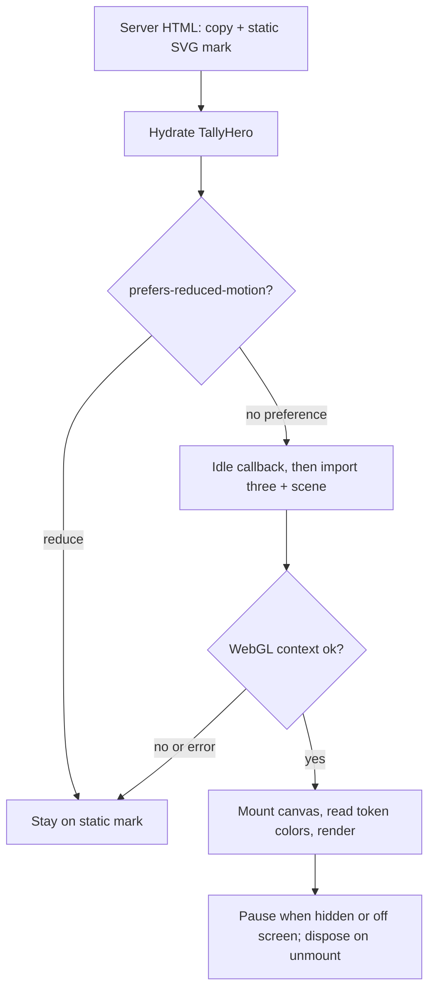

# Face-lift: grouped sidebar, refreshed chrome, public landing

## Goal Capsule

- **Objective:** A client who opens Tallyline finds their projects, tickets and roadmap progress quickly from a clear sidebar, and a visitor who is not signed in sees an honest public page that says what Tallyline is.
- **Means:** Describe the grouped sidebar as data in `apps/web/lib/sidebar-nav.ts` and render it from `apps/web/components/app/shell.tsx` (KTD1, KTD2), refresh chrome with existing tokens only (KTD3), and rework the existing logged-out landing around one lazy three.js hero (KTD4, KTD5).
- **Authority:** `DESIGN.md` is the design contract. `AGENTS.md` and the owner rules below outrank this plan. Branch off `origin/feat/portfolio-overview` (PR #270, stacked on #269); the PR is a draft with that base.
- **Execution profile:** Web only (`apps/web`, `tools/e2e`, docs). No API, schema or migration change.
- **Stop conditions:** Do not merge (merging to `main` auto-deploys tallyline.app). Do not deploy. Stop if `pnpm lint:design`, `pnpm test:contrast` or the axe suite cannot be made to pass without a new color.
- **Finish:** `ce-work` implements; the caller opens the draft PR and starts CI.

## Product Contract

### Summary

Tallyline is the client-facing hub for tickets and repo roadmap progress; projects are repos. This phase changes how it looks and navigates, not what it stores. The sidebar gets grouped sections and a project switcher. The app chrome (headers, spacing, density) is tidied against `DESIGN.md`. The logged-out `/` becomes a refreshed landing page with one restrained three.js hero.

### Problem Frame

The sidebar is a flat "Work" list of eight items plus a "Workspace" block. Projects, the client's unit of work, are not in it at all; they live behind Overview. The landing page exists and is honest, but its hero is a DOM board loop, and the owner wants a single considered 3D hero that carries the brand mark (four tally strokes struck by one azure line) without hurting load time, accessibility or indexability.

### Requirements

**Sidebar**

- R1. The desktop sidebar shows these groups, defined once in U1: Workspace (Overview, My issues, Inbox), Work (Triage, Review, Board, Issues, Support), Projects (project list), Planning (Roadmap, Cycles), Views (saved views, when any), and Settings (Activity, Insights, Settings for owner and admin) (KTD1).
- R2. A project switcher in the sidebar lists the workspace's projects, opens `/projects/:id`, and marks the current project. It is a keyboard-operable listbox-style popover, positioned `fixed` or portaled so the scrolling nav cannot clip it, and works at the rail width.
- R3. The sidebar collapses to a rail on desktop (button and `[`), remembers the choice per device, and on viewports under 1024px is a drawer opened from the top bar, closed by Escape, backdrop or navigation.
- R4. Keyboard navigation keeps working: `g`-sequences in `apps/web/components/global-nav.tsx`, `[`, and Cmd+K. Every item's hint matches its real `g` binding.

**Chrome**

- R5. Page headers, the mobile top bar and sidebar spacing follow `DESIGN.md` density (rows 32 to 40px, 4px base, 1px lining, one elevation level) and use only existing tokens. `pnpm lint:design` passes: per-file counts in `apps/web/lint-design-allowlist.json` may only go down (lower them with `pnpm lint:design --update-allowlist` in the same change), and every new file has zero violations. Type sizes use the named scale classes the lint accepts, never `text-[Npx]`.

**Landing**

- R6. Logged-out `/` renders server-side copy that is indexable (heading, paragraphs, links in the HTML response, page-level `title` and `description`).
- R7. The hero is one three.js scene built from the tally-mark idea. It is lazy-loaded after first paint, so the server-rendered `h1` stays the LCP element and the static mark adds no layout shift. It never loads for `prefers-reduced-motion: reduce` (static mark stays) and falls back to the static mark when WebGL is unavailable or errors.
- R8. Colors in the scene come from the design tokens read from CSS custom properties at runtime. No new hex values, no new 3D dependency.
- R9. Copy is honest: a self-hostable, agent-native issue tracker. The word "AI" does not appear in landing copy, and there are no invented stats, logos or testimonials.
- R10. Text links on the landing are distinguishable without color (underline), so axe `link-in-text-block` passes.

**Verification**

- R11. `tools/e2e/tests/a11y.spec.ts` covers the new landing in both themes, with the hero loaded and with reduced motion. `pnpm test:contrast`, `pnpm lint:design`, typecheck, lint and unit tests pass.

### Key Decisions

- **Project switcher placement.** It sits under the workspace header in the sidebar, above the nav (session-settled: user-directed — chosen over a top-bar breadcrumb switcher: the owner specified the switcher as part of the sidebar). Governs R2.
- **Hero technology.** Use the installed `three`, not `anomalyco/rune` (session-settled: user-directed — chosen over rune: it has no license and is Rust-native). Governs R7, R8.

### Scope Boundaries

- Not in scope: new API endpoints, a client or guest role, project-scoped issue filtering beyond the existing `/projects/:id` page, iOS.
- Outside this change: pricing, hosted-plan claims, any new marketing pages beyond `/`.

#### Deferred to Follow-Up Work

- Retarget this stack to `main` after #269 and #270 merge.

## Planning Contract

### Key Technical Decisions

- KTD1. **Navigation is data, not JSX.** Move the item lists into `apps/web/lib/sidebar-nav.ts` as a pure function from `{role, counts, projects, views, pathname, search}` to sections. The shell renders it. This makes grouping, active-state rules and hint/`g`-binding parity unit-testable without a browser. (session-settled: user-directed — chosen over leaving the flat Work list: the owner asked for grouped sections.)
- KTD2. **One `GOTO` source.** Export the `g`-sequence map from a small module imported by both `global-nav.tsx` and `sidebar-nav.ts`, and assert in a unit test that every nav hint maps to a route. Items without a binding show no hint.
- KTD3. **Tokens only.** Chrome edits use existing Tailwind token classes (`bg-surface-*`, `border-lining*`, `text-ink-*`). No arbitrary colors, no new custom properties. The Projects group shows a project initial tile built from `surface-3` and `ink-muted`, not per-project colors.
- KTD4. **Hero is a progressive layer over a server-rendered mark.** A client component `TallyHero` always renders a static inline SVG of the mark (so the hero is present in the first HTML, in an aspect-ratio box that adds no layout shift). After mount, and only when motion is allowed, it dynamically `import()`s `three` plus the scene module and mounts a canvas over the SVG, fading the SVG out once the first frame renders. `three` therefore stays out of the initial bundle. (session-settled: user-directed — chosen over a statically imported canvas: the owner required lazy-loading so LCP is unaffected.)
- KTD5. **Scene is small and restrained.** Four thin vertical bars (lining color) and one azure strike (accent), orthographic camera, no textures, no post-processing, slow pointer parallax and a gentle idle drift, pixel ratio capped at 2, render loop paused when the tab is hidden or the hero is off screen (`IntersectionObserver`), full disposal on unmount. Resolution of colors: read `--color-lining-strong` and `--color-accent` via `getComputedStyle` at mount and on `prefers-color-scheme` or `data-theme` change.
- KTD6. **The existing BoardLoop hero is removed.** "One hero" means one animated element. Real product screenshots below the fold stay. The `landing.spec.ts` assertion `canvas toHaveCount(0)` is replaced by a hero test.
- KTD7. **Landing metadata lives in `app/page.tsx`.** Export `metadata` with a landing-specific title and description. The CSP is nonce-based with `strict-dynamic`, which permits Next's dynamically loaded chunks, so no CSP change is expected; verify in the e2e run.

### High-Level Technical Design

Directional sketch of hero loading, not code.

### Assumptions

- `meta.projects` (already loaded for every `(app)` page by `loadMeta`) is the project list; no new fetch.
- Projects are not capped in the API response; the sidebar shows the first 8 by name and the switcher lists all with a type-ahead filter.
- The existing landing e2e (`tools/e2e/tests/landing.spec.ts`) and axe suite run against a seeded demo stack in CI, not locally in this environment; local verification is unit tests, typecheck, lint, design gates and a built-page smoke check.

### Risks & Dependencies

| Risk | Mitigation |
|---|---|
| Renaming the "Primary" nav landmark or the collapse button breaks e2e specs (`lists.spec.ts`, `theme-toggle.spec.ts`, `lists.spec.ts` quick-actions check) | Keep the `nav` named "Primary", the "Collapse sidebar"/"Expand sidebar" buttons and the "Quick actions" nav; update specs only where the IA changed |
| Hero hurts LCP or CLS | Static SVG sized by CSS aspect ratio in the first HTML (no CLS); canvas absolutely positioned inside the same box; three loaded post-idle; the `h1` is the LCP element |
| axe `link-in-text-block` or contrast failure on the landing | Underline text links; keep token pairs already used; both themes scanned |
| WebGL in headless CI is unavailable | Fallback path is the supported path; the e2e hero test accepts either canvas or static mark and asserts no console errors |
| Switcher popover traps focus badly | Follow `picker-popover.tsx` (`fixed` positioning); otherwise a simple disclosure with `aria-expanded`, Escape and arrow keys, covered by a Playwright keyboard test |

## Implementation Units

### U1. Sidebar navigation model

- **Goal:** Grouped nav as data with parity to `g`-sequences. Covers R1, R4. Implements KTD1, KTD2.
- **Files:** create `apps/web/lib/sidebar-nav.ts`, `apps/web/lib/sidebar-nav.test.ts`, `apps/web/lib/goto-map.ts`; modify `apps/web/components/global-nav.tsx`.
- **Approach:** Sections: Workspace (Overview, My issues, Inbox with unread count), Work (Triage, Review, Board, Issues, Support with counts), Projects (first 8 projects), Planning (Roadmap, Cycles), Views (when present), Settings group (Activity, Insights, Settings for owner/admin). Move the active-state rules out of `shell.tsx` into the module (`/issues` respects saved views; on `/projects/:id` only the project row is current, so one item carries `aria-current`).
- **Patterns to follow:** `apps/web/lib/settings-nav.ts` and its test.
- **Test scenarios:**
  - Member role: no Settings item; owner and admin: Settings present.
  - Counts: triage 3, review 0, unread 12 produce count badges only for non-zero values.
  - Active state: `/projects/abc` marks only the project row, not Overview; `/issues/TLY-1` marks Issues; `/issues?state=todo` with a matching saved view marks the view, not Issues.
  - Parity: every item with a hint has a `GOTO` route equal to its href; no two items share a hint.
  - Projects: 0 projects gives an empty Projects group with a "No projects yet" row; 12 projects shows 8 plus a "View all" link to `/overview`.
- **Verification:** `pnpm --filter @tallyline/web test`.

### U2. Sidebar and project switcher UI

- **Goal:** Render the grouped sidebar, rail and drawer; add the switcher. Covers R1 to R3. Implements KTD1, KTD3.
- **Dependencies:** U1.
- **Files:** modify `apps/web/components/app/shell.tsx`; create `apps/web/components/app/project-switcher.tsx`; modify `apps/web/components/app/nav-icons.tsx` / `icons.ts` only if a glyph is missing (a project glyph).
- **Approach:** Shell consumes `buildSidebarNav`. Section headings are `<h2>`-free group labels using `role="group"` with `aria-label` so landmark and group tests can find them. Rail mode shows icons, dividers between groups and a switcher button with the project initial; the popover opens to the right. Drawer behavior and Escape handling stay; add focus return to the menu button on close. The mobile bottom "Quick actions" nav is unchanged apart from active-state reuse.
- **Test scenarios:** (Playwright, in `tools/e2e/tests/sidebar.spec.ts`)
  - Groups Workspace, Projects, Planning are visible in the "Primary" nav at 1280px.
  - Switcher opens by click and by Enter, filters by typing, arrow keys move, Enter navigates to `/projects/:id`, Escape closes and returns focus.
  - `[` toggles the rail; reload keeps it; rail still exposes the switcher and every link by accessible name.
  - At 390px the sidebar is hidden, the menu button opens the drawer, Escape closes it, navigating closes it.
  - `g o`, `g p`, `g c` still navigate; Cmd+K opens the palette from the sidebar search button.
  - The existing `lists.spec.ts` and `theme-toggle.spec.ts` sidebar assertions still pass.
- **Verification:** typecheck, lint, e2e spec in CI.

### U3. Chrome refresh

- **Goal:** Headers, spacing and density per `DESIGN.md`. Covers R5. Implements KTD3.
- **Dependencies:** U2.
- **Files:** modify `apps/web/components/app/page-header.tsx`, `apps/web/components/app/shell.tsx` (workspace header, footer cluster, mobile top bar); `apps/web/app/globals.css` only if an existing utility needs a spacing token alias.
- **Approach:** Header: 48px min height, `lining-faint` rule, title in the existing named type-scale class, count in `ink-subtle`, actions right-aligned and wrapping on narrow widths. Sidebar: 232px default, 32px rows, 8px group gaps, workspace name and user block in the footer cluster, theme toggle and sign-out kept. Mobile top bar shows the current section title. No elevation beyond one level; no new colors.
- **Test scenarios:** Test expectation: styling-only, covered by the existing e2e suite plus a `pnpm lint:design` run showing no new violations and a unit assertion in U1 that nothing was lost from the nav. Add a phone-width no-horizontal-scroll check for `/overview` and `/board` in `sidebar.spec.ts`.
- **Verification:** `pnpm lint:design`, `pnpm test:contrast`, typecheck, lint.

### U4. Hero scene and loader

- **Goal:** The lazy three.js hero with static and reduced-motion fallbacks. Covers R7, R8. Implements KTD4, KTD5.
- **Files:** create `apps/web/components/landing/tally-hero.tsx` (client, static SVG plus loader), `apps/web/lib/landing-hero-scene.ts` (scene factory: `mountHeroScene(el, colors) -> dispose`), `apps/web/lib/hero-colors.ts` (token reader), `apps/web/lib/hero-colors.test.ts`; delete `apps/web/components/landing/board-loop.tsx`.
- **Approach:** The scene module is the only importer of `three`, loaded through dynamic `import()` from `tally-hero.tsx`. Gate order: reduced-motion check, `requestIdleCallback` (timeout 1500ms, `setTimeout` fallback), module import, WebGL context creation in a try/catch. Canvas is `aria-hidden`; the static SVG carries the accessible name only if the hero conveys content, otherwise it is decorative with the heading doing the work. Dispose geometries, materials and the renderer on unmount.
- **Test scenarios:**
  - `hero-colors`: given a stubbed `getComputedStyle` returning `rgb(...)` and hex custom properties, returns parsed numeric colors; a missing property returns `null` (no color literal in source) and the loader then keeps the static mark.
  - E2E: with motion allowed the page eventually has one `canvas` inside the hero or, when WebGL is unavailable, still shows the static mark with no console errors.
  - E2E: with `reducedMotion: "reduce"` there is no `canvas` and no request for the three chunk.
  - E2E: initial HTML response contains the hero SVG and the `h1` text (indexable).
- **Verification:** unit tests, typecheck, build, e2e in CI.

### U5. Landing page rework, metadata and copy

- **Goal:** New landing composition around the hero with honest copy. Covers R6, R9, R10. Implements KTD6, KTD7.
- **Dependencies:** U4.
- **Files:** modify `apps/web/components/landing/landing.tsx`, `apps/web/app/page.tsx`; create `apps/web/components/landing/copy.ts` and `apps/web/components/landing/copy.test.ts`.
- **Approach:** Hero block: eyebrow ("AGPL-3.0, self-hosted"), `h1` "One board for humans and agents.", two sentences on what it is, primary action (Self-host free) and secondary (Sign in / Open app), the hero beside or behind the copy. Below: the existing real-screenshot rows, keyboard strip, connect snippets and self-host section stay, edited to drop claims not in the product. Copy lives in `copy.ts` so a test can scan it. In-text links (`<a>` inside paragraphs) get `underline underline-offset-2`. Export `metadata` (title "Tallyline: a self-hostable issue tracker for humans and agents", description in the same terms).
- **Test scenarios:**
  - `copy.test.ts`: no string in the copy module matches `/\bAI\b/i`; no digit-percent or "trusted by" patterns; every link href is an https URL or a site path.
  - E2E (`landing.spec.ts`): the heading and screenshots assertions still hold; the old no-canvas assertion and the `Demo board` image assertion (it belonged to the removed BoardLoop) are replaced by the hero assertions from U4; signed-in visitors see "Open app".
  - E2E: document `title` and meta description match the exported metadata.
- **Verification:** unit tests, typecheck, lint, e2e in CI.

### U6. Accessibility, docs and design record

- **Goal:** Gate coverage and the written record. Covers R11. Touches R5, R7.
- **Dependencies:** U2 to U5.
- **Files:** modify `tools/e2e/tests/a11y.spec.ts`, `tools/e2e/tests/landing.spec.ts`, `tools/e2e/tests/lists.spec.ts` / `theme-toggle.spec.ts` only where IA changed; modify `DESIGN.md` (Imagery: record the narrow landing-hero exception and its limits), `docs/portfolio.md` (sidebar entry points), `CHANGELOG.md`.
- **Approach:** In `a11y.spec.ts`, keep the existing logged-out `/` scan in both themes, wait for the hero to settle (canvas present or fallback confirmed) before scanning, and add a `reducedMotion: "reduce"` scan of `/`. Add the grouped sidebar and an open switcher popover to the overlay scans. DESIGN.md exception text: one decorative-free 3D element on the public landing only, made of the brand mark, token colors, never in the app, always with a static fallback.
- **Test scenarios:** the axe scans above, both themes, desktop and 390px; no `link-in-text-block` violation on `/`.
- **Verification:** `pnpm lint:design`, `pnpm test:contrast`, `pnpm test:token-parity`, CI e2e.

## Verification Contract

| Command | Applies to | Expectation |
|---|---|---|
| `pnpm --filter @tallyline/web typecheck` | all web units | exit 0 |
| `pnpm --filter @tallyline/web lint` | all web units | exit 0 |
| `pnpm --filter @tallyline/web test` | U1, U4, U5 | all pass |
| `pnpm lint:design` | U2 to U6 | exit 0; allowlist lowered via `--update-allowlist` for rewritten files, never raised |
| `pnpm test:contrast` | U3, U5, U6 | exit 0 |
| `pnpm test:token-parity` | U6 | exit 0 |
| `pnpm --filter @tallyline/web build` | all | exit 0; landing route builds |
| Playwright (`tools/e2e`: `a11y`, `landing`, `sidebar`, `lists`, `theme-toggle`) | U2 to U6 | passes in CI (needs the seeded stack) |

## Definition of Done

- Every R-ID is covered by a passing check above or a recorded CI-only check.
- No new color, hex value or dependency; allowlist counts only lowered, never raised; `package.json` and the lockfile unchanged.
- `board-loop.tsx` and any dead code from the old landing hero are removed.
- `DESIGN.md` records the hero exception; `CHANGELOG.md` has the entry.
- The PR is a draft based on `feat/portfolio-overview`, stacked-on note first in the body, and the `check.yml` run URL is reported.

## Sources / Research

- `apps/web/components/app/shell.tsx` (current sidebar), `apps/web/components/global-nav.tsx` (`GOTO`), `apps/web/lib/meta.ts` (`projects`), `apps/web/components/landing/landing.tsx`, `tools/e2e/tests/{a11y,landing,lists,theme-toggle}.spec.ts`, `apps/web/lib/security-headers.ts` (nonce plus `strict-dynamic`), `docs/portfolio.md`, `DESIGN.md` (Motion, Imagery, Responsive Behavior).
