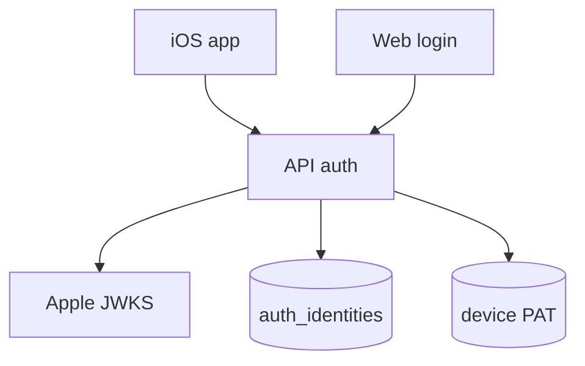
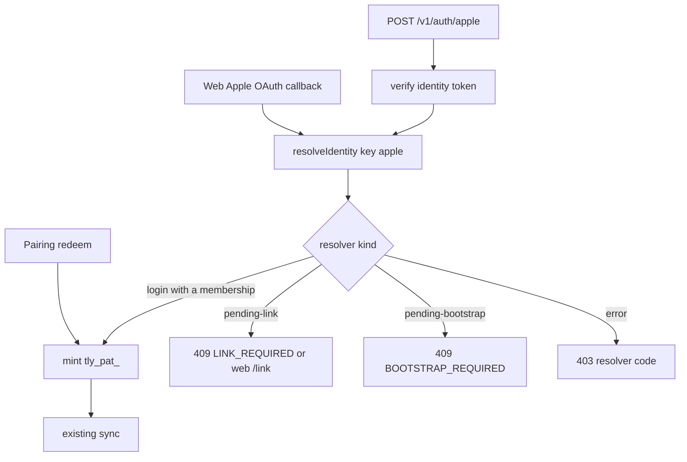

# Apple Sign-In Identity - Plan

## Goal Capsule

- **Objective:** One person can open Tallyline Cloud on the phone with Sign in with Apple, and on the web with Sign in with Apple, and see the same workspace. A self-hosted phone can still pair with a code.
- **Means:** Extend `auth_identities` and `resolveIdentity`, then mint the existing device PAT (KTD1, KTD2).
- **Authority:** This file is the implementation spec for ledger units C1a, C1b, I1, and W1. `docs/plans/CE-PLAN.md` remains the sequencing ledger for the rest of the cloud track. `docs/auth.md` remains the operator description of providers.
- **Stop:** Do not add a second token stack. Do not drop pairing. Do not put Apple client secrets, team ids, or private keys in the repo. Do not delete projects or issues to bootstrap Apple.
- **Who ships:** One implementation pass lands the units below. The owner sets Apple Developer ids in the host environment before anyone can sign in against `https://api.tallyline.app`.

## Product Contract

Product Contract unchanged for R1–R4. This file plans that slice. R5, R6, pricing, Stripe, and every ledger unit other than C1a, C1b, I1, and W1 stay on `docs/plans/CE-PLAN.md`.

### Summary

Prove and finish the Apple path that is already wired through `resolveIdentity`. Native sign-in mints the same `tly_pat_` credential pairing uses. The web button uses the existing Apple OAuth callback. Live sign-in stays off until the owner fills env.

### Problem Frame

Cloud on the phone still depends on a pairing code unless Apple sign-in is actually proven and configured. The verifier, `POST /v1/auth/apple`, the iOS button, and the web button are already in the tree, and the ledger still marks C1a, C1b, I1, and W1 open. The open work is proof, the contract fixture, and the owner console gate. A mistaken user delete would also drop workspace membership, because `workspace_members.user_id` cascades.

### Requirements

- R1. One human account can sign in with password and/or Apple on the web, and the same account can sign in on iOS with native Sign in with Apple.
- R2. A successful cloud iOS Sign in with Apple mints the same device PAT shape pairing redeem already returns, so outbox and delta sync stay as they are.
- R3. Pairing codes remain the way into a self-hosted server, and they remain available on cloud as a fallback.
- R4. Apple `sub` is the stable identity key. Email is metadata, including a private-relay address. An operator may replace the human login rows and re-attach membership. Projects and issues stay.

### Key Decisions

- D1. Extend `auth_identities` and `resolveIdentity`. (session-settled: user-approved — chosen over a parallel Nimbus-style JWT stack: the phone and the web should share the users the API already has.) Governs R1, R2.
- D2. Ship iOS Sign in with Apple before deeper iOS chrome when they conflict. (session-settled: user-directed — chosen over deep iOS chrome before identity: the phone should reach the workspace without a pairing code first.) Governs R1, R2.
- D5. Wipe or replace the human login only as an operator step, and keep projects. (session-settled: user-directed — chosen over deleting the workspace to start Apple clean: the issues have to remain.) Governs R4.
- D7. One implementation pass covers C1a, then C1b, then I1 and W1. (session-settled: user-directed — chosen over splitting this slice across several passes: the four surfaces are one identity.) Governs R1, R2, R3.
- D8. Apple Developer Services ID, the iOS Sign in with Apple capability, and the env client ids are owner work. Code runs behind env. Live web and TestFlight Apple stay blocked until those values exist. The owner is not chosen yet. Governs R1.

D6 from the ledger (cloud iOS always calls `https://api.tallyline.app`) is carried as a constraint on I1. The brief did not name a rejected alternative for it, so it is not marked session-settled here. The iOS button already posts only to `TallylineConfig.defaultServerURL`. Self-host stays on the pairing form. Nothing in the tree makes that host split infeasible.

### Scope Boundaries

In this pass: C1a identity-token checks, C1b `POST /v1/auth/apple` and the iOS contract fixture, I1 the cloud button through the existing sync path, W1 the web button through the existing Apple OAuth callback, and a written re-link procedure for R4.

Out of this pass:

- Stripe, `BILLING=on`, and pricing copy (ledger C3, W3, R6).
- Connected-identities settings beyond what already ships (ledger W2).
- App Review demo workspace (ledger C2, I3).
- Deeper iOS chrome (ledger I4).
- Google on iOS.
- Admin UI for an Apple provider row. Apple stays env-only. `apps/api/src/auth/providers/registry.ts` already skips DB `apple` rows.
- Sending the Apple full name into `users.name`. The native route passes `name: null`. Change this only if the owner asks.
- A used-nonce table for `POST /v1/auth/apple`. Replay until `exp` mints another device PAT and is visible on the devices list. Build the table if a captured request is replayed after sign-out and that list is not a fast enough signal.

#### Deferred to Follow-Up Work

- Ledger C1c stays the name of the web authorize/callback milestone. The callback already exists. This pass does not open a new milestone for it. W1's tests cover the methods list and the callback the button uses, and they fix that callback only if those tests fail.
- A scripted migration that deletes the historical user. The pass documents the re-point. It does not run it.

### Open Questions

- OQ4. Who enables Sign in with Apple on bundle `app.tallyline.ios`, creates the Services ID, and sets the return URL `https://api.tallyline.app/v1/auth/oauth/apple/callback`. Deferred for live sign-in. It does not block the tests in this plan. Do not invent the ids.

## Planning Contract

### Key Technical Decisions

- KTD1. Reuse `mintDeviceCredential` so the Apple response is a `tly_pat_` token with the same JSON keys as pairing redeem. (session-settled: user-approved — chosen over a parallel JWT stack: sync already stores `tly_pat_`.) Governs R2.
- KTD2. Keep `verifyAppleIdentityToken` as the server check of Apple's identity token against Apple's JWKS. The iOS client sends the raw nonce to the API and puts the hex SHA-256 of that nonce on the Apple request. The verifier compares the token `nonce` claim to that same hex digest. Governs R1, R4.
- KTD3. Audiences come from env. `APPLE_BUNDLE_IDS` and `APPLE_CLIENT_ID` enable `POST /v1/auth/apple`. Web OAuth also needs `APPLE_TEAM_ID`, `APPLE_KEY_ID`, and `APPLE_PRIVATE_KEY`. Empty means the button and the route stay off. Governs R1.
- KTD4. The sign-in path does not delete users. R4's replace step is the runbook in U5, after a new or linked user exists. Governs R4.
- KTD6. Do not rewrite the Apple modules that already call `resolveIdentity`. Add the missing route test, fixture, and runbook. Change a module only when one of those tests shows it violates R1–R4.

KTD5 on the ledger (pricing copy before Stripe) is not this slice.

### High-Level Technical Design

`loginResolved` picks the membership at the end of the list when the user has several workspaces. This pass does not add a workspace picker on the Apple response.

### Assumptions

- A1. The web Services ID callback is already the C1c behavior W1 needs. This pass does not add a separate C1c unit. If `apps/api/src/routes/apple-web.test.ts` or the W1 scenarios fail, the fix stays inside the existing OAuth files.
- A2. `AUTH_ACCOUNT_LINKING` defaults to `auto`. A verified email match on `POST /v1/auth/apple` then inserts `auth_identities` and mints a PAT with no web `/link` step. `login` is what produces `LINK_REQUIRED`. This pass does not change the default. Use U5 when the Apple email will not match and the `sub` must own the existing workspace.
- A3. Apple's identity-token `nonce` claim is the hex digest the client set on the request, which matches the Firebase iOS guide and the current client. A Supabase report describes a base64url claim instead. Do not switch encodings unless a token from a real device fails `bad_nonce` while the client still sends the raw nonce.
- A4. `config_` is a mutable object. Route tests may set `appleBundleIds` and `appleClientId` the way `apps/api/src/services/identity.test.ts` sets `authAccountLinking`, and they may stub JWKS with `__setProviderFetchForTests`. Restore both in `afterAll`.
- A5. Success of live sign-in on `api.tallyline.app` is owner work (D8, OQ4). This plan's done bar is the automated proof plus the runbook.

### Sequencing

U1 first, then U2. U3 and U4 wait on U2's response keys. U5 can be written any time and does not touch the auth route.

## Implementation Units

### U1. C1a Apple identity-token verification

**Goal:** The existing verifier accepts an Apple `sub` only when issuer, audience, expiry, RS256, and the hex nonce check pass, and it never treats a bare email as verified.

**Requirements:** R1, R4. D1, KTD2, KTD6.

**Dependencies:** none

**Files:**
- `apps/api/src/auth/apple-identity.ts`
- `apps/api/src/auth/apple-identity.test.ts`
- `apps/api/src/auth/providers/registry.ts` (read; edit only if env registration of `apple` is absent when `appleWebReady` is true)

**Approach:**
- Keep the verifier. The suite already accepts a locally signed token, and it rejects a wrong audience, a wrong nonce, and an expired token.
- Add the cases below before changing verification logic.
- Registry stays env-first. A DB row with type `apple` stays skipped.

**Execution note:** Add the failing characterization cases first. Change `apple-identity.ts` only if a case shows a current check violating R4.

**Patterns to follow:** `apps/api/src/auth/apple-identity.test.ts` mints RS256 tokens with a local key and injects `fetchJwks`.

**Test scenarios:**
- Happy path: token `iss` is `https://appleid.apple.com`, `aud` is `app.tallyline.ios`, `nonce` is the hex SHA-256 of raw nonce `client-nonce-1`, `sub` is `apple-sub-abc`, `email_verified` is the string `"true"`. Expect `subject` `apple-sub-abc`, `emailVerified` true.
- `email_verified` boolean `true` yields `emailVerified` true.
- `email_verified` missing, or the string `"false"`, yields `emailVerified` false and still returns `sub`.
- Token with no `email` claim yields `email` null and `emailVerified` false.
- Signature from a different key yields `AppleAuthError` code `bad_signature`.
- `kid` not in the stub JWKS yields `unknown_kid`.
- `alg` `none` yields `bad_alg`.

**Verification:** The new cases pass with no network. A regression that marks email verified because the claim is present fails the missing-`email_verified` case.

### U2. C1b Device PAT from POST /v1/auth/apple

**Goal:** `POST /v1/auth/apple` verifies the token, calls `resolveIdentity` with provider key `apple`, and on a login with a membership returns the pairing PAT body.

**Requirements:** R2, R3, R4. KTD1, KTD3, KTD6.

**Dependencies:** U1

**Files:**
- `apps/api/src/routes/apple-auth.test.ts` (new)
- `apps/api/src/routes/apple-auth.ts` (only if the test cannot reach the verifier through `config_` and `__setProviderFetchForTests`)
- `apps/api/src/routes/ios-contract.test.ts`
- `apps/ios/Tests/TallylineCoreTests/Fixtures/apple_sign_in.json` (written by the contract test)
- `apps/ios/Tests/TallylineCoreTests/ContractFixtureTests.swift`

**Approach:**
- Mutate `config_.appleBundleIds` to include `app.tallyline.ios` for the suite and restore the previous value afterward (A4).
- Stub `__setProviderFetchForTests` so the JWKS URL returns the test public JWK. Mint the identity token the same way U1 does.
- Seed a workspace member with `apps/api/test/tenants.ts` patterns used by `apps/api/src/routes/ios-contract.test.ts`. Insert an `auth_identities` row `provider_key=apple` for the returning-user case.
- On 200, assert the body keys `token`, `tokenType`, `expiresAt`, `scopes`, `deviceId`, `server`, `workspace.slug`, `workspace.name`. `token` starts with `tly_pat_`. `scopes` is `read` and `write`.
- Extend the iOS contract writer to capture that 200 body as `apple_sign_in.json` when `IOS_FIXTURES=write`. The Swift test decodes it with `PairingRedeemResponse` and checks the `tly_pat_` prefix the way `pair_redeem.json` is checked.
- Do not change pairing redeem.

**Execution note:** Write the route test first, against the current handler. Add a fetch seam on the route only if the stubbed `oauthFetch` is not the fetcher `verifyAppleIdentityToken` calls.

**Patterns to follow:** `mintDeviceCredential` in `apps/api/src/services/devices.ts`. Error mapping in `apps/api/src/routes/apple-auth.ts`. Contract capture in `apps/api/src/routes/ios-contract.test.ts`.

**Test scenarios:**
- Happy path: known `auth_identities` row for `sub`, user is a workspace member. `POST /v1/auth/apple` with that token, the matching raw nonce, `deviceName` `Luke's iPhone`, `platform` `ios`. Expect 200 and a `tly_pat_` token. A second call with a new nonce mints a second device row and does not revoke the first token.
- Repeat sign-in omits `email` on the token. The same `sub` still returns 200 for the same user.
- No `APPLE_BUNDLE_IDS` and no `APPLE_CLIENT_ID` (empty audiences). Expect 503 `APPLE_NOT_CONFIGURED` and no `user_tokens` row.
- Wrong raw nonce. Expect 401 `INVALID_APPLE_TOKEN` and no credential.
- Verified email matches an existing user, no `auth_identities` row, `authAccountLinking` left at default `auto`. Expect 200, one new `auth_identities` row for that `sub`, and a `tly_pat_` token. No `/link` round trip.
- Same seed with `authAccountLinking` set to `login`. Expect 409 `LINK_REQUIRED` and no device token.
- Verified email matches nobody, no invite, auto-join off. Expect 403 `INVITE_REQUIRED`.
- `email_verified` absent and the email string equals an existing user. Expect 403 `INVITE_REQUIRED`, no `auth_identities` row for that `sub`, and no new `user_tokens` row. Unverified email does not take the email-match rung.
- Repeat the happy-path body byte for byte, while the token is unexpired. Expect another 200 and a second `tly_pat_` token. That replay is accepted. Do not add a used-nonce table in this pass.
- Pairing redeem in `apps/api/src/routes/devices.test.ts` still returns a `tly_pat_` token. This route test must not delete that behavior.

**Verification:** The route suite and the contract fixture agree on the 200 keys. Pairing tests still pass. The handler is unchanged unless a scenario above fails on the current code.

### U3. I1 Cloud Sign in with Apple on iOS

**Goal:** The cloud button posts the identity token to `https://api.tallyline.app`, stores the PAT, and shows the API's message when sign-in is refused. Self-host stays on pairing.

**Requirements:** R1, R2, R3. D2, KTD1.

**Dependencies:** U2

**Files:**
- `apps/ios/Sources/tallyline_ios/SignInViews.swift`
- `apps/ios/Sources/tallyline_ios/SessionModel.swift`
- `apps/ios/Sources/TallylineCore/APIClient.swift`
- `apps/ios/Sources/TallylineCore/Config.swift` (read-only check)
- `apps/ios/Tests/TallylineCoreTests/ContractFixtureTests.swift`

**Approach:**
- Keep `SignInWithAppleButton` on `InstancePickerView`. It must keep calling `session.signInWithApple` with `serverURL: TallylineConfig.defaultServerURL`, not the self-host text field.
- Keep `request.nonce` as the hex SHA-256 of `rawNonce`, and keep sending `rawNonce` in the JSON body (KTD2, A3).
- `SessionModel` already prefers the API error message inside a private `describe`. Keep that. Do not replace `LINK_REQUIRED` or `INVITE_REQUIRED` with a new client-side state machine. Core tests cannot call `describe`.
- The self-host block stays behind the pairing disclosure and still opens `PairView`.
- Decode `apple_sign_in.json` from U2. No new UI type.

**Patterns to follow:** `finishSignIn` shared by `pair` and `signInWithApple` in `SessionModel.swift`.

**Test scenarios:**
- Happy path: `ContractFixtureTests` decodes `apple_sign_in.json` into `PairingRedeemResponse`. `token` has prefix `tly_pat_`. `workspace.slug` is non-empty.
- User cancels the Apple sheet (`ASAuthorizationError.canceled`). `handleApple` in `SignInViews.swift` clears the error and does not call `signInWithApple`. Change that branch only if the file shows cancel calling `setError`.
- A stub HTTP 409 whose JSON is `{"error":{"code":"LINK_REQUIRED","message":"sign in on the web once to link this Apple ID to your account"}}` makes `APIClient.send` throw `APIClientError.http` with that message. Add this only if `TallylineCore` tests already stub `URLSession`. Otherwise it stays on the manual bar. Do not call `SessionModel.describe` from `TallylineCoreTests`.
- In `SignInViews.swift`, the Apple completion calls `signInWithApple` with `TallylineConfig.defaultServerURL`. It does not pass `serverText`. Confirm by reading that call. It is not a fixture test.

**Verification:** `TALLYLINE_CORE_ONLY=1 swift test` decodes the new fixture. Cloud SIWA still ignores the server field. Pairing UI is still present.

### U4. W1 Web Sign in with Apple

**Goal:** When the web Apple env is complete, `/v1/auth/methods` lists Apple and the login page shows Sign in with Apple. The callback resolves the same `sub` the phone uses. Incomplete env hides the button.

**Requirements:** R1, R4. KTD3, A1.

**Dependencies:** U1

**Files:**
- `apps/web/app/(auth)/login/page.tsx`
- `apps/web/app/api/auth/methods/route.ts`
- `apps/web/app/api/auth/callback/route.ts`
- `apps/api/src/routes/apple-web.test.ts`
- `apps/api/src/auth/providers/apple.ts` (only if a scenario fails)
- `apps/api/src/routes/oauth.ts` (only if a scenario fails)

**Approach:**
- Leave the login page's Apple branch as it is when `providers` contains `type === "apple"`. There is no page unit test. Button visibility is a manual check.
- Do not add `apple` to `apps/web/components/provider-form.tsx`.
- Drive the OAuth exchange with `__setProvidersForTests` and a stub provider, the way `apps/api/src/auth/providers/providers.test.ts` stubs a provider. Do not assert React markup from an API test.

**Patterns to follow:** `apps/api/src/routes/apple-web.test.ts` for the form-post bounce and an `auth_identities` hit. `apps/web/app/api/auth/callback/route.ts` sends `purpose === "pending-link"` to `/link`.

**Test scenarios:**
- Happy path: set the four web Apple fields on `config_` the way `identity.test.ts` mutates `config_`. `GET /v1/auth/methods` includes `{ key: "apple", type: "apple" }`.
- `appleClientId` set and `applePrivateKey` empty. Methods omit `apple`.
- Callback `POST` with Apple's form body continues to the GET callback, as the existing bounce test requires. Do not drop that test.
- Stub `exchange()` returns a verified email that matches a password user, and `authAccountLinking` is `login`. `POST /v1/auth/oauth/exchange` returns `purpose` `pending-link` and does not set a session cookie.
- Stub `exchange()` returns `sub` `apple-sub-1` and a verified email, policy `auto`, no existing identity. A second `exchange()` with the same `sub` and `email` null returns the same user. The `auth_identities` table has one row for that `sub`.

**Verification:** `apple-web.test.ts` covers the methods gate, the bounce, the link redirect, and the stable `sub`. `pnpm --filter @tallyline/web typecheck` passes. The login page still shows password sign-in when Apple is absent.

### U5. R4 re-link runbook

**Goal:** An operator can move workspace membership onto the post-Apple user without deleting projects or issues.

**Requirements:** R4. D5, KTD4.

**Dependencies:** none

**Files:**
- `docs/auth.md` (add a short subsection under the Apple section)

**Approach:**
- State the order. Create or link the Apple user first, through the app. Copy `workspace_members` onto that user and keep the role. Re-point shared `views` that must survive. Then `DELETE` the old user.
- Name the hazards from `apps/api/src/db/schema.ts`. `workspace_members.user_id` and `views.owner_id` are `ON DELETE CASCADE`. `user_tokens.user_id` is `ON DELETE CASCADE`. `issues.created_by` is `ON DELETE SET NULL`. `userFromToken` joins `user_tokens` to `users` and `workspaces`. It does not check `workspace_members`. An old PAT keeps working until that user row is gone.
- Deleting the old user is what revokes those PATs. Do it only after the new user holds membership and the views that must survive. List every other foreign key to `users.id` in that schema file first, and re-point any row whose loss would drop access or shared data.
- Never `DELETE` from `workspaces`, `projects`, or `issues` as part of this step.
- Say that a verified email match under the default `auto` policy is the normal attach (A2). This procedure is the fallback when the Apple email will not match.

**Test scenarios:**

Test expectation: none -- this unit is operator prose. The route tests in U2 already show that sign-in itself does not delete users.

**Verification:** A reader of `docs/auth.md` can follow the order without guessing which delete cascades. The subsection contains no secret values.

## Verification Contract

- API: `pnpm --filter @tallyline/api exec vitest run src/auth/apple-identity.test.ts src/routes/apple-auth.test.ts src/routes/apple-web.test.ts src/routes/devices.test.ts src/routes/ios-contract.test.ts`
- Refresh the Apple fixture only when the 200 shape changes: `IOS_FIXTURES=write pnpm --filter @tallyline/api exec vitest run src/routes/ios-contract.test.ts`
- iOS core: `TALLYLINE_CORE_ONLY=1 swift test` in `apps/ios`
- Web: `pnpm --filter @tallyline/web typecheck`
- Manual, after the owner sets env (OQ4), not part of the code done bar: on a phone, Sign in with Apple against `https://api.tallyline.app` opens issues for the membership `loginResolved` picks. The same Apple id on the web resolves the same user. The login page shows Sign in with Apple only when methods include `apple`. A pairing code still works against a self-host URL. Canceling the Apple sheet leaves the phone signed out. A server with zero workspaces answers `BOOTSTRAP_REQUIRED` on the phone.

## Definition of Done

- U1 through U5 meet their verification lines.
- `POST /v1/auth/apple` and pairing redeem both return a `tly_pat_` token for a member, and pairing tests still pass.
- The web login page shows Sign in with Apple only when methods include `apple`.
- `docs/auth.md` states the re-link order and the cascade hazards.
- No Apple private key, team id, or client secret was added to the repo.
- Abandoned experiments from the pass are not left in the diff.
- `docs/plans/CE-PLAN.md` still owns units outside this slice. Its section 6 points here for C1a, C1b, I1, and W1.

## System-Wide Impact

`resolveIdentity` is shared by web OAuth and `POST /v1/auth/apple`. `AUTH_ACCOUNT_LINKING` defaults to `auto`, so a verified email match on the phone inserts `auth_identities` and mints a PAT without the web `/link` proof. `login` is the policy that returns `LINK_REQUIRED` instead. Web OAuth still ends in a session cookie. Native sign-in ends in a `tly_pat_` token. A web identity token is not a second mint path: the native verifier expects a hex nonce, and the web authorize nonce is raw.

`userFromToken` trusts a live `user_tokens` row. Widgets read an App Group snapshot the app writes. They do not call Apple. The share extension and sync keep using the keychain PAT. U5 must delete the old user after membership has moved, or that user's PATs stay valid.

A server with no workspace returns `pending-bootstrap`. The phone gets 409 `BOOTSTRAP_REQUIRED`. The first workspace is still created on the web. When the user has several memberships, `loginResolved` picks the last one. This pass does not add a picker, so the phone and an existing web session can land in different workspaces for the same `sub`.

## Risks

- Nonce encoding. The client and verifier agree on hex (KTD2). A3 records the conflicting base64url report. A real-device `bad_nonce` is the signal to revisit it. Do not change both sides "just in case."
- Hide My Email. Later tokens may omit email. The identity-hit path in `resolveIdentity` does not need the email again. The tests in U2 cover that.
- Operator delete. U5 deletes the old user only after the new user holds membership, because `user_tokens` cascade on that delete and `userFromToken` does not consult `workspace_members`. The sign-in route must not grow a delete.
- Replay of one Apple POST. The same unexpired body mints another PAT. That is accepted. A used-nonce store is not in this pass. The devices list is where a surprise credential shows up. Add a store only if a captured request is replayed after the person has signed out and the extra device is not enough of a signal.
- Several workspaces. The PAT's workspace is the last membership, not the web session's current workspace. Accepted for this pass.
- Live Apple without env. The route returns 503. That is the intended gate (D8), not a fallback that skips verification.
- JWKS fetch uses `oauthFetch`, which refuses non-public hosts. Tests must inject the fetcher rather than point the suite at Apple.

## Origin coverage

`docs/plans/CE-PLAN.md` sections 1–3 and 9–12 stay on that ledger. Section 4's R1–R4 and D1, D2, D5, D7, D8 are this plan's product contract. D3, D4, D6, R5, and R6 are answered under Scope Boundaries or the D6 paragraph above. Section 5's C1a, C1b, I1, and W1 are U1–U4. C1c is A1. Other C/W/I rows are out of this pass. Section 6 item 1 is this plan. Section 7's KTD1–KTD4 are the planning contract. KTD5 is out. Section 8's commands are the Verification Contract, narrowed to the Apple files.

## Sources

- `apps/api/src/routes/apple-auth.ts` maps resolver kinds to 503, 401, 403, and 409, then calls `mintDeviceCredential`.
- `apps/api/src/auth/apple-identity.ts` checks RS256, issuer, audience, expiry, hex nonce, and explicit `email_verified`.
- `apps/api/src/services/identity.ts` matches `auth_identities` on provider key plus subject before any email policy.
- `apps/ios/Sources/tallyline_ios/SignInViews.swift` hashes the nonce and posts only to the default cloud URL.
- `apps/web/app/(auth)/login/page.tsx` renders the Apple link when methods include type `apple`.
- Firebase's iOS Apple guide: the request nonce is the SHA-256 hex digest, and Apple returns that value in the identity token. https://firebase.google.com/docs/auth/ios/apple
- Supabase gotrue issue 2378 describes a base64url nonce mismatch in a different verifier. It is the reason for A3, not a change to KTD2. https://github.com/supabase/auth/issues/2378
