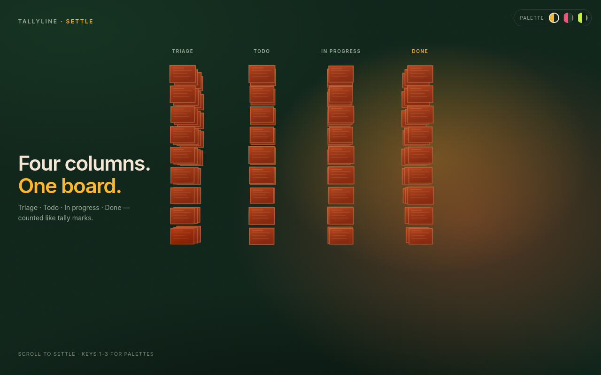

# Landing page motion prototype

A standalone Three.js test of a "chaos to order" landing page for tallyline.app.
Open `index.html` through any static server (for example `python3 -m http.server`)
and scroll.

Scenes:

1. A cloud of pages drifting in chaos.
2. The pages settle into four columns: Triage, Todo, In progress, Done.
3. Light trails (agents) carry pages to Done.
4. The board flattens into a roadmap timeline you can drag or pan with the arrow keys.

Palettes follow one rule: two base colors that complement each other, plus one
bright "life" color used sparingly. Press 1, 2 or 3 to switch:

| Key | Background | Pages | Life color |
| --- | --- | --- | --- |
| 1 | Deep pine `#12261C` | Terracotta `#C4532F` | Sunset gold `#FFB627` |
| 2 | Forest `#1C3B2A` | Ember `#E2602B` | Hot pink `#FF4F7B` |
| 3 | Moss black `#0F1A12` | Clay `#B5543A` | Lime `#C6F432` |

Respects `prefers-reduced-motion` with a static settled board.

This is a test, not the shipped page. Known rough spots: the roadmap scene
still bunches up, and the grain overlay is heavy.

