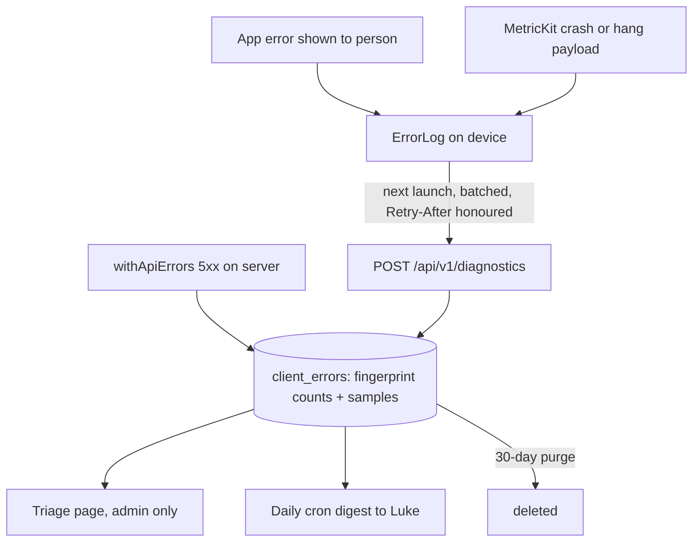
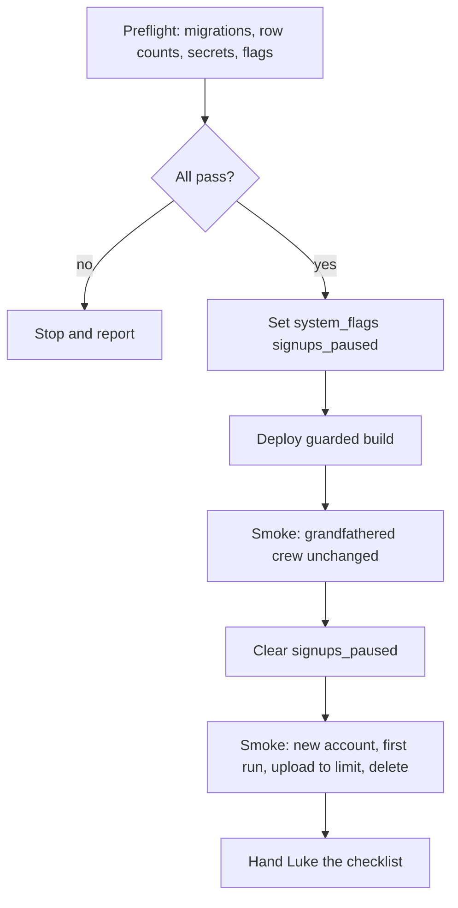

# Kate Production Launch for 10k Users - Plan

**Target repos:** `duketopceo/kate` (backend, this repo) and `duketopceo/kate-ios` (iOS). Paths prefixed `ios:` are in kate-ios; all others are in kate.

---

## Goal Capsule

- **Objective:** Strangers can sign up for Kate on production, get their own crew within free limits, and use every tab without confusing dead ends. The service protects itself from abuse and runaway cost. Every client and server error reaches Luke. Kate can legally start charging once the movie-data question is resolved.
- **Means:** Harden the open sign-up that is already live in production (kill switch, throttles, complete account deletion, bounded reads). Add first-party error and crash logging. Audit and simplify every iOS tab. Make the movie source swappable so Plus can launch without TMDB. Gate everything on deterministic tests run on self-hosted runners (KTD1–KTD9).
- **Authority:** Product Contract Requirements win on behavior; KTDs win on mechanism; units override neither. The prior launch plan (`docs/plans/2026-10-14-0110-feat-kate-app-store-launch-plan.md`) stays authoritative for its settled decisions (13+ age policy, simplify by default never by deletion, icon C).
- **Execution profile:** One PR per unit per repo, merged only when the local or self-hosted checks for the merge result pass in a separate command. Luke authorized production deploy and open sign-up for this plan. Each production step still runs only after its gate in U15 passes.
- **Stop conditions:** Stop and ask Luke if TMDB replies that a free-API app may not have any paid tier and the Wikidata source is not yet shippable. Also stop if a production read shows data loss from migration 0043, if Apple secrets are still unset when U15 reaches the App Review gate, or if a cost alert fires during rollout.
- **Who finishes:** Claude executes U1–U15 and the backend production deploys. Luke sets Apple secrets, contacts TMDB sales, registers the macOS build host runner, runs TestFlight uploads, and tests from the checklist U15 hands over.

---

## Product Contract

### Summary

Production already runs main with open sign-up on (deployed 2026-10-15 21:13 UTC with migrations 0041–0048 applied), but without the guards the launch needs. This plan adds those guards, fixes account deletion, adds first-party error and crash logging, audits and simplifies every iOS tab, and builds deterministic tests on self-hosted runners. Plus monetization stays built but off until the movie-data licensing is settled, and the plan builds the commercial-safe movie source that unblocks it. It ends with a staged production rollout and a test checklist for Luke; the launch video follows separately.

### Problem Frame

Kate is about to be offered to the public, and three things stand in the way of 10,000 strangers using it safely and of Kate earning money. First, the server has no way to pause sign-ups or uploads without a deploy, Sign in with Apple has no throttle, and deleting an account leaves the person's crew behind. Second, nobody learns when the app fails: errors stay on the phone and crashes are not captured at all. Third, TMDB's terms treat any app that earns money "directly or indirectly" as commercial, so turning on Plus while movie data comes from TMDB's free API would breach the licence even though movie search itself stays free.

### Key Decisions

- **Plus charges for storage, members and video; movie search stays free; TMDB stays out of anything paid.** Research found TMDB's terms count any paid tier as commercial use, so Plus stays off until TMDB grants a commercial agreement or movies run on a commercial-safe source. (session-settled: user-directed — chosen over buying a TMDB commercial licence up front and over keeping Kate free: Luke wants an app that can make money without TMDB in it.) Governs R11, R12, R13.
- **Production rollout includes open sign-up for 10k users.** (session-settled: user-directed — chosen over deploy-only with invite-only kept: Luke chose "Deploy + open sign-up".) Governs R1–R6, R22.
- **Bug logging is first-party.** Errors and crashes go to Kate's own Worker and D1, with no third-party SDK. (session-settled: user-directed — chosen over Sentry and over local-only logs: no new vendor holding user data.) Governs R14–R17.
- **Deterministic tests run on self-hosted runners**: a Linux box for backend and web, the macOS build host for XCUITest and screenshots. (session-settled: user-directed — chosen over paid hosted Actions and over local-only gates: private repos are billing-blocked on hosted runners.) Governs R18–R20.
- **Every tab is audited by code review, web screenshots and iOS UI-test screenshots.** (session-settled: user-directed — Luke's "check every tab".) Governs R8–R10.
- **13+ neutral age screen** carries forward from the prior launch plan unchanged. Governs R7.

### Requirements

**Abuse and cost protection**

- R1. An operator can pause new sign-ups, pause uploads, or put Kate in read-only mode within a minute and without a deploy, each independently of the others. Delete account, export, sign-in for existing users, sign-out, App Store notifications and diagnostics upload keep working under every flag.
- R2. A paused state shows the person a plain "try again later" message in both new and old app builds, and queued journal entries and ideas wait in the outbox instead of being dropped.
- R3. New-account creation is throttled per IP and capped per day across the service, for both Sign in with Apple and email. Existing people signing back in are never counted or blocked by these caps.
- R4. The service pauses sign-ups or uploads automatically when daily usage crosses set thresholds, and tells Luke the same day.
- R5. Reads of journal, movies, ideas and trips stay bounded in cost as a crew's history grows. New builds page through everything; builds older than this release see the newest 2,000 items, which is acceptable because only TestFlight builds predate it.
- R6. Deleting an account removes everything the person owns, including their crew when they are its last member. When others remain, ownership passes to the longest-standing member.
- R7. People on builds that predate the 13+ age screen can still sign in. The legacy adult confirmation stops creating new accounts after a dated cutoff.

**Every tab, simplified**

- R8. Every iOS tab (Today, Journal, Plans, Movies, Outside, Settings and Settings > Advanced) is reviewed for bugs, dead ends, confusing copy and missing error states, and each finding is fixed or filed.
- R9. Hitting a free limit (storage, video, members, crew full) tells the person exactly what happened and offers a free next step. It never mentions an upgrade that does not exist.
- R10. All user-facing copy follows the plain-language rules: short sentences, no jargon, and empty states that say what to do next. This completes the prior plan's U8.

**Making money without TMDB in the paid tier**

- R11. Kate keeps TMDB data no longer than six months, shows attribution where TMDB data appears, and degrades a purged movie to its title, year and a placeholder poster.
- R12. Movie search and details can come from a commercial-safe source (Wikidata, CC0) chosen by server configuration; on that source posters are a generated placeholder or a crew-uploaded image, and the app works the same way on either source.
- R13. Plus can be switched on only when both the app build and the server enable it together, and only after TMDB grants commercial use in writing or the commercial-safe source is the live movie source.

**Bug logging**

- R14. Every server error and every app error the person sees is recorded centrally with build, endpoint, status, error code and a request id that matches the server log.
- R15. App crashes and hangs on iOS are captured on the device and uploaded on the next launch.
- R16. Diagnostics never contain journal text, names, crew names, photos, locations or TMDB content. They are not linked to the person's identity and are deleted after 30 days.
- R17. Luke has a private triage page listing errors grouped by fingerprint, and gets a daily digest of new and rising errors.

**Deterministic tests and CI**

- R18. Backend tests, migration checks against D1's own rules, and web end-to-end tests run on a self-hosted Linux runner for every PR and give the same result on every run.
- R19. iOS UI tests drive every tab against a fixture server with a fixed clock, locale and data, run on the macOS build host, and produce App Store screenshots.
- R20. A PR merges only after its self-hosted checks pass on the exact merge result: the PR is up to date with main, and the checks ran against the current main head.

**Production rollout**

- R21. Before each production step, a read-only preflight confirms migration state, data integrity, secrets and flags, and stops the step on any mismatch that step requires.
- R22. The rollout ends with sign-up open behind working guards, a recorded smoke test of an existing grandfathered crew and a brand-new account, and a written test checklist for Luke.

### Acceptance Examples

- AE1. **Covers R1, R2.** Given uploads are paused, when an old build uploads a photo, then it receives 503 with Retry-After and shows its generic "try later" message. When the person then deletes their account, deletion succeeds.
- AE2. **Covers R3.** Given 5 accounts were created from one IP today, when a sixth person on that IP signs in with Apple for the first time, then creation is refused with `rate_limited`. When an existing user on the same IP signs in, they get in.
- AE3. **Covers R6.** Given Ana is the only member of her crew, when she deletes her account, then her crew, its media in R2, `crew_usage`, `crew_plans` and invites are gone. Given Ana owns a crew with Ben, when she deletes, Ben becomes owner and keeps the shared items.
- AE4. **Covers R5.** Given a crew with 3,000 journal entries, when an old build requests the journal without paging parameters, then it receives the newest 2,000 and a truncation header. A new build pages through all 3,000.
- AE5. **Covers R9.** Given a free crew at 1 GB with Plus off, when someone adds a photo, the app says the crew's space is full. It points to Recently deleted and to removing videos, and says nothing about upgrading.
- AE6. **Covers R13.** Given `KATE_PLUS_ENABLED=true` on the server but a build compiled without Plus, when an App Store notification arrives, it is stored and acknowledged and no paywall appears anywhere.

### Success Criteria

- A fresh account completes sign-up, first run and a first journal entry with a photo in under two minutes on a TestFlight build, with zero errors in the triage page.
- At 10,000 accounts with typical use, monthly Cloudflare spend stays under $60, and the worst-case R2 storage bound stays under $150. The Cloudflare billing/usage page checked at day 7 and day 30 after open sign-up backs this.
- The full self-hosted suite runs green three consecutive times on the same commit with no retries.

### Scope Boundaries

- Web pages get only a copy, error-state and screenshot pass. The product surface is iOS, and the web app has no tabs.
- Plus pricing, paywall design and StoreKit purchase flows are already built behind the flag and are not redesigned here.
- Cairn's production plan is a separate plan written after Kate ships. The launch video comes after this plan.

**Considered and not built:**

- A per-user API rate limit on every request. It adds a D1 write to every call, and the app's cold-open fan-out can trip it by itself. Upload and creation limits plus the kill switch cover the cost risk. Revisit if Workers analytics shows one account or IP above 50,000 requests a day.
- App Attest or Turnstile at sign-up. Turnstile has no native iOS SDK, and App Attest is a risk signal, not a gate. Per-IP and daily caps bound the damage. Revisit if the triage page shows scripted sign-ups.
- A minimum-supported-build mechanism (426). Only TestFlight builds exist outside Luke's crew today. Revisit before the second App Store release.
- Third-party crash symbolication. Raw MetricKit stacks are stored, and dSYMs are archived per build for offline symbolication.
- A "Send error reports" toggle in Settings > Advanced. Diagnostics are anonymous and not linked to the person. Revisit on App Review feedback or user request.

### Deferred to Follow-Up Work

- Moving migration 0048 (Luke's Moab seed) out of the schema chain and out of `export:selfhost`.
- Removing the stale `AGENTS.md` "no auth stack" principle and `scripts/responsive-screenshots.mjs` (replaced by U12's e2e screenshots).
- Wikidata-sourced recommendations and streaming providers. U10 covers search and details only.
- Email-verified sign-up (needs a mail sender).
- Fail-closed handling of the IP salt in production (`KATE_IP_SALT` is set, verified by `wrangler secret list` 2026-10-15).
- A shared boolean-flag parser across all flags (U11 only widens `isPlusEnabled`).
- Splitting `MoviesView` into search, list and detail files, only if a U9 audit finding requires it.

### Open Questions

- Q1. **Blocking only for turning Plus on while TMDB is the live movie source.** U10 and U11 proceed regardless, and the Wikidata source satisfies the R13 precondition if TMDB never answers.
- Q2. **Blocking for the App Review gate in U15:** Luke sets `APPLE_TEAM_ID`, `APPLE_SIWA_KEY_ID`, `APPLE_SIWA_PRIVATE_KEY` and `APPLE_TOKEN_ENC_KEY` in production. Without them, deleting an account cannot revoke the Apple token, which App Review requires.

---

## Planning Contract

### Key Technical Decisions

- KTD1. **The kill switch is three independent D1 `system_flags` rows (`signups_paused`, `uploads_paused`, `read_only`, each on or off, any combination allowed), cached about 30 seconds per isolate, and a read failure means all flags clear.** A cron cannot change `wrangler.jsonc` vars and a deploy is not instant, so a var-based switch cannot meet R1 or R4. Paused flags return 503 with Retry-After and a new error code (`signups_paused`, `uploads_paused`, `read_only`), so builds that predate the codes fall back to their generic retry-later handling (R2). Exempt routes are listed once in the guard module, not per route. Accepted tradeoff: failing open means a D1 incident leaves sign-ups and uploads unguarded during the incident; failing closed would take the whole app down on any D1 blip, and the per-IP and global counters in D1 fail the same way.
- KTD2. **Creation throttles wrap only the create branch of `completeSignup`.** The per-IP cap is 5 per day and the global cap is 500 per day, tunable via `system_flags`. Both count in `rate_limits` scopes, so create/delete loops still count, and the per-IP scope buckets IPv6 addresses by /64. The returning-user path is never touched (R3). A global cap hit sets only `signups_paused` and sends an alert instead of returning a misleading `rate_limited`; a cap-triggered `signups_paused` auto-clears at the next UTC day rollover, while operator-set pauses stay until cleared.
- KTD3. **The usage guard derives everything from Kate's own counters**: `crew_usage` totals, new accounts and uploads, read by the daily cron (U6 adds `client_errors` volume when that table lands). It needs no Cloudflare API token. Its thresholds live in `system_flags`. The cron wraps each job with `.catch` and records a heartbeat row, so a dead cron itself shows up in the digest (R4). It cannot see request counts, so request volume is checked on Cloudflare's own usage data. Alert rows are also pushed immediately to an ntfy topic.
- KTD4. **Bounded reads are opt-in.** No paging parameters returns the legacy shape capped at 2,000 rows plus an `X-Kate-Truncated` header, which is acceptable because only TestFlight builds predate this release. New builds send `limit` and `before` cursors and page through everything. The duplicate guard asks the server by title or movie id instead of scanning the local list (R5).
- KTD5. **Diagnostics are fingerprint-deduplicated counts in a D1 `client_errors` table** keyed by build, platform, endpoint template, status, code and kind. Each row keeps a few sample payloads, a first-seen and last-seen time, and a count. Server errors land in the same table from `withApiErrors` with source `server`. An anonymous per-install id replaces the user id, so the privacy label stays "Diagnostics, not linked" (R14, R16). The endpoint accepts authenticated sessions, plus a signed-out variant capped at 4 KB per report with a strict per-IP limit for sign-in failures. New rows are capped per day at 5,000 for signed-in app reports, 1,000 for server 5xx (its own budget, so app reports cannot blind server capture), and 500 for the signed-out variant.
- KTD6. **MetricKit is the only crash source.** Payloads (`MXCrashDiagnostic`, `MXHangDiagnostic`) are stored unsymbolicated. `scripts/testflight.sh` archives each build's dSYMs on the macOS build host for offline symbolication (R15). There is no signal handler, because a homemade handler risks deadlocks and double reporting.
- KTD7. **Movie data goes behind a `MovieSource` interface with `tmdb` and `wikidata` implementations**, selected by a `KATE_MOVIE_SOURCE` var. Wikidata free-text title search uses the Wikidata/MediaWiki search API (`wbsearchentities` or `action=query&list=search`, filtered to films and series), then SPARQL or an entity fetch by QID for title, year, genres and the IMDb id; never free-text SPARQL. Results are cached in the existing catalog tables with source and fetch time. Posters on the Wikidata source are a generated typographic placeholder or a crew-uploaded image, never hotlinked Commons files (R12). TMDB ids remain the identity key for existing rows, and Wikidata rows key on the QID with a mapping column.
- KTD8. **One helper decides "Plus on"** for the server (`isPlusEnabled` accepting the same truthy set as other flags). The release checklist in U15 flips the iOS `KATE_PLUS` compile flag and the server flag only together, and only with the R13 precondition recorded (R13).
- KTD9. **CI runs on self-hosted runners only for these private repos, with merge gating enforced by the merge procedure.** A personal account (the repos are owned by user `duketopceo`) has no organization-level runner pools, so each repo gets one repo-level runner registered with `--ephemeral` (JIT, re-registered per job). The Linux runner is a non-sudo user outside the docker group on `the Linux dev machine` (or the production host when available), with no access to the main user's home or omaseal session; The macOS build host runner is likewise its own user and is labelled `macos`. Workflows never use `pull_request_target`. GitHub branch protection on private repos is unavailable on the current plan, so R20 is enforced by the merge step checking the head SHA's check runs, the same rule as the standing "never merge in the same command as tests". The merge step also refuses unless the PR branch is up to date with main (the base SHA the checks ran against equals the current main head). (session-settled: user-directed — chosen over hosted Actions: hosted runners are billing-blocked for private repos.)

### High-Level Technical Design

Kill-switch and throttle flags (KTD1, KTD2). Three independent on/off flags; any combination is allowed. The guard runs before route handlers. Exempt routes skip every flag.

| Flag | Who may set | Who may clear |
|---|---|---|
| `signups_paused` | operator, global cap hit, cron threshold | operator, or the cap-triggered pause at the next UTC day rollover |
| `uploads_paused` | operator, cron storage threshold | operator |
| `read_only` | operator only | operator |

| Flag | Refused with 503 + Retry-After | Always allowed |
|---|---|---|
| `signups_paused` | account creation (Apple, email) | sign-in of existing people, everything else |
| `uploads_paused` | photo and video upload, upload sessions | reads, text writes, exempt set |
| `read_only` | every mutation not in the exempt set | reads, exempt set |
| Exempt set (all flags) | none | `DELETE /account`, export, sign-out, existing sign-in, `/api/appstore/notifications`, diagnostics upload, health |

Diagnostics flow (KTD5, KTD6):

Rollout sequence (U15):

### Assumptions

- Workers Paid is active on the account, because the production Worker has been serving the OpenNext app. U15 preflight confirms it.
- The macOS build host is reachable and Luke can register it as a runner. Until he does, R19 runs manually on the macOS build host with the same scripts.
- An owner deleting their account while others remain hands ownership to the member with the earliest `crew_members.created_at`. Deletion is never blocked.

### Sequencing

U1 → U2 → U3 → U4 harden production first and ship as soon as each is green. U4 is required before App Review. U6 → U7 → U8 deliver logging. U12 → U13 come early in parallel so later units gate on them. U5, U9, U10, U11 and U14 follow. U15 pass 1 runs for the guarded backend (after U1–U4, migration 0049 only) and pass 2 for the full release (after all units, migrations 0050–0051 and the iOS release).

### System-Wide Impact

- **AI assistants (MCP):** the `kate-mcp` Worker reaches Kate through its service binding, so its writes pass the same U1 guard. `read_only` also stops assistant writes, and assistant reads keep working.
- **Old app builds:** pause codes arrive as 503 with Retry-After (KTD1), paging is opt-in (KTD4), and legacy age confirmation keeps working for returning people (U2). Old builds degrade but never lose data.
- **Self-host copies:** `system_flags` treats an absent flag row as clear, and U3 adds the cron entry to the template. Self-hosted installs inherit the guards with no setup.
- **Privacy surface:** diagnostics add a new data category, so the App Store label, `PrivacyInfo.xcprivacy` and the privacy page change together in U7.

### Risks and Dependencies

| Risk | Decision |
|---|---|
| Open sign-up is live with no guards until U1–U2 deploy | Accepted for hours, not days. The iOS app is not public, and production has 2 users. U1–U2 ship first. If U1–U2 are not deployed within 24 hours of this plan, set `KATE_INVITE_ONLY=true` and redeploy until they are. |
| TMDB never answers | U10's Wikidata source unblocks Plus anyway, with placeholder posters as the cost (R12, R13). |
| Apple secrets stay unset | Account deletion skips Apple revoke. This blocks the App Review submission but not the backend rollout (Q2). |
| Wikidata search quality or latency under load | The existing local catalog cache plus the 2.5 s timeout (KTD7, U10). |
| Another session deploys mid-rollout | U15 confirms the deploy window with Luke first. Preflight re-runs immediately before each step. |
| MetricKit misses crashes on some iOS versions | ErrorLog upload stays the primary signal, and MetricKit is additive (KTD6). |
| The Linux runner shares the Linux dev machine with local LLM services | The runner user has no sudo, and its jobs live in `app.slice` like other user work. If oomd kills llama services during CI, CI moves to the production host. |

### Sources and Research

- TMDB API Terms of Use 2.A (commercial "directly or indirectly", charging for an integrating app) and the 6-month cache limit: research dossier summarized in Key Decisions. Kate's own `docs/research/2026-10-12-legal-compliance.md` reached the same reading.
- Cloudflare: D1 100 bound params per statement and a 10 GB per-database cap. Rate-limiting binding windows are only 10 s or 60 s and eventually consistent, hence D1 counters in KTD2. Budget alerts only notify and lag a day, hence KTD3. Workers Logs keep logs 7 days, and their pricing changes 2026-12-01.
- MetricKit delivers late and was unreliable on iOS 17.2–17.5, hence ErrorLog stays the primary signal and MetricKit adds crashes (KTD6).
- GitHub self-hosted runners on private repos: no fork PRs, repo-level ephemeral runners (KTD9).
- Code anchors: `src/lib/auth/complete-signup.ts` (shared create path), `src/lib/invites/rate-limit.ts` (`withinRateLimit`), `src/lib/legal/account-deletion.ts` (no crew deletion today), `src/lib/api/read.ts` and `src/modules/queries.ts` (unbounded reads), `src/lib/api/errors.ts` (`withApiErrors`), `src/lib/tmdb*.ts` and `src/lib/movie-recs.ts`, `src/lib/plus/config.ts`, `worker.ts` (cron jobs), `ios:Sources/KateCore/ErrorLog.swift`, `ios:Sources/KateCore/ErrorCatalog.swift`, `ios:Sources/KateCore/Outbox.swift`.

---

## Implementation Units

| U-ID | Title | Key files | Depends on |
|---|---|---|---|
| U1 | Kill switch | `src/lib/ops/system-flags.ts`, `drizzle/migrations/0049_*` | none |
| U2 | Creation throttles and age cutoff | `src/lib/auth/complete-signup.ts` | U1 |
| U3 | Usage guard cron and observability | `worker.ts`, `src/lib/ops/usage-guard.ts`, `wrangler.jsonc` | U1 |
| U4 | Complete account deletion | `src/lib/legal/account-deletion.ts` | none |
| U5 | Bounded reads | `src/lib/api/read.ts`, `ios:Sources/KateCore/Store*` | U12 |
| U6 | Diagnostics backend | `src/lib/diagnostics/*`, `app/api/v1/diagnostics` | U1 |
| U7 | iOS error and crash upload | `ios:Sources/KateCore/Diagnostics*`, `ios:Sources/kate_ios/MetricKit*` | U6 |
| U8 | Triage page and daily digest | `src/app/(admin)/triage`, `src/lib/diagnostics/digest.ts` | U6, U3 |
| U9 | Every-tab audit and simplification | `ios:Sources/kate_ios/**`, `ios:Sources/KateCore/EmptyCopy.swift` | U12 |
| U10 | Movie source and TMDB compliance | `src/lib/movies/source/*`, `src/lib/tmdb-purge.ts` | none |
| U11 | Plus enablement gate | `src/lib/plus/config.ts`, `docs/release-checklist.md` | U10 |
| U12 | Deterministic test harness | `e2e/*`, `ios:UITests/*`, `ios:Tests/**` | none |
| U13 | Self-hosted CI | `.github/workflows/*`, `ios:.github/workflows/*`, `scripts/ci/*` | U12 |
| U14 | App Store screenshots | `ios:UITests/Screenshots*`, `docs/app-store/*` | U9, U13 |
| U15 | Production rollout and Luke's checklist | `scripts/ops/preflight.sh`, `docs/launch-checklist.md` | Pass 1: U1–U4. Pass 2: all |

### U1. Kill switch

**Goal:** Operators and the cron can pause sign-ups, uploads or all writes without a deploy (R1, R2).

**Requirements:** R1, R2; KTD1.

**Dependencies:** none.

**Files:**
- `drizzle/migrations/0049_system_flags.sql` (new)
- `src/lib/ops/system-flags.ts` (new)
- `src/lib/ops/system-flags.test.ts` (new)
- `src/lib/api/guard.ts` (new)
- `src/lib/api/errors.ts`
- `app/api/v1/admin/flags/route.ts` (new, platform-admin session)
- `src/lib/auth/complete-signup.ts`
- `docs/error-codes.md`
- `ios:Sources/KateCore/ErrorCatalog.swift`
- `ios:Sources/KateCore/Outbox.swift`
- `ios:Tests/KateCoreTests/ErrorHandlingTests.swift`

**Approach:**
1. Create a `system_flags` table (key, value, updated_at, updated_by) with independent rows `signups_paused`, `uploads_paused` and `read_only` (each on or off, any combination allowed) plus thresholds used by U2 and U3. The cron and the global cap only set their own flag.
2. Add a per-isolate cache with a 30-second TTL that fails open to all flags clear.
3. Make `guard.ts` the single place mapping route kind to flag. Routes declare their kind (`create`, `upload`, `mutation`, `exempt`). Sign-in routes are exempt in `guard.ts`.
4. Enforce `signups_paused` inside the create branch of `completeSignup`: the refusal returns 503 `signups_paused` before any invite or account work, and `SignupFailure` status widens to include 503.
5. Add the admin route to read and set flags. It requires an authenticated session where `isPlatformAdmin(caller.crewId, caller.memberKey)` is true (reuse `src/lib/legal/reports.ts`), with no shared admin key. State-changing calls are POST only and are recorded with who and when.
6. On iOS, add the three codes to `ErrorCatalog` as retryable-later and make Outbox park them.
7. On iOS, show one app-wide pause banner with the try-later copy and a visible pending count for parked outbox items with the retry time. Compose controls stay enabled and save to the outbox.

**Patterns to follow:** `inviteOnly()` style helpers; `apiError` envelope; ErrorCatalog lockstep with `docs/error-codes.md`.

**Test scenarios:**
- Covers AE1. With `uploads_paused` set, a photo upload returns 503 `uploads_paused` with Retry-After, and `DELETE /account` still returns success.
- With `read_only`, a journal create returns 503 `read_only`, while GET journal, export, sign-out and App Store notifications succeed.
- With `signups_paused`, a first-time Apple sign-in is refused and an existing user's Apple sign-in succeeds.
- A D1 error while reading flags yields `normal` and logs once.
- A flag change is visible after the cache TTL without a redeploy (fake timers).
- With `signups_paused` on, the create branch of `completeSignup` returns 503 `signups_paused` before any invite or account work, and sign-in routes pass the guard.
- `signups_paused` and `uploads_paused` set together refuse both, and clearing one leaves the other set.
- The admin flags route refuses a caller who is not a platform admin and refuses GET-style state changes. A POST by an admin records who and when.
- iOS: Outbox given 503 `uploads_paused` parks the item and retries after Retry-After. An unknown 503 code also parks.
- iOS UI test: the fixture server returns `read_only`; the pause banner shows, and compose still saves to the outbox with a pending count.

**Verification:** Setting a flag through the admin route changes behavior on the next request after the TTL, and every exempt route passes under every flag combination.

### U2. Creation throttles and age cutoff

**Goal:** New-account creation is throttled per IP and per day without touching returning sign-ins. Legacy age confirmation stops creating accounts after a cutoff (R3, R7).

**Requirements:** R3, R7; KTD2.

**Dependencies:** U1.

**Files:**
- `src/lib/auth/complete-signup.ts`
- `src/lib/auth/signup-throttle.ts` (new)
- `src/lib/auth/signup-throttle.test.ts` (new)
- `src/lib/auth/apple-signin.ts`
- `src/lib/auth/email-auth.ts`
- `src/lib/auth/apple-auth.test.ts`
- `ios:Sources/kate_ios/Auth/*` (or the sign-in view location)
- `ios:Sources/KateCore/ErrorCatalog.swift`

**Approach:**
1. In the create branch only, check the per-IP scope (5 per day, IPv6 addresses bucketed by /64) and the global scope (cap from `system_flags`, default 500).
2. When the global cap is hit, set `signups_paused` (it auto-clears at the next UTC day rollover; operator-set pauses stay until cleared) and record an alert row for U3's digest. The hit also sends an alert through U3's ntfy push.
3. Accepting `ageConfirmed18` for new accounts ends at a configured date (`system_flags`, default 2026-12-01). Returning sign-ins are unaffected. Log the `X-Kate-Build` header on create so old-build creates can be counted. Email sign-up keeps its existing `email_taken` 409.
4. Render the sign-in screen states below, mirrored in `ErrorCatalog`, and reference them from U9.

| Code | Plain copy | Action |
|---|---|---|
| `signups_paused` | "New accounts are paused for a bit. Please try again later." | Try later |
| `rate_limited` | "Too many new accounts were made from this network today. Please try again tomorrow." | Try later |
| `age_band_required` | "This version of Kate is out of date. Please update the app to sign up." | Update the app |

**Patterns to follow:** `withinRateLimit` and `EMAIL_RATE` constants; the existing `apple-auth.test.ts` fixtures.

**Test scenarios:**
- Covers AE2. The sixth first-time Apple sign-in from one IP in a day returns 429 `rate_limited`, and an existing user from that IP signs in.
- The global cap reached sets `signups_paused`, and the next create returns 503 `signups_paused`.
- Create, delete and create again from one IP counts twice toward the cap.
- A cap-triggered `signups_paused` clears at the next UTC day rollover, while an operator-set pause stays set.
- Two IPv6 addresses in the same /64 share one per-IP bucket.
- Fixture-server UI test: the sign-in screen renders the copy and action for each of `signups_paused`, `rate_limited` and `age_band_required`.
- `ageConfirmed18` without a band before the cutoff creates an 18+ account. After the cutoff it returns `age_band_required`, while a returning legacy user signs in.
- The "unknown" IP bucket is limited separately and cannot exhaust the global cap alone.

**Verification:** All auth tests pass and a returning user is never refused in any throttle state.

### U3. Usage guard cron and observability

**Goal:** Usage is measured daily, thresholds trip the kill switch automatically, and Luke hears about it the same day (R4, R14 server side).

**Requirements:** R4, R14; KTD3.

**Dependencies:** U1.

**Files:**
- `worker.ts`
- `src/lib/ops/usage-guard.ts` (new)
- `src/lib/ops/usage-guard.test.ts` (new)
- `src/lib/api/errors.ts`
- `wrangler.jsonc`
- `wrangler.template.jsonc`

**Approach:**
1. Add a daily job computing total stored bytes (all crews, including grandfathered), new accounts, uploads and D1 size.
2. Compare these against `system_flags` thresholds. Set `uploads_paused` or `signups_paused` when one is crossed, and write an alert row.
3. Push each alert row immediately to the ntfy topic URL held in Worker secret `KATE_ALERT_NTFY_URL`. An absent secret means rows only, and the absence is logged. Luke subscribes to the topic on his phone, and the daily digest (U8) goes to the same topic.
4. Add `.catch` to every cron job and write a heartbeat row per job.
5. Add `X-Request-Id` to every API response from `withApiErrors`.
6. Enable `observability` with head sampling in `wrangler.jsonc`.
7. Add the `scheduled` entry to the template so self-host copies keep their cron jobs.

**Patterns to follow:** existing isolated `waitUntil` cron jobs in `worker.ts`; `crew_usage` accounting in `src/lib/limits/usage.ts`.

**Test scenarios:**
- Stored bytes above the threshold set `uploads_paused` and write one alert. A second run on the same day writes no duplicate alert.
- Grandfathered crews count toward the total.
- One cron job throwing still lets the other jobs run and records a failed heartbeat.
- Every API error response carries an `X-Request-Id` matching the logged id.
- An alert row is written and an ntfy push is attempted once. A failed push does not fail the cron job.

**Verification:** A local cron trigger against seeded data trips the expected flag, and the heartbeat shows all jobs.

### U4. Complete account deletion

**Goal:** Deleting an account removes everything the person owns and never leaves a ghost crew (R6).

**Requirements:** R6.

**Dependencies:** none.

**Files:**
- `src/lib/legal/account-deletion.ts`
- `src/lib/legal/account-deletion.test.ts`
- `src/lib/crew-isolation.test.ts`

**Approach:**
1. Inside `deleteAccount`, before the final account-row deletes (sessions, identities and the user row stay last, preserving the retry-on-failure contract), check each crew the person was in, counting remaining members other than the departing user. With none left, purge the crew. There are no crew-prefixed R2 keys, so before deleting any crew rows, select every R2 key belonging to the crew: `media` (all rows, `m/<id>`), `avatars` (`avatars/<id>`), photos (full and thumb via `photoObjectKey`), `pending_uploads` (abort the multipart upload, then delete the key), and `track_chunks` and `track_marks` (`tm/...`). Delete those objects, then the crew-scoped rows in every table listed by the isolation test (covering `crew_usage`, `crew_plans` and invites), then the `crews` row.
2. With members left and the person as owner, promote the remaining member with the earliest `crew_members.created_at` by setting `role = 'owner'`.
3. Make the isolation test fail when a crew-scoped table is missing from the purge list.
4. Backstop: the daily cron purges any crew with zero members, using the same purge function.

**Patterns to follow:** the existing R2-first purge in the trash cron; `collectCrewSlice` structure.

**Test scenarios:**
- Covers AE3. Deleting the sole member removes the crew row, its media objects and every crew-scoped row.
- Covers AE3. The owner deleting with one other member makes that member owner, and shared todos and movies remain.
- A crew with a `crew_plans` row deletes cleanly under D1 foreign keys.
- An R2 failure mid-purge returns a retryable error and leaves the crew row in place so a retry completes it.
- A new crew-scoped table not in the purge list fails the isolation test.
- The daily cron purges a crew with zero members, and leaves crews that still have members.

**Verification:** After deleting a sole-member test account locally, a query for its crew id returns zero rows in every table, and every R2 key collected before the purge returns 404.

### U5. Bounded reads

**Goal:** Journal, movies, ideas and trips reads cost a bounded amount per request, new builds page through everything, and truncation for old builds is always flagged by a header (R5).

**Requirements:** R5; KTD4.

**Dependencies:** U12 (fixtures for old-build tests).

**Files:**
- `src/lib/api/read.ts`
- `src/modules/queries.ts`
- `app/api/v1/journal/route.ts`
- `app/api/v1/movies/route.ts`
- `src/lib/api/read.test.ts`
- `ios:Sources/KateCore/Models.swift`
- `ios:Sources/KateCore/Store*.swift`
- `ios:Sources/kate_ios/Duplicates/DuplicateGuard.swift`
- `ios:Tests/KateCoreTests/PagingTests.swift` (new)

**Approach:**
1. Push the private-row filter into SQL.
2. Add optional `limit` and `before` cursor parameters with an index on crew and time.
3. With no parameters, return the legacy shape capped at 2,000 rows with `X-Kate-Truncated`.
4. iOS pages with the cursor, and the duplicate guard calls a server lookup.

**Patterns to follow:** `Models.swift` and `read.ts` lockstep (AGENTS.md).

**Test scenarios:**
- Covers AE4. 3,000 entries without parameters return 2,000 plus the truncation header. Paging returns all 3,000 exactly once, in order.
- Another member's private entries never appear on any page.
- An entry created between page fetches appears on refresh, with no duplicates across pages.
- The duplicate guard finds a duplicate that sits beyond the first page.

**Verification:** Rows read per journal request on a large seeded crew are bounded by the page size in the local D1 query stats.

### U6. Diagnostics backend

**Goal:** App and server errors are stored centrally, deduplicated, capped and private (R14, R16).

**Requirements:** R14, R16; KTD5.

**Dependencies:** U1 (diagnostics is exempt from every flag).

**Files:**
- `drizzle/migrations/0050_client_errors.sql` (new)
- `src/lib/diagnostics/store.ts` (new)
- `src/lib/diagnostics/scrub.ts` (new)
- `src/lib/diagnostics/store.test.ts` (new)
- `app/api/v1/diagnostics/route.ts` (new)
- `src/lib/api/errors.ts`
- `src/lib/ops/usage-guard.ts`
- `worker.ts` (30-day purge)
- `docs/error-codes.md`

**Approach:**
1. Upsert a fingerprint row with a count, first-seen and last-seen, keeping at most 3 sample payloads per fingerprint.
2. The scrubber allowlists fields (build, os, device model, endpoint template, status, code, kind, request id, stack frames) and drops everything else. Build is validated against a known-builds pattern. Endpoint is validated against the server's route-template list, and anything else collapses to `unknown`. Every allowlisted field has a length and character-set limit, and stack frames and request ids pass a UUID and invite-code redaction pattern.
3. Limit signed-in uploads to 200 reports per install per day and 1,000 per account per day (counter keyed on a salted hash of the user id, never stored in report rows). The signed-out variant is capped at 4 KB per report and 20 reports per IP per hour, has its own smaller budget of 500 new rows per day separate from the 5,000 per day signed-in app budget and the 1,000 per day server budget, and also has a per-install-id cap that is not trusted alone.
4. Stop writing new rows above each budget, while counts keep incrementing.
5. Record server 5xx from `withApiErrors` with source `server`.
6. Add the `client_errors` volume metric to the U3 usage guard.

**Patterns to follow:** `withinRateLimit`; `ErrorLogPath.sanitize` rules mirrored server side.

**Test scenarios:**
- The same error reported 50 times yields one row with count 50 and 3 samples.
- A payload containing `text`, `name` or `crewName` fields or an unknown field stores none of them.
- The global row cap reached still increments counts on existing fingerprints and refuses new rows with 429.
- A signed-out flood cannot consume the authenticated budget.
- A raw `/i/<code>` endpoint is stored as `unknown`.
- A thrown route error produces a `server` row whose request id matches the response header.
- Rows older than 30 days are purged by the cron.

**Verification:** Posting a sample report locally shows a scrubbed row, and the payload contains no field outside the allowlist.

### U7. iOS error and crash upload

**Goal:** Errors the person sees and MetricKit crashes and hangs reach the server without loops or privacy leaks (R14, R15, R16).

**Requirements:** R14, R15, R16; KTD5, KTD6.

**Dependencies:** U6.

**Files:**
- `ios:Sources/KateCore/DiagnosticsUploader.swift` (new)
- `ios:Sources/KateCore/ErrorLog.swift`
- `ios:Sources/kate_ios/MetricKitReceiver.swift` (new)
- `ios:Sources/kate_ios/kate_iosApp.swift`
- `ios:Sources/kate_ios/PrivacyInfo.xcprivacy`
- `ios:Tests/KateCoreTests/DiagnosticsUploaderTests.swift` (new)
- `docs/app-store/privacy-labels.md`
- `src/app/(public)/privacy/page.tsx`
- `ios:scripts/testflight.sh` (dSYM archive)

**Approach:**
1. Upload unsent ErrorLog entries and stored MetricKit payloads on launch and on foreground, batched.
2. Honour Retry-After, give up after 3 attempts per batch, and cap disk use at 200 entries.
3. Failures of the upload itself never enter ErrorLog.
4. Use a random install id stored in the Keychain.
5. Declare "Crash Data", "Performance Data" and "Other Diagnostic Data" as not linked and not tracking in the privacy label and manifest, and update the privacy page.

**Patterns to follow:** `Backoff.swift`; `ErrorLogPath.sanitize`; `PrivacyManifest` tests.

**Test scenarios:**
- Five pending entries upload as one batch and are marked sent.
- A 429 with Retry-After of 60 seconds defers the next attempt by at least 60 seconds (injected clock).
- A failed upload adds nothing to ErrorLog.
- The privacy manifest test lists the three diagnostic data types.

**Verification:** A forced error in a debug build appears on the triage page within one launch cycle.

### U8. Triage page and daily digest

**Goal:** Luke sees grouped errors on demand and gets a daily summary (R17).

**Requirements:** R17, R4 alerting.

**Dependencies:** U6, U3.

**Files:**
- `src/app/(admin)/triage/page.tsx` (new)
- `src/lib/diagnostics/digest.ts` (new)
- `src/lib/diagnostics/digest.test.ts` (new)
- `worker.ts`

**Approach:**
1. Serve the triage page only to requests carrying a cookie set by a new Worker secret `KATE_TRIAGE_KEY`. The key is submitted once to a POST route compared with `safeEqual`, which sets an httpOnly, SameSite=Lax, Secure cookie (mirroring `/api/edit`). The page returns 404 otherwise, carries `noindex`, and is never linked publicly. Samples render as escaped text only, and the page sends a restrictive CSP with no inline script.
2. List fingerprints sorted by 24-hour count, with build, first-seen and samples, and a "mark known" action. Marking known moves a fingerprint to a collapsed Known list with an unmark action. Known fingerprints are excluded from the new-fingerprint section but still appear when the 3x rising rule trips.
3. The digest covers new fingerprints, fingerprints rising more than 3x day over day, usage-guard alerts and failed cron heartbeats. It is plain text with samples truncated, and is pushed to the ntfy topic held in `KATE_ALERT_NTFY_URL` (U3); Luke subscribes on his phone.
4. The digest is never summarized by a model, because error samples can contain TMDB titles.

**Test scenarios:**
- A request without the triage cookie gets 404.
- A sample containing a `<script>` tag renders as escaped text.
- A known fingerprint is hidden from the new section, and appears again when it rises more than 3x.
- A digest over seeded data lists one new fingerprint and one rising fingerprint, plus the alert.
- An empty day sends a one-line "all quiet" digest so silence means a broken cron.

**Verification:** The page renders seeded data in the web screenshot run, and a manual cron trigger delivers a digest.

### U9. Every-tab audit and simplification

**Goal:** Every iOS tab is free of found bugs, dead ends and jargon. Limits explain themselves (R8, R9, R10).

**Requirements:** R8, R9, R10.

**Dependencies:** U12 (UI tests capture each tab before and after).

**Files:**
- `ios:Sources/kate_ios/TodayView.swift`
- `ios:Sources/kate_ios/JournalView.swift`
- `ios:Sources/kate_ios/MoviesView.swift`
- `ios:Sources/kate_ios/Schedule/*`
- `ios:Sources/kate_ios/IdeasView.swift` (Plans tab)
- `ios:Sources/kate_ios/Outside/*`
- `ios:Sources/kate_ios/Settings/*`
- `ios:Sources/KateCore/EmptyCopy.swift`
- `ios:Sources/KateCore/ErrorCatalog.swift`
- `ios:Sources/kate_ios/Debug/ComponentGallery.swift`
- `ios:Tests/KateCoreTests/CopyTests.swift` (new)
- `docs/audits/2026-10-tab-audit.md` (new)

**Approach:**
1. Audit each tab in turn: code review, a fixture-driven UI-test walk, then screenshots. The checklist includes VoiceOver labels, largest Dynamic Type and dark appearance per tab, with UI-test captures at largest Dynamic Type for each tab. Record findings in the audit doc with severity.
2. Fix critical and important findings in this unit. File minor ones as GitHub issues labelled `tab-audit`.
3. Settings gains error UI for delete-account failures (`apple_reauth_required`, retryable purge).
4. Add copy for quota and `crew_full`: invitees see "This crew is full — ask the owner, or start your own"; owners see the member count.
5. The delete-account confirmation shows variant copy: sole member (the crew and its photos and videos are erased), owner with others (ownership passes to the longest-standing member), and plain member.
6. Make `ComponentGallery` debug-only.
7. Run the plain-language copy pass over `EmptyCopy` and `ErrorCatalog` messages, including the sign-in screen state table from U2.

**Execution note:** Capture each tab's UI-test screenshots before changing it, so the audit doc shows before and after.

**Test scenarios:**
- Covers AE5. `quota_exceeded` with Plus unavailable maps to copy naming Recently deleted, with no upgrade wording.
- `crew_full` on invite redeem maps to the invitee copy with a start-own-crew action.
- The copy lint fails on any catalog message over 120 characters or containing "error code", "server" or "API".
- UI test: each tab's empty state shows a next-step action.
- UI test: the delete confirmation shows the right copy for each variant (sole member, owner with others, plain member).
- UI test: each tab survives an offline launch with a visible offline banner and no spinner left running.

**Verification:** The audit doc lists every tab with a finding count, each critical or important finding links to its fix commit, and the before and after screenshots are attached.

### U10. Movie source and TMDB compliance

**Goal:** Kate honours TMDB's six-month limit today and can switch movies to a commercial-safe source by configuration (R11, R12).

**Requirements:** R11, R12; KTD7.

**Dependencies:** none.

**Files:**
- `src/lib/movies/source/index.ts` (new)
- `src/lib/movies/source/tmdb.ts` (new, wraps `src/lib/tmdb.ts`)
- `src/lib/movies/source/wikidata.ts` (new)
- `src/lib/movies/source/wikidata.test.ts` (new)
- `src/lib/tmdb-purge.ts` (new)
- `src/lib/tmdb-purge.test.ts` (new)
- `drizzle/migrations/0051_movie_source.sql` (new)
- `app/api/v1/movies/*`
- `worker.ts`
- `ios:Sources/kate_ios/MoviesView.swift` (placeholder poster)
- `ios:Sources/KateCore/Movies*.swift`

**Approach:**
1. The purge job deletes TMDB-derived rows older than 180 days from `tmdb_catalog`, `tmdb_query_cache`, recommendations and the season cache, and strips overview, poster path and providers from user `movies` rows. Title and year are kept.
2. Add `source` and `wikidata_qid` columns.
3. The Wikidata source searches titles with the Wikidata/MediaWiki search API (never free-text SPARQL), fetches details by QID with SPARQL or an entity fetch, uses a descriptive User-Agent, caches results, and maps them to the same response shape.
4. Posters fall back to a generated placeholder (title and year on a token colour) or a crew-uploaded image.
5. Search and add work identically on either source. Movies responses carry a `capabilities` field (`source`, `recommendations`, `streaming`), and `MoviesView` hides recommendation and streaming sections entirely when the capability is absent.
6. Keep the existing TMDB attribution (Settings row, `MoviesView`), and show it on movie detail and Settings > About only when the row or source is tmdb.

**Test scenarios:**
- A movie row fetched 181 days ago loses its TMDB fields on purge, keeps its title and year, and shows the placeholder.
- With `KATE_MOVIE_SOURCE=wikidata`, a search for "Heat 1995" returns a result with QID, title, year and genres from recorded search and entity fixtures.
- UI test with the Wikidata capability-set fixture: recommendation and streaming sections are absent, not empty.
- UI test: TMDB attribution shows on movie detail and Settings > About for a tmdb row, and does not show for a Wikidata row.
- A Wikidata timeout returns the existing "couldn't reach the movie database" state, not a 500.
- No TMDB request is made while the source is `wikidata` (fetch stub asserts zero calls).

**Verification:** Both sources pass the same movie route test suite, and the purge job runs inside the cron heartbeat.

### U11. Plus enablement gate

**Goal:** Plus can only go live with both flags on together and the licensing precondition recorded (R13).

**Requirements:** R13; KTD8.

**Dependencies:** U10.

**Files:**
- `src/lib/plus/config.ts`
- `src/lib/plus/plus.test.ts`
- `docs/release-checklist.md` (new)
- `ios:scripts/testflight.sh`

**Approach:**
1. Keep the change inside `isPlusEnabled` in `src/lib/plus/config.ts`, accepting yes and on like the other flags.
2. Add a checklist that requires both flags, the TMDB written answer or `KATE_MOVIE_SOURCE=wikidata`, and App Review sandbox accounts.
3. `testflight.sh` refuses `KATE_PLUS=1` unless `KATE_PLUS_RELEASE_OK=1` is set with a reference to the checklist entry.

**Test scenarios:**
- Covers AE6. A server with Plus on receiving a notification for a build without Plus stores and acknowledges it, with no client-facing change.
- `KATE_PLUS_ENABLED=yes` enables Plus, the same as `true`.
- `testflight.sh` with `KATE_PLUS=1` and no release-OK variable exits non-zero before archiving.

**Verification:** The checklist exists and the guard trips in a dry run.

### U12. Deterministic test harness

**Goal:** Every suite gives the same result on every run, and UI and web flows are testable without production (R18, R19).

**Requirements:** R18, R19.

**Dependencies:** none.

**Files:**
- `e2e/playwright.config.ts` (new)
- `e2e/*.spec.ts` (new)
- `scripts/test/seed-local.ts` (new)
- `scripts/test/d1-migrations-check.sh` (new)
- `ios:UITests/*` (new target)
- `ios:project.yml`
- `ios:Sources/kate_ios/TestHooks.swift` (new, debug-only)
- `ios:Tests/fixtures-server/*` (new)
- `ios:Tests/KateCoreTests/*` (11 files using `Date()`)

**Approach:**
1. Apply all migrations with `wrangler d1 migrations apply --local` in the migration check, so D1-only limits fail in CI.
2. Run Playwright against `wrangler dev` with a seeded local D1, a fixed clock and a stubbed TMDB.
3. The iOS UI tests launch with arguments that point at a local fixture server.
4. Pin the clock, locale `en_US`, time zone UTC, animations off and keyboard autocorrect off.
5. The fixture server serves canned envelopes, including every limit and pause code.
6. Replace real-clock `Date()` in existing tests with an injected clock.
7. Playwright specs capture screenshots of the public pages and the triage page (this replaces `scripts/responsive-screenshots.mjs`).

**Test scenarios:**
- The migration check fails on a migration with a 9-term compound SELECT (regression for 0043).
- An e2e run of the public pages, `/i/[code]` invite lookup and the admin triage auth gate passes against seeded data.
- A UI test opens each tab, the fixture server returns `uploads_paused`, and the app shows the try-later copy.
- A Playwright run writes screenshots of each public page and the triage page, with seeded data and a fixed clock.
- Running each suite three times on one commit yields identical results.

**Verification:** Three consecutive runs with no retries are green on the Linux box and the macOS build host.

### U13. Self-hosted CI

**Goal:** Every PR on kate and kate-ios runs its suites on self-hosted runners, and merges wait for them (R18, R19, R20).

**Requirements:** R18, R19, R20; KTD9.

**Dependencies:** U12.

**Files:**
- `.github/workflows/ci.yml`
- `scripts/ci/setup-runner.md` (new)
- `ios:.github/workflows/ci.yml` (new)
- `ios:.github/workflows/ui-tests.yml` (new)
- `scripts/ci/merge-when-green.sh` (new)

**Approach:**
1. Move `runs-on` to `[self-hosted, linux]` for backend and web, and `[self-hosted, macos]` for UI tests.
2. Register one repo-level runner per repo with `--ephemeral` (JIT, re-registered per job), as a non-sudo user outside the docker group with no access to the main user's home or omaseal session. The macOS build host runner is likewise its own user.
3. Trigger workflows on `pull_request` and `push` to main only, with no `pull_request_target`.
4. `merge-when-green.sh` checks that every required check run on the PR head SHA succeeded, and refuses unless the PR branch is up to date with main (the base SHA the checks ran against equals the current main head), before calling `gh pr merge --squash`, as a separate command from the test run.

**Execution note:** This is mostly configuration. Prove it with one throwaway PR per repo showing the checks running on the self-hosted labels.

**Test expectation:** none for workflow YAML itself; `merge-when-green.sh` gets a dry-run mode exercised against a PR with a failing check, which must refuse to merge.

**Verification:** A PR on each repo shows its checks executed by the self-hosted runners, and a deliberately failing check, or a PR branch behind main, blocks `merge-when-green.sh`.

### U14. App Store screenshots

**Goal:** App Store screenshots come from the deterministic UI tests rather than manual captures. This completes the prior plan's U12.

**Requirements:** R19, R10.

**Dependencies:** U9, U13.

**Files:**
- `ios:UITests/ScreenshotTests.swift` (new)
- `ios:Tests/fixtures-server/screenshots/*` (new seed)
- `docs/app-store/screenshots.md`

**Approach:** Use a seed crew with friendly fictional content and fixed dates. Capture each tab at the 6.9" and 6.5" sizes in light mode. The output is collected as a workflow artifact on the macOS build host and copied to `~/Downloads/claude/kate-launch/screenshots/` for Luke.

**Test expectation:** the screenshot test asserts each target screen reached its expected title before capturing.

**Verification:** One run produces the full set at both sizes with no personal data, checked by viewing the files.

### U15. Production rollout and Luke's checklist

**Goal:** Guarded code reaches production safely, sign-up opens behind it, and Luke has a precise test checklist (R21, R22).

**Requirements:** R21, R22.

**Dependencies:** pass 1 needs U1–U4; pass 2 needs all units.

**Files:**
- `scripts/ops/preflight.sh` (new)
- `docs/launch-checklist.md` (new)
- `scripts/expected-tables.txt`

**Approach:**
1. Preflight (read-only) checks, re-run before each pass:
   - remote migrations applied;
   - row counts: members match `member_module_prefs`/`member_first_run`, which verifies the 0043 backfill;
   - every user has `age_band`;
   - pre-launch crews are `grandfathered`;
   - secret names: `KATE_IP_SALT` and `TMDB_API_KEY` present and `KATE_PLUS_ENABLED` absent (each stops the step); the four Apple secrets only warn and do not stop;
   - the expected tables exist.
2. Confirm with Luke that no other session (Devin) deploys during the window.
3. **Pass 1 (after U1–U4):** apply migration 0049 only, after preflight passes. Set `signups_paused`, deploy, smoke-test Luke's grandfathered crew (modules intact, uploads uncapped), then clear the flag. Smoke-test a new email account end to end: own crew, first run, upload to quota, delete with R2 key check.
4. **Pass 2 (after all units):** apply migrations 0050–0051 after preflight passes. Add an App Review gate step that fails when any Apple secret is missing. Deploy, and confirm the triage page shows no new server fingerprints in the hour after deploy. Then run the iOS release checklist.
5. Write the checklist to the repo and to `~/Downloads/claude/kate-launch/`.

**Test expectation:** `preflight.sh` is exercised against the local D1 with a deliberately missing backfill, and must exit non-zero naming the check.

**Verification:**
- Production serves the guarded build.
- All pause flags in `system_flags` are clear.
- Both smoke tests are recorded in the checklist with timestamps.
- After pass 2, the triage page shows no new server fingerprints in the hour after deploy.

---

## Verification Contract

| Gate | kate command | kate-ios command | Applies to |
|---|---|---|---|
| Lint, types, unit tests | `npm run lint`, `npm run typecheck`, `npm test` | `KATE_CORE_ONLY=1 swift test` | every unit |
| D1 migration check | `scripts/test/d1-migrations-check.sh` | none | U1, U6, U10, any migration |
| Build | `npm run build` and `npm run build:cloudflare` | `xcodebuild build` on the macOS build host (or `swiftc -parse` on Linux for syntax) | every unit |
| Web e2e | `npx playwright test -c e2e` | none | U8, U12, U15 |
| iOS UI tests | none | `xcodebuild test -scheme kate_iosUITests` on the macOS build host | U9, U12, U14 |
| Determinism | each suite three times on one commit | same | U12, U13 |
| Production preflight | `scripts/ops/preflight.sh` | none | U15, before every production step |

Each command's exit code is checked on its own. Piping through `tail` or combining with merge in one command is not allowed.

---

## Definition of Done

- Every unit's verification outcome holds, and its tests are in the repo and green on the self-hosted runners.
- Production runs the guarded build with migrations through 0051. Sign-up is open, and every R1 exempt route is proven under each flag.
- The triage page and daily digest are live, and one real digest has reached Luke.
- The tab audit doc is complete, with every critical and important finding fixed and the rest filed as issues.
- Plus remains off in production and in builds unless the U11 checklist precondition is recorded.
- `docs/launch-checklist.md` and `~/Downloads/claude/kate-launch/checklist.md` hold Luke's test steps.
- No abandoned experiment code remains in either repo's diff, and no PR from this plan is left open.
